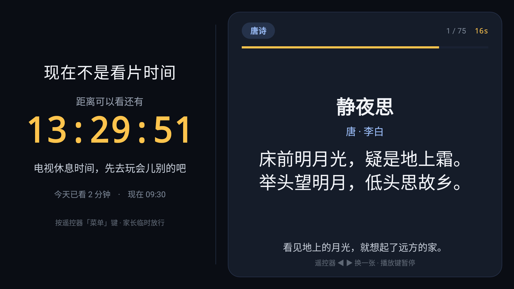
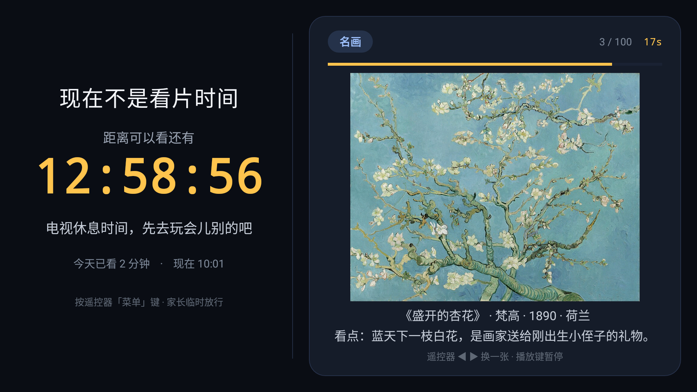
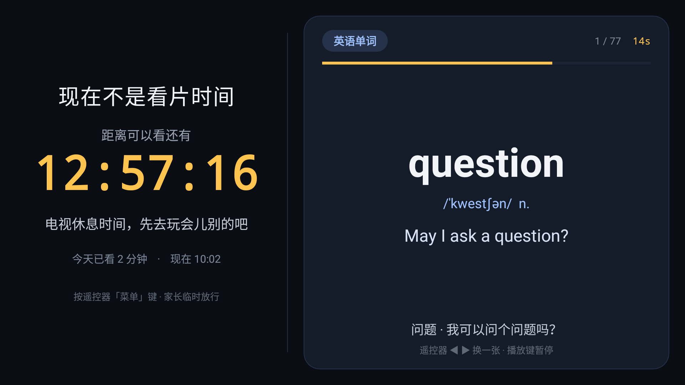
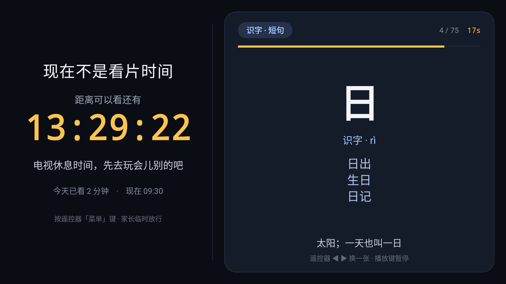
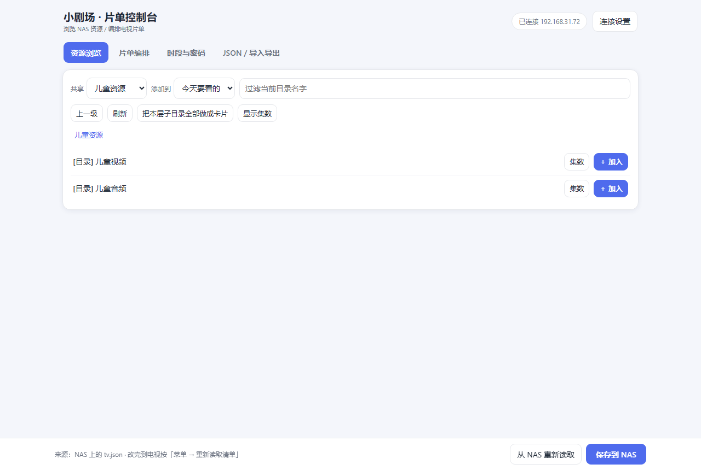
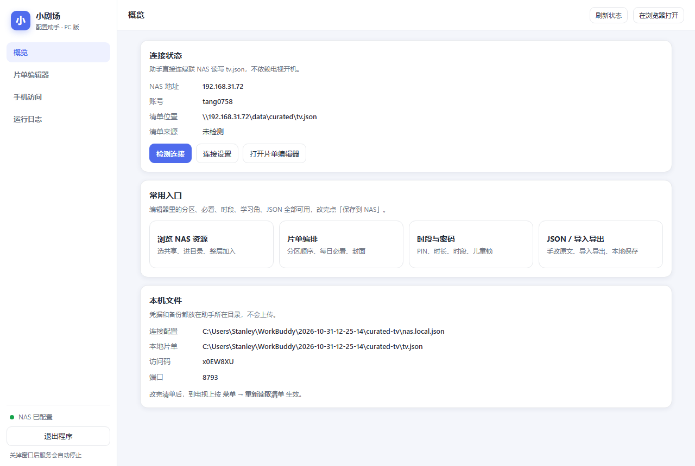
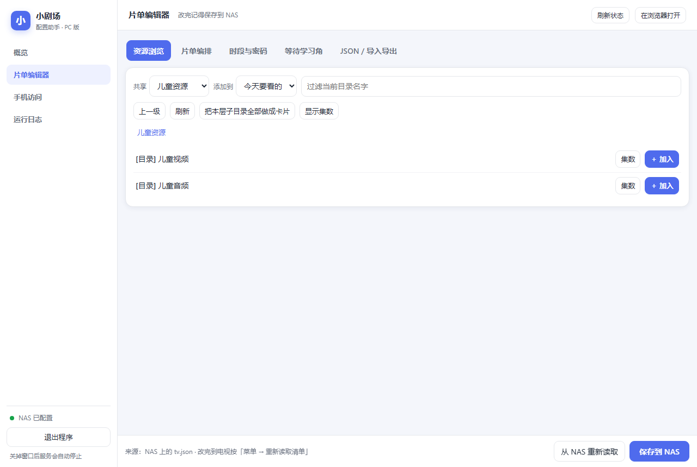
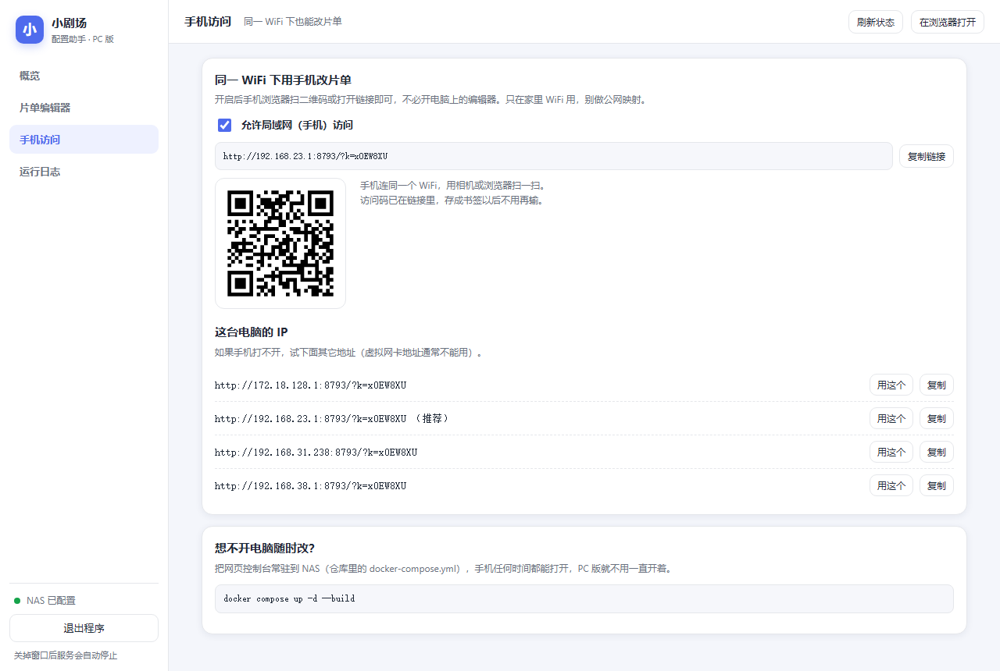
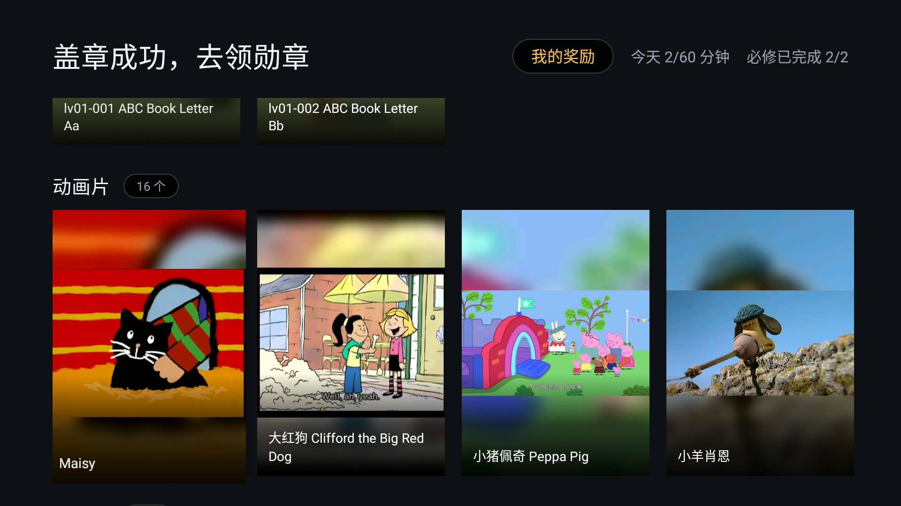

# 小剧场 · KidTvCurated

给家里电视用的**家长编排型儿童点播应用**。电视上只出现你在 NAS 清单里写好的内容，
不扫全盘、不联网刮削、不被推荐算法带跑。

- 视频走 **SMB 直读**（smbj），海报墙 + 内置 ExoPlayer 播放，不依赖 Kodi / Jellyfin 服务端
- 片单只是一份 `tv.json`，放在 NAS 上，改完在电视上按菜单键刷新即可
- 适合 Android TV / 国产电视（海信 55E3F-MAX，Android 9，2.5GB RAM 实测通过）

---

## 功能

| 功能 | 说明 |
|---|---|
| 编排片单 | 只显示 `tv.json` 里写的条目；`file` 单集、`folder` 整季（递归 3 层子目录） |
| **海报缩略图** | 从 NAS 读现成封面图；支持 `data:xxx.jpg` 跨共享读取（视频共享只读也能用）。附 `tools/make_covers.py` 一键从视频截帧生成竖版海报 |
| 每日必看门禁 | `gate: true` 分区全部看完，才解锁 `requires: "daily"` 的分区 |
| 每日自动轮换 | `auto: {"folder": "...", "count": 2}` 每天自动换一批 |
| **打卡墙** | 当天必看全部完成自动盖章；月历可翻页，连续天数实时统计 |
| **勋章墙** | 10 枚成就勋章，按累计打卡 / 连击 / 观看时长 / 视频数解锁，新勋章有小红点 |
| **每日播放时长** | 真实播放时长累计（暂停不计时），主界面与奖励中心显示；可设每日上限 |
| **可用时段 + 大倒计时** | 工作日 / 周末分别设时间窗；不可用或时长用尽时锁屏，左 42% 显示大倒计时 |
| **等待时间学习角** | 锁屏右 58% 自动轮播 **255 张离线卡片**：57 首唐诗、78 个 A–Z 英语单词（每字母 3 个）、50 幅内置名画、70 张识字 / 成语 / 短句；可分阶段出题、自定义卡片、换成 NAS 上的图片，遥控器翻页与暂停 |
| **家长临时放行** | 锁屏按菜单键（或直接按遥控器数字键）输 PIN，放行 15 分钟 |
| **防跳看** | 必看视频记录「真正看到过」的最远位置，只许回看已看部分，快进越界自动拉回并提示 |
| **手机 / PC 编排** | 网页控制台浏览 SMB 目录、可视化编辑片单与时段，一键写回 NAS |
| **PC 桌面配置助手** | 双击启动独立窗口，连 NAS、编排片单、开手机二维码、看日志、一键退出；可打包成单个 exe |
| 家长选项 | 菜单键 + PIN：重读清单 / 今天重来 / 跳过必看 / 清进度 / 奖励中心 / 临时放行 |
| 续播 | 记住每个文件看到哪儿；进度过 92%（可在清单改）自动标记完成 |
| 断网兜底 | 读不到 NAS 时用上次缓存的清单照常显示 |
| NAS 换 IP 自愈 | 445 连不上时扫本网段找 SMB 主机，找到自动切过去 |

### 锁屏长什么样（电视实拍）

不可用时段锁屏按 **左 42% / 右 58%** 分栏：左边是需要隔几米也看得清的大倒计时，
右边留给名画和诗句这类需要画面宽度的学习内容，每 20 秒自动换一张。









### 遥控器

| 按键 | 作用 |
|---|---|
| 上 / 下 | 选分区 |
| 左 / 右 | 选片；播放时快退 / 快进 15 秒 |
| OK | 播放 / 暂停、进入 |
| 返回 | 回上一级（开了儿童锁时，主界面的返回键会被吞掉） |
| 菜单 | 家长选项（要 PIN）；儿童锁下也是「退出到桌面」的入口 |
| 信息 / 指南 | 打卡墙 · 勋章墙 |
| 数字键（锁屏时） | 直接输 PIN 临时放行 |
| ◀ ▶ / ▲▼ / OK（锁屏时） | 手动翻一张学习卡片 |
| 播放 / 暂停（锁屏时） | 暂停 / 继续自动轮播 |

---

## 开机自启与儿童锁（不让孩子退回桌面）

**先说一个硬约束：Android 的 Home 键由系统独占，普通应用收不到、也拦不住。**
所以「只改 App 代码」一定会被绕过，必须按按键归谁管分层处理：

| 防线 | 挡住什么 | 要不要动系统 |
|---|---|---|
| ① 应用内拦截 | 返回键、设置 / 输入源 / 最近任务等**能收到**的功能键 | 不用，改 `tv.json` |
| ② 默认桌面 | **Home 键** | 要，adb 写死首选桌面 |
| ③ 前台守卫 | 被切到后台、最近任务切走 | 不用，App 自带 |
| ④ 开机自启 | 开机后厂商桌面 / 其它应用抢跑的几秒 | 不用，App 自带（仅儿童锁开启时；VIDAA 上受限，见下） |
| ⑤ 物理 / 系统 | 输入源、直播、电源等硬件快捷键 | 要，遮挡按键或 Device Owner |

### ① + ③ + ④：App 内已实现，改清单即可

```json
"kiosk": {
  "enabled": true,
  "exitComponent": "com.jamdeo.tv.vod/com.ju.main.launcher.LauncherActivity",
  "exitMinutes": 30,
  "reentryMs": 1000,
  "blockBack": true,
  "blockSystemKeys": true
}
```

改完在电视按 **菜单 → 重新读取清单** 生效。字段说明见 [docs/CONFIG.md](docs/CONFIG.md#儿童锁-kiosk)，网页控制台「时段密码」页也有开关。

- 主界面吞掉返回键；剧集 / 播放 / 奖励页的返回键仍可回上一级（还在 App 内，安全）。
- 应用被切到后台约 1 秒后，前台守卫自动把主界面拉回；**关屏待机、家长放行期间不会打扰**。
- `BootReceiver` 监听 `BOOT_COMPLETED` / `HISENSE_BOOT_COMPLETED` / `QUICKBOOT_POWERON`，**只在 `kiosk.enabled` 时**开机把主界面带回前台；没开儿童锁的普通安装不会开机自启。
  ⚠️ **本机（海信 55E3F-MAX / VIDAA / Android 9）实测不向第三方派发开机广播**：开机后 App 进程根本没起来，首启仍停在海信原生桌面，**按一次 Home 才进小剧场**。这是 ROM 的自启动管控，不是代码问题（Aerial 兼容表也写「海信 VIDAA 开机多数先进聚好看」）。标准 Android TV 上该接收器有效。
- 家长出口：菜单 → PIN → 「退出到桌面」，会临时放行 `exitMinutes` 分钟再启动指定桌面；回来后可在同一菜单「结束家长放行」。`exitComponent` 要指向**当前仍启用**的桌面：Aerial 停用后请改成海信原生桌面（如上），否则点了没反应。

### ② 设为默认桌面（Home 键失效的关键一步）

装了声明 `HOME` 的 APK 后，系统里有 3 个桌面候选（海信原生 / Aerial / 小剧场），原来的首选被清空，**按 Home 会弹「选择主屏幕应用」**。别在弹窗里只点一次 —— 那只会写一条 `mAlways=false` 的记录，下次照样问。直接写死首选：

```bash
adb shell cmd package set-home-activity --user 0 com.family.curated/.MainActivity
adb shell cmd package resolve-activity --brief -a android.intent.action.MAIN -c android.intent.category.HOME
# 应直接返回 com.family.curated/.MainActivity，不再是 com.android.internal.app.ResolverActivity
adb shell dumpsys package | grep -A6 'Preferred Activities User 0'   # mAlways=true 才算稳
adb shell setprop persist.vt.use_home_pkg com.family.curated           # 海信开机桌面属性，保持一致
```

> 这台 Android 9 上 `cmd package set-home-activity` **确实存在**（早期文档写「没有」是漏看了 help）。

**Aerial 会抢桌面，必须一起处理。** 它自带 `HomeGuardService`（无障碍「Aerial 桌面守护」）和 `RevivalListener`（通知监听，负责开机复活），日志里是：

```
AerialGuard: stock home com.family.curated came to the front; bringing Aerial back
```

只要它活着，任何首选桌面都会被覆盖，而且**每次开机都会把自己重新写回** `enabled_accessibility_services` / `enabled_notification_listeners`。实测有效、完全可逆的做法：

```bash
# 1) 从两个服务列表里摘掉含 orchard 的项（其余海信系统服务保留），再写回
adb shell settings get secure enabled_accessibility_services
adb shell settings get secure enabled_notification_listeners
adb shell settings put secure enabled_accessibility_services '<过滤后的值>'
adb shell settings put secure enabled_notification_listeners '<过滤后的值>'
adb shell am force-stop app.orchard.tv

# 2) 组件级 disable 会被海信 shell 权限拒绝；包级 disable-user 可以，且完全可逆
adb shell cmd package disable-user --user 0 app.orchard.tv
```

Aerial 停用后，**按 Home 直接回小剧场主界面**（`singleTask` 收掉上面的播放页），返回键被吞、切到后台约 1 秒拉回；开机首启受上面 VIDAA 限制仍先停在原生桌面，**按一次 Home 即可进入，此后再也出不去**。Aerial 原先的「开机自动调起」不再需要。万一清单读不到、停在空清单界面，PIN 出口仍在，或用下面的撤销命令恢复。

**撤销（回到原样）**

```bash
adb shell cmd package enable --user 0 app.orchard.tv
adb shell cmd package set-home-activity --user 0 app.orchard.tv/.MainActivity
adb shell setprop persist.vt.use_home_pkg app.orchard.tv
adb reboot
```

想连 Aerial 的桌面守护一起恢复，把上面备份的两个 settings 原值写回即可。

> 图省事也可以**不做第 ② 步**：只开 `kiosk.enabled`，孩子按 Home 会先看到别的桌面约 1 秒再被拉回。
> 桌面加载通常就要好几秒，实际很难点进去，但会闪一下。

### 允许出现其它应用入口（家长勾选）

儿童锁不等于「除了视频什么都不能用」。在 `tv.json` 里打开 `apps` 段后，主界面最后会多一行应用图标，
**显示哪几个由家长在电视上选**：菜单 → PIN → 「选择允许显示的应用」，OK 多选、保存立刻生效；
桌面 / 设置 / 安装器 / 应用商店会自动从候选里排除。

```json
"apps": {
  "enabled": true,
  "title": "应用",
  "showAfterDaily": true,
  "maxMinutes": 30,
  "entries": []
}
```

`showAfterDaily: true` 表示**今天的必看全部看完之后**才解锁这一行（没做完时卡片显示「还差 N 个才解锁」）；
想一直可用改成 `false`。孩子点开应用后临时放行 `maxMinutes` 分钟，按 Home / 返回、超时或到了不可用时段
都会自动回小剧场，前台守卫不会被绕过。字段、优先级和「恢复清单默认」的说明见 [docs/CONFIG.md](docs/CONFIG.md#应用入口-apps)，
网页控制台「时段与密码」页同样能改。

> 想连「从允许的 App 跳到别的应用」也堵上，可选执行
> `adb shell appops set com.family.curated GET_USAGE_STATS allow` 让守卫识别前台应用；不授权则降级为定时拉回。

### 附：为什么 Aerial 能做到「开机 / 主页键接管」

研究 [pengchujin/aerial-tv](https://github.com/pengchujin/aerial-tv) 后结论很明确：**它靠的不是标准 Android 能力，而是 adb 授予的系统级权限 + 一整套对抗国产 ROM 的守护组件**。项目安装命令里就写着：

```bash
adb shell pm grant app.orchard.tv android.permission.WRITE_SECURE_SETTINGS
adb shell cmd notification allow_listener app.orchard.tv/app.orchard.tv.guard.RevivalListener
adb shell appops set app.orchard.tv SYSTEM_ALERT_WINDOW allow
```

本机把电视上的 APK pull 下来解析 + `dumpsys package` 核对，这几个权限**全部 `granted=true`**。README 原话：

> 国产电视大多只认自家桌面，待机时还会清理第三方 App。所以 Aerial 用一个无障碍服务，原桌面一出现就切回来（只看哪个窗口在前台，不读屏幕内容）；被清理后再靠通知监听让系统把它拉起来（不读通知）。

| Aerial 组件 / 权限 | 作用 | 本机抓到的证据 |
|---|---|---|
| `guard.HomeGuardService`（无障碍） | 监听窗口切换，别的桌面一出现就抢回前台 | 日志 `AerialGuard: stock home com.family.curated came to the front; bringing Aerial back` |
| `guard.RevivalListener` + `Revival{Account,Sync}Service` | 进程被清后由系统重新拉起 | 重启后 `enabled_notification_listeners` 又出现 `app.orchard.tv/...RevivalListener` |
| `guard.BootReceiver`（`BOOT_COMPLETED` + `LOCKED_BOOT_COMPLETED`） | 开机尝试自启 | README 也承认部分 ROM「开机广播全被拦」 |
| `WRITE_SECURE_SETTINGS` | 开机把守护重新写回系统设置 | 每次重启后两个服务列表都被重新写回 orchard 条目 |
| `SYSTEM_ALERT_WINDOW` + `PACKAGE_USAGE_STATS` | 后台起 Activity、监测前台应用 | 守护能在别的桌面之上把自己拉到前台 |

**它的「开机直达」其实是「开机先落原生桌面，十几秒后由守护抢回来」**：兼容表直说海信 VIDAA「开机多数先进聚好看」，大眼橙「按主页键先落优酷桌面，约 13 秒后由守护切回」。所以单靠 `BOOT_COMPLETED` 复刻不了这个效果。

本项目没有照抄：给儿童应用授予 `WRITE_SECURE_SETTINGS` + 无障碍 + 悬浮窗权限面太大，两套守护还会互相抢前台。取舍是**停用 Aerial、把小剧场写死为首选桌面、用 App 内前台守卫兜底**，代价就是开机后需按一次 Home。真要「开机零操作直达」，只能照 Aerial 那套给小剧场授权并写一个只做前台切换的无障碍服务；本项目实测 `boot_app_componentname`、`settings_startup_source_custom_pkg_key` 在这台机器上都不生效，已撤销。

### ⑤ 硬件键：软件真的管不了

输入源 / 直播 / 电源 / 语音快捷键由系统或红外固件直接处理，应用连按键事件都收不到。可选：

- **最省事也最可逆**：把 Home、输入源、设置、直播键贴住，或换一把只有方向键 + OK + 返回的简易遥控器。
- **更彻底**：把 App 设成 Device Owner（`dpm set-device-owner`）后用锁任务模式，可禁掉最近任务、状态栏等。
  但要求设备无账号、往往得恢复出厂，撤销也麻烦，**不建议在已经装了一堆应用的电视上盲操作**。
- 海信若自带「儿童模式 / 应用锁」，可以再叠一层。

---

## 部署

### 1. 准备

- JDK 17、Android SDK 34（platform-34 + build-tools 34.0.0）
- 一台开了 SMB 文件服务的 NAS
- 电视打开网络 ADB：`adb connect <电视IP>:5555`

### 2. 填本机私有配置（这两个文件不会进 Git）

```bash
cp nas.example.json nas.local.json       # 改 NAS 地址 / 账号 / 密码 / 共享名
cp docs/LocalSecrets.example.kt.txt \
   app/src/main/kotlin/com/family/curated/data/LocalSecrets.kt   # 去掉说明，填同一组账号密码
```

`local.properties` 里写 `sdk.dir=...`（Gradle 会自动生成本地路径，已忽略）。

### 3. 编译安装

```bash
./gradlew :app:assembleDebug            # Windows: gradlew.bat
adb install -r app/build/outputs/apk/debug/app-debug.apk
```

### 4. 生成片单 / 编排内容

**推荐用 PC 桌面配置助手**（下两节，双击即用）或网页控制台：浏览 NAS 目录、勾文件夹、改时段、一键写回。
命令行方式：

```bash
python -m pip install pysmb
python make_playlist.py --upload        # 扫 NAS 生成 data/curated/tv.json 并上传
python set_schedule.py --show           # 查看当前时段设置
```

想手编就从 **[`examples/tv.json`](examples/tv.json)** 复制一份改名 `tv.json` —— 这是提交的**公开模板**，
里面全是 `YOUR_NAS_*` 占位符和虚构目录。字段手册见 [docs/CONFIG.md](docs/CONFIG.md)，
编辑器补全 / 校验见 [docs/tv.schema.json](docs/tv.schema.json)。

---

## 网页控制台：手机 / 电脑上编排片单

不用敲命令行、不用记 JSON 字段。浏览器里直接浏览 NAS 目录、勾文件夹、改时段、编排锁屏学习卡片，一键写回 NAS。



手机窄屏会自动改成整行排布，[看手机截图](docs/preview/console-mobile.png)。

```bash
python -m pip install -r tools/requirements.txt
python tools/console.py                 # 本机：自动打开 http://127.0.0.1:8765/?k=访问码
python tools/console.py --lan           # 同一 WiFi 的手机也能打开，终端会打印手机链接和二维码
python tools/console.py --lan --port 9000 --token 我的访问码
```

五个页签：

| 页签 | 能做什么 |
|---|---|
| **资源浏览** | 选共享、逐层进目录，看视频 / 图片和大小；「集数」递归统计（和电视端一致，含多层季目录）；单条或整层「加入」到指定分区；文件可直接下载到手机 |
| **片单编排** | 增删改分区与顺序、改标题 / key / gate / requires / 列数，条目上下移，配置 `auto` 每日轮换，设「每日必看」；每个条目显示封面缩略图预览、可直接改 `cover` 路径 |
| **时段与密码** | PIN、看完比例、工作日 / 周末时间窗、每日时长、锁屏提示语，带常用预设 |
| **等待学习角** | 学习角开关、每张停留秒数、类别顺序、内置题库开关、分阶段（第几阶段 × 每类张数）、名画目录与共享、自定义卡片（唐诗 / 单词 / 名画 / 识字）增删改排序 |
| **JSON / 导入导出** | 看原文、手改后应用到编辑器、下载 tv.json、导入 JSON、载入公开模板、写到本地 tv.json |

链接后可以加 `&tab=sections` / `&tab=rules` / `&tab=learning` / `&tab=json` 直接进某一页，手机上可以分别存书签。

常用流程：资源浏览 → 选好「添加到」哪个分区 → 点「＋ 加入」或「把本层子目录全部做成卡片」
→ 片单编排里调顺序 / 标必看 → 底部「保存到 NAS」→ 电视上按菜单「重新读取清单」。

保存时会：自动把 `nas` 段同步成控制台正在用的真实账号密码（前端从不回显密码）、
把旧清单备份为 NAS 同目录的 `tv.backup.json`、回读校验字节数。

**手机访问**：电脑跑 `--lan`，手机连同一个 WiFi，扫终端二维码或输入终端打印的 `http://192.168.x.x:8765/?k=...`。
访问码首次自动生成并存在 `.console_token`，手机存书签后不用每次输。
想不开电脑就随时改、**人在外网也能改**，把服务常驻到 NAS（详见 [外网也能改片单](#外网也能改片单不用开家里电脑)）：

```bash
docker compose up -d --build            # 在仓库根目录执行
docker compose logs -f kidtv-console    # 看访问码和手机链接
```

标准 compose 把凭据和访问码放在命名卷 `kidtv-config` 里（UGOS Pro 部署包放在项目文件夹的 `config/` 里），
首次打开页面点「连接设置」填一次即可，重建容器不丢。
绿联 UGOS Pro 推荐用打包好的部署包（`python tools/make_nas_bundle.py` 生成 `dist/kidtv-console-ugospro.zip`），
解压到 NAS 后在「容器 → 项目」里选那个文件夹即可；详见[外网也能改片单](#外网也能改片单不用开家里电脑)。端口是 8765。

> 安全：默认只监听 `127.0.0.1`；`--lan` / Docker 会监听局域网，所有 API 都要求访问码。
> 页面不回显 NAS 密码，但局域网是明文 HTTP，只建议在家里 WiFi 用，别做公网端口映射。

---

## PC 桌面版配置助手

网页控制台已经能在浏览器里用；这一节是**独立的桌面程序**：双击就开一个没有地址栏的窗口，
不用敲命令、不用记端口。它复用同一个后端 `tools/console.py` 和同一个编辑器 `tools/static/index.html`，
所以上面的五个页签、保存备份、连接设置全部原样可用，配置也和网页版通用。





### 启动

| 方式 | 怎么做 | 适合 |
|---|---|---|
| **双击 bat（推荐）** | 双击项目根目录 `KidTvConfig-PC.bat` | 有 `dist/KidTvConfig-PC.exe` 时直接开它；没有就用 Python 源码跑并自动装依赖 |
| **独立 exe** | 双击 `dist/KidTvConfig-PC.exe` | 拷到任何一台 Windows 电脑都能用，不用装 Python，约 10 MB |
| 命令行 | `python tools/desktop.py [--lan] [--port 9000]` | 调试 / 换端口 / 指定 `--window browser` |

首次打包 exe：双击 `tools/build_pc_exe.bat`（需要 Python + pip，约 20 秒），产物在 `dist/`。

窗口优先用 `pywebview` 原生窗口（装了 `pip install pywebview` 才用），否则自动用 Edge / Chrome 的
`--app` 无地址栏窗口，最后回退默认浏览器。**重复双击不会起第二个服务**：检测到已有助手在跑，
会直接把它的窗口打开。关掉应用窗口（Windows 上会自动检测）或点左下角「退出程序」即停止服务。

### 窗口里能做什么

| 页签 | 功能 |
|---|---|
| **概览** | NAS 地址 / 账号 / 清单路径，一键「检测连接」看清单来源；「连接设置」填账号密码并测试；四个快捷入口直达资源浏览 / 片单编排 / 时段与密码 / JSON |
| **片单编辑器** | 内嵌完整网页控制台，改完点右下角「保存到 NAS」，电视上按菜单「重新读取清单」 |
| **手机访问** | 一键开 / 关局域网访问（无需重启程序），显示手机链接、二维码和本机所有 IP，可切换正确的网段 |
| **运行日志** | 最近 120 条请求与错误，连不上 NAS / 保存失败时先看这里 |



### 数据放在哪

凭据、访问码、上次端口和是否开启手机访问，都存在**助手所在目录**：

```
nas.local.json          NAS 地址 / 账号 / 密码（不进 Git）
.console_token          访问码，第一次自动生成，手机书签长期有效
.console_desktop.json   端口 / 手机访问开关 / 上次窗口模式
tv.json                 离线编辑时「写到本地 tv.json」的产物
.pc_profile/            Edge / Chrome 应用窗口的独立浏览器配置
```

exe 放在 `dist/` 时会自动继承项目根目录已有的 `nas.local.json` 和访问码；
把 exe 单独拷到别处，则在那台机器的 exe 同目录新建一套，不会写进 exe 内部。
可用 `KIDTV_CONFIG` 环境变量指定别的配置文件路径。

### 自检与排错

```bash
python tools/desktop.py --self-test          # 不开窗口，逐个测接口，退出码 0 = 全部通过
dist\KidTvConfig-PC.exe --self-test          # 打包版同样能自检
python tools/desktop.py --no-window          # 只跑服务，用浏览器自己开页面
```

自检覆盖桌面页、编辑器页、状态 / 日志 / 二维码接口、读取 NAS 上的 tv.json 和 SMB 连接检测。
端口被占用时换一个：`--port 8799`；想看真实报错：`--window browser` 或看「运行日志」页。

### 手机 / 安卓版

**安卓原生编辑器还没做**。手机现在用浏览器打开网页控制台即可：PC 版「手机访问」页一键开局域网 +
扫二维码，或者按上一节把 `docker-compose.yml` 常驻到 NAS，不开电脑也能随时改。
在手机浏览器里选「添加到主屏幕」，图标和体验接近原生 App；功能与 PC 完全一致（窄屏自动改整行排布）。

> 安全：默认只监听 `127.0.0.1`；开启手机访问后监听局域网，所有 API 都要求访问码，
> 「退出程序」只允许从电脑本机调用，页面不回显 NAS 密码。别把端口映射到公网。

---

## 外网也能改片单（不用开家里电脑）

**结论**：把控制台搬到 NAS 上常驻（电脑关不关机都无所谓），外网再用「私有网络」或「绿联官方远程访问」连回家。
**不要在路由器上把 8765 映射到公网，也不要拿 DDNS 裸奔**——这个页面能读 NAS 明文账号密码、改家长 PIN 和整份片单。

电视完全不用动：它依旧在内网读 `\\<NAS IP>\data\curated\tv.json`，外网只是把这份文件改了而已。

### 方案怎么选

| 方案 | 外网怎么打开 | 额外要装的东西 | 安全性 | 适合 |
|---|---|---|---|---|
| **A. Tailscale（推荐）** | 手机/笔记本连上 Tailscale，浏览器开 `http://100.x.y.z:8765/` | NAS 装 Tailscale（或直接用本项目的 `docker-compose.tailscale.yml`），手机装一次 App | 不对外开任何端口，只有你登录过的设备能连 | 主要用自己手机改、最在意安全 |
| **B. 绿联 UGREENlink 容器快捷方式** | 外网浏览器登录绿联账号 → UGOS 桌面点「控制台」快捷方式 | 什么都不装，HTTPS 由绿联提供 | 网址在公网可达，靠绿联账号 + 强访问码 | 想最省事、偶尔用别人的设备改 |
| **C. Cloudflare Tunnel + Access** | 任意浏览器打开自己的域名，先过邮箱验证码 | 一个域名 + Cloudflare 账号 | 有 HTTPS 和二次认证 | 想要固定网址、已有域名 |
| **D. 应急：绿联云 App 直接改文件** | 手机绿联云 → 文件管理 → 编辑 `data/curated/tv.json` | 绿联云 App | 安全但要手写 JSON，容易写错 | 上面都没配好时的兜底 |
| ✗ 路由器端口映射 / DDNS 直接暴露 8765 | — | — | 不要这么做 | — |

绿联官方 2026 年的远程访问说明同样把 Tailscale 列为「不暴露端口」的路线；
UGREENlink 打开容器页面的做法见[绿联官网教程](https://nas.ugreen.com/blogs/how-to/set-up-navidrome-on-nas)里的
「Use a UGREENlink Container Shortcut for Browser Access」一节。

### 第 1 步：控制台常驻到 NAS（所有方案都要做）

```bash
cp .env.example .env
# 编辑 .env，把 KIDTV_TOKEN 填成 16 位以上强访问码：
#   python -c "import secrets;print(secrets.token_hex(12))"
docker compose up -d --build
docker compose logs -f kidtv-console        # 看访问码和局域网链接
```

#### UGOS Pro：用部署包，别只传一个 compose 文件

绿联图形界面的「项目」如果只上传 `docker-compose.yml`，`build: context: .` 会因为找不到
`Dockerfile` / `tools/` / `examples/` 而构建失败。所以先生成自包含部署包：

```bash
python tools/make_nas_bundle.py            # 生成 dist/kidtv-console-ugospro.zip
python tools/make_nas_bundle.py --no-secrets   # 不想把本机 SMB 凭据打进包里时用这个
```

包里自带 `Dockerfile`、`tools/console.py`、`tools/static/`、`examples/tv.json`、
固定好的强访问码、连接设置和 `使用说明.md`；解压后保持目录结构，上传到 NAS 共享文件夹
（例如 `data/kidtv-console/`），然后：

1. 控制面板 → **容器（Docker）→ 项目 → 创建**，项目路径**选这个文件夹本身**。
2. Compose 选「使用现有 `docker-compose.yml`」或把文件内容粘贴进去，点部署（首次拉镜像要几分钟）。
3. 容器 running 后开 `http://<NAS 内网 IP>:8765/`，首次输一次包里附的访问码。
4. 如果图形界面不支持 `build`，改用包里的 `docker-compose.nobuild.yml`（免构建，挂载目录直接跑）；
   会开 SSH 的话更简单：`cd kidtv-console && sh ./install.sh`。

> 部署包默认把本机的 `nas.local.json` 一起放进去，打开就能连 NAS，**含明文密码，别外传**；
> 传到 NAS 后可删掉电脑上的 zip。用 `--no-secrets` 则首次打开页面点「连接设置」自己填。
> 访问码写在 compose 的 `KIDTV_TOKEN` 里，走 UGREENlink 时把同文件的 `KIDTV_TRUST_PROXY` 改成 `1`。

其它系统（老 UGOS / 常开小主机）：用仓库根的 `docker-compose.yml`，
凭据和访问码存在命名卷 `kidtv-config` 里，重建容器不丢。

> 容器默认 `--lan` 监听 `0.0.0.0`，只在家庭局域网可达；**只要不做路由器端口映射，公网就进不来**。
> 配置文件、访问码和 `tv.json` 都在 NAS 上，PC 桌面版和这个容器可以并存（在不同机器上，互不干扰）。

### 第 2 步 A：Tailscale（推荐）

- **简单版**：NAS 系统里装 Tailscale 客户端并登录（绿联可用 Docker 部署或系统包），手机 / 笔记本装 Tailscale 登录同一账号；
  外网时浏览器打开 `http://<NAS 的 100.x.y.z>:8765/`。服务就在 NAS 上，不需要配子网路由。
- **更封闭版**（控制台只存在于私有网络，家里局域网和公网都扫不到 8765）：

  ```bash
  # .env 里填 TS_AUTHKEY（https://login.tailscale.com/admin/settings/keys 生成）和 KIDTV_TOKEN
  docker compose -f docker-compose.tailscale.yml up -d --build
  docker exec kidtv-tailscale tailscale ip -4     # 拿到 100.x.y.z
  ```

  该 compose 让控制台共享 Tailscale 容器的网络命名空间，不发布任何宿主机端口。
  需要 NAS 的 Docker 支持 `/dev/net/tun` + `NET_ADMIN`；图形化 Docker 不支持 `network_mode: service:` 时，退回「简单版」。
  UGOS 会周期性改写 `resolv.conf`，如果 Tailscale 里出现 DNS 解析异常，在 Tailscale 后台
  DNS → Global nameservers 填 `223.5.5.5` / `1.1.1.1` 并打开 Override。

### 第 2 步 B：UGREENlink（最省事）

1. 绿联 NAS：Docker → 容器 → 找到 `kidtv-console` → 三点菜单 → **桌面快捷方式 / 快速访问** → 端口填 `8765` → 保存。
2. 外网手机/电脑浏览器登录绿联账号（UGREENlink），在 UGOS 桌面点这个快捷方式；
   也可以直接用系统生成的 `https://app-8765-<你的ID>.xx.ugdocker.link`（以绿联实际给的地址为准）。
3. 设 `KIDTV_TRUST_PROXY=1` 后重新部署（标准 compose 改 `.env`，UGOS Pro 部署包改
   `docker-compose.yml` 里同一行）——经反向代理时才能按真实客户端做访问码限速。
4. 这个网址和配置入口**不要发到群里 / 不要外传**。

### 第 2 步 C：Cloudflare Tunnel（有域名时）

域名托管到 Cloudflare → Zero Trust → Tunnels 建隧道 → Public Hostname 指向 `http://<NAS 内网 IP>:8765`
（cloudflared 与控制台同一 Docker 网络时可用容器名）→ 在 Access 里加一条只允许自己邮箱收验证码的策略；
`.env` 设 `KIDTV_TRUST_PROXY=1`。这样公网只有过了 Cloudflare 登录的人才能看到控制台。

### 首次在外网打开（三种方案通用）

- **书签不要带 `?k=`**：直接打开根地址，页面会弹「输入访问码」，输一次就存在这台设备的浏览器里；
  之后所有请求走请求头，URL、浏览器历史、反向代理日志里都不会出现访问码（登录门已改成这种写法，也兼容 UGREENlink 的子路径）。
- 连续输错 5 次访问码会临时锁定 5 分钟，防止公网猜码；锁定只按客户端 IP 计，不会牵连其它设备。
- 改完保存到 NAS → 电视上按菜单「重新读取清单」生效。人在外网时电视照常在内网播放，不受影响。

### 安全清单

- `KIDTV_TOKEN` 用 16 位以上随机串；家长 PIN 也别留默认 `1234`
- `tv.json` 含 NAS 明文密码，控制台能读能改，只给家长自己用
- 不做 8765 端口映射、不配公网 DDNS；用反向代理时设 `KIDTV_TRUST_PROXY=1`
- 用方案 B/C 时，网址不外传；长期不用可以直接停容器
- 电脑上的 PC 桌面版只监听 `127.0.0.1`，与 NAS 上的容器互不影响

### 排错

| 现象 | 检查 |
|---|---|
| `Dockerfile not found` / `COPY failed` | UGOS Pro 只传了 `docker-compose.yml`；把整个部署包目录放到项目路径，或改用 `docker-compose.nobuild.yml` |
| 镜像拉取慢 / 构建超时 | 在 UGOS Pro 的 Docker 设置里配国内镜像加速，等几分钟重试 |
| 挂载 `./config` 报错 | 少数固件要求绝对路径，把 `./config:/app/config` 换成 NAS 上该文件夹的绝对路径 |
| 容器里检测连接失败 | NAS 地址换 `host.docker.internal` / 网桥网关 `172.17.0.1` 试试；确认 SMB 445 可达、账号密码正确 |
| 弹访问码，输入后没反应 | 码输错或触发 429 锁定，等 5 分钟；`docker compose logs` 里能看访问码 |
| 页面能开但读不到清单 | 容器里「连接设置」没填 / SMB 445 不通 / 共享名和 `curated/tv.json` 路径不对 |
| Tailscale 连上却打不开 8765 | 确认用的是 NAS 在 tailnet 里的 `100.x` 地址；用封闭版 compose 时看 `kidtv-tailscale` 的 IP；容器日志有无报错 |
| UGREENlink 快捷方式 404 | 端口填 8765、容器健康；图形化 Docker 不支持就换 Tailscale |
| 保存失败 | `data` 共享是否可写、磁盘空间、NAS 账号权限；保存前会自动备份 `tv.backup.json` |

---

## 片单格式

生效文件固定为 **`data/curated/tv.json`**（`儿童资源` 共享通常只读，所以清单单独放可写的 `data`）。
`file` / `folder` 路径都相对「儿童资源」共享根目录，中文直接写，不要百分号编码。

```json
{
  "nas": { "host": "192.168.31.72", "user": "...", "password": "...", "share": "儿童资源" },
  "playlistShare": "data",
  "pin": "1234",
  "passRatio": 0.92,
  "schedule": {
    "enabled": true,
    "weekday": [["17:30", "20:30"]],
    "weekend": [["09:00", "11:30"], ["16:00", "21:30"]],
    "dailyLimitMinutes": 60,
    "lockMessage": "电视休息时间，先去玩会儿别的吧"
  },
  "learning": {
    "enabled": true,
    "intervalSeconds": 20,
    "order": ["poem", "word", "art", "text"],
    "useBuiltin": true,
    "stage": 0,
    "stageSize": 0
  },
  "sections": [
    {
      "key": "daily", "title": "今天要看的", "gate": true,
      "items": [
        { "title": "识字 第3课", "file": "儿童视频/01.学习类视频/识字/03.mp4",
          "cover": "data:curated/covers/a1b2c3d4e5.jpg" }
      ]
    },
    {
      "key": "fun", "title": "动画片", "requires": "daily",
      "items": [
        { "title": "汪汪队", "folder": "儿童视频/99.娱乐动画/汪汪队立大功 PAW Patrol" }
      ]
    }
  ]
}
```

| 字段 | 含义 |
|---|---|
| `gate` | 标记该分区为「每日必看」 |
| `requires` | 被哪个 `key` 分区锁住；那个分区全看完才解锁 |
| `auto` | `{ "folder": "...", "count": 2 }`，每天自动从文件夹取 N 个并按天轮换 |
| `passRatio` | 播放进度达到多少算「看完」，默认 0.92 |
| `cover` | 封面图；`data:curated/covers/x.jpg` 表示去 `data` 共享读（视频共享只读时用）。留空自动找同名 jpg，详见 [封面章节](#海报缩略图为什么一开始是灰的) |
| `pin` | 家长密码，4 位数字 |
| `schedule.enabled` | `false` 或整段删掉 = 不限制时段 |
| `schedule.weekday/weekend` | 时间窗，支持 `["18:00","20:00"]`、`"18:00-20:00"`、`{"start":"18:00","end":"20:00"}`；跨零点写 `23:00-01:00` 也可以 |
| `schedule.dailyLimitMinutes` | 每天最多播放分钟数，`0` = 不限 |
| 不写 `weekend` | 周末沿用工作日；写 `[]` = 周末全天可用 |
| `learning.enabled` | 锁屏右半边学习角；整段省略也会启用内置题库，`false` = 只留大倒计时 |
| `learning.intervalSeconds` | 学习卡片每张停留秒数，默认 20 |
| `learning.stage` / `stageSize` | 分阶段：`1` + `50` = 第一阶段每类只出前 50 张；改 `2` 进下一批；都为 `0`（默认）= 255 张全上 |
| `learning.custom` | 自定义卡片数组，字段见 [docs/CONFIG.md](docs/CONFIG.md) |

改完按遥控器**菜单 → 重新读取清单**生效，不用重装 App。
`python set_schedule.py --weekday 18:00-20:30 --weekend 09:00-11:30,16:00-20:30 --limit 45` 可以命令行改时段。

---

## 海报缩略图：为什么一开始是灰的

**App 不联网刮削海报，也不会从视频里截帧。** 它只会按固定命名去 NAS 找「现成的图片文件」：
视频同名 `.jpg/.png`、`-poster.jpg`，或目录里的 `folder.jpg` / `poster.jpg` / `cover.jpg` / `封面.jpg`。
找不到就退回标题文字卡。Kodi / Nova 那种自动出海报，是靠联网刮削 TMDB，这个 App 为了「离线、只显示家长编排的内容」特意没做。

所以资源目录里一张图片都没有时，所有卡片都是灰的 —— 不是加载失败。而且视频共享常是只读的，连同名 jpg 也没法放进去。

解决办法：用 `cover` 把封面指向可写的 `data` 共享，并让本机批量生成。

```bash
python -m pip install -r tools/requirements.txt
# 另需本机 ffmpeg / ffprobe 在 PATH 里

python tools/make_covers.py --dry-run     # 看看每个条目会拿哪个视频截帧
python tools/make_covers.py --apply       # 截帧 → 上传 data/curated/covers/ → 写回 NAS 清单
```

- `file` 条目直接截该视频；`folder` 条目递归找第一个视频。
- 在视频 20% / 45% 处各截一帧挑信息量大的，避开黑屏片头；拼成 480×682 竖版海报（完整画面居中、上下模糊背景），不会被竖版卡片裁掉主体。
- 文件名按路径 hash 固定，重复跑不会堆垃圾；已有 `cover` 的条目跳过，`--force` 可重做；`--plain` 输出原始 16:9 画面。
- `--apply` 写清单前自动备份 `tv.backup.json`，且只把 `cover` 合并进 NAS 上的最新清单，不会覆盖家长在控制台的其它改动。
- 懒人版：双击 `tools/make-covers.bat`，等于 `--from-nas --apply`（只处理没有封面的新条目）。
- 网页控制台「片单编排」里每个条目都有**缩略图预览**、`cover` 输入框和「选图」按钮：
  点「选图」会在 NAS 上浏览，只列图片，点哪张就填哪张（自动写成 `共享名:路径`）；留空时保存会自动接上同目录的
  `folder.jpg` / `poster.jpg` / `cover.jpg` / `封面.jpg`，省得电视逐条去试。

新增一个条目后补缩略图的三条路，按省事程度排：

1. **让脚本截帧**（推荐）：双击 `tools/make-covers.bat`，十几秒后 `cover` 自动写进 NAS 清单，电视刷新即可见。
2. **用现成图片**：把图丢到视频/剧集目录里，按上面命名规则起名；或在控制台「选图」指过去。
3. **手动写 `cover`**：`"cover": "儿童视频/…/abc.jpg"` 或 `"data:curated/covers/xxx.jpg"`，留空则自动找同名图。

改完在电视按**菜单 → 重新读取清单**（或重启 App）刷新封面缓存。字段细节见 [docs/CONFIG.md](docs/CONFIG.md)。



---

## 内置名画与离线题库

锁屏右半边的内容全部离线：**57 首唐诗、78 个 A–Z 单词（每字母 3 个）、50 幅名画、70 张识字 / 成语 / 短句**，共 255 张。
文字卡片是 `data/builtin/` 里的代码常量，50 幅名画是 `assets/art/` 里的缩略图，
均为作者逝世逾百年的公共领域作品，出处见 [docs/ART_SOURCES.md](docs/ART_SOURCES.md)。

| 想做的事 | 怎么做 |
|---|---|
| 加减诗句 / 单词 / 名画 / 识字卡 | 改 `data/builtin/Poems.kt`、`Words.kt`、`Arts.kt`、`Texts.kt`，跑 `python tools/check_library.py` 自检 |
| 换一张内置名画 | 改 `tools/fetch_art.py` 的清单，`python tools/fetch_art.py --force` 后重编译 |
| 换成 NAS 上的图 / 孩子画作 | 只写 `learning.artFolder`，不用重编译 |
| 只让孩子先学第一批 | `learning.stage = 1`、`stageSize = 50`；熟悉后改成 `2` |

内置卡按四类**交错**出题，不会连着来十几个单词；遥控器 `◀ ▶` 手动翻页、播放键暂停。

---

## 播放偶发失败：多数不是格式问题

冷启动后第一次打开视频偶尔报「格式不支持 / 容器解析失败」，再点一次就好了 —— 这几乎都是
**SMB 首次读取被中断**，不是编码问题：NAS 断掉了空闲连接、会话过期，或 ExoPlayer 探测文件头时
没拿到完整字节，媒体框架就会把一次 I/O 故障归类成解析错误。

App 内置三层自愈，正常情况下不需要再手动点一次：

| 层 | 行为 |
|---|---|
| `Smb.openRetrying` | 打开文件失败重试 3 次；连续失败才强制重建整条 SMB 连接（250ms / 500ms 退避） |
| `SmbDataSource.read` | 播放中读取抖动按**同一偏移**重读 3 次，必要时换文件句柄，不跳帧、不打断播放 |
| `PlayerActivity` | 仍报错则自动重建播放器最多 3 次（0.7s / 1.4s / 2.1s 退避），保留续播位置和「已看过」边界 |

只有「文件不存在」「没权限」这类重试也没用的错误会直接失败。彻底失败后按遥控器 **OK**
还能手动重来一次，界面按错误码给出更准的提示：2xxx = NAS 读取、3xxx = 文件头没读完整、
4xxx = 解码器可能真的不支持（例如 HEVC 10bit、DTS 音轨）。

排查日志：

```bash
adb shell logcat -d -s PlayerActivity:W SmbDataSource:W Smb:W
```

---

## 后续玩法规划（还没做，按性价比排序）

「家长远程改单」已由网页控制台和 PC 桌面配置助手实现，下面这些还没做：

1. **每周任务卡**：一周给 3~5 个小目标（看一集纪录片 / 学一首字母歌），完成翻卡，比每日打卡更有惊喜感
2. **片尾小问答**：必看视频播完弹一道 2 选 1 的题，答对才算真正完成，防止挂着不看
3. **奖励兑换**：攒够星星可以找家长换「多看 10 分钟」「周末挑一部电影」，把时长变成可协商的奖励
4. **成长报告**：每周日生成一张图（本周看了什么、坚持几天、新解锁勋章），可推到 NAS 或打印
5. **多娃档案**：进应用先选头像，各自有独立片单、打卡墙和勋章
6. **成就动画 / 音效**：解锁勋章时全屏礼花 + 一句定制化夸奖
7. **生日 / 节日彩蛋**：特定日期自动换主题色、放出一部「特别放映」
8. **观影笔记**：看完让孩子用遥控器给这集打分，慢慢形成口味档案
9. **软关机提醒**：还剩 5 分钟时画面边缘渐变暖色，提前预告，减少硬切断带来的哭闹
10. **配置文件版本管理**：控制台里一键对比 / 回滚历史版本，改错了不用去 NAS 翻备份
11. **安卓原生配置 App**：手机浏览器 + 「添加到主屏幕」已经够用；真要离线编辑、系统文件选择器或推送提醒，再做一个原生 APK（PC 版已先行完成）

---

## 目录

```
app/src/main/kotlin/com/family/curated/
  MainActivity.kt        海报墙 + 家长菜单 + 门禁
  PlayerActivity.kt      ExoPlayer + 防跳看 + 时长累计
  EpisodesActivity.kt    剧集列表
  RewardsActivity.kt     打卡墙 + 勋章墙
  LockActivity.kt        锁屏：左 42% 大倒计时 / 右 58% 学习角轮播
  KidApp.kt              全局时间守卫
  data/  Model / Store / Repo / Smb / SmbDataSource / Covers
         Schedule / GateKeeper / Extras / Badges
         Learning / LearningLibrary / ArtImages
  data/builtin/  Poems / Words / Arts / Texts（255 张内置卡片）
  ui/    SectionsAdapter / PosterAdapter
app/src/main/assets/art/  50 幅公共领域名画缩略图，离线内置
make_playlist.py         扫 NAS 生成片单（命令行）
set_schedule.py          命令行改时段 / 时长 / PIN
KidTvConfig-PC.bat       双击启动 PC 桌面版（优先用 dist 里的 exe）
tools/desktop.py         PC 桌面启动器：后台服务 + 独立窗口 + 单实例 + 自检
tools/static/desktop.html  桌面外壳：概览 / 手机二维码 / 日志 / 退出
tools/pc.spec + build_pc_exe.bat   打包成 dist/KidTvConfig-PC.exe
tools/console.py         网页控制台后端：浏览 SMB + 编排片单（手机 / PC / 桌面版共用）
tools/static/index.html  控制台前端（无外部依赖，离线可用）
tools/fetch_art.py       重新下载 / 更换内置名画图片
tools/make_covers.py     从 NAS 视频截帧，批量生成海报缩略图并写回 cover 字段
tools/check_library.py   内置题库自检（数量 / A–Z / 图片引用 / 重复）
tools/requirements.txt   控制台依赖（pysmb / qrcode）
tools/make_nas_bundle.py 生成 UGOS Pro 部署包（dist/kidtv-console-ugospro.zip，自包含可导入）
tools/Dockerfile + docker-compose.yml   常驻 NAS，手机随时可改
docker-compose.tailscale.yml  外网方案 A：控制台只在 Tailscale 私有网络可见
.env.example                 固定访问码 / 端口 / 反向代理开关模板（复制成 .env 用）
examples/tv.json         公开的配置模板，复制改名即可用
docs/CONFIG.md           字段手册 / 常见配方 / 排错
docs/ART_SOURCES.md      内置名画来源与许可
docs/tv.schema.json      JSON Schema（编辑器补全与校验）
docs/LocalSecrets.example.kt.txt   私有凭据模板
```

## 安全说明 · 为什么这几个文件不进 Git

| 文件 | 里面有什么 | 不上传的原因 |
|---|---|---|
| `nas.local.json` | NAS 地址、账号、**明文密码**，供 Python 脚本连接 | 纯凭据文件，每台机器不同 |
| `app/.../data/LocalSecrets.kt` | 同一组账号密码，会被**编译进 APK** | 同上；仓库里只有占位符版 `docs/LocalSecrets.example.kt.txt` |
| `tv.json`（根目录 / NAS 上那份） | `nas` 段的**明文账号密码**、家长 PIN，以及你家真实的片库目录和片名 | 既是凭据也是隐私，还是「扫描 NAS 自动生成」的运行时产物，每台 NAS 都不一样 |
| `local.properties` | 本机 Android SDK 绝对路径 | 只对当前电脑有效 |

仓库里公开的模板是 [`examples/tv.json`](examples/tv.json)：所有地址、账号、路径都换成了示例值，
别人复制一份填上自己的即可。`.gitignore` 只忽略**根目录**的 `tv.json`，不会误伤 `examples/tv.json`。

- NAS 账号密码只存在于电视本机（APK + NAS 上的 tv.json）和上述本地文件；Git 历史里只有 `YOUR_NAS_USER`
- 家长 PIN 明文写在 NAS 的 `tv.json` 里，仅用于防止孩子随手解锁，不是安全加密；装好请改掉默认 `1234`
- 网页控制台默认只监听 `127.0.0.1`，开 `--lan` 后所有 API 都要求访问码；要放到外网先看「外网也能改片单」，别直接做端口映射
- 访问码失败 5 次会锁定 5 分钟；登录门把访问码只存在浏览器本地，不写进 URL / 历史 / 代理日志
- 提交前可以扫一眼：`git diff --cached | grep -i password`
