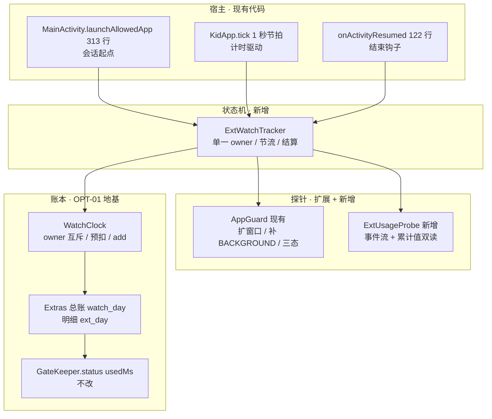

# ADR-01 · 外部应用计时（UsageStats 精确计时 + 零权限预扣兜底）

| 项目 | 内容 |
|---|---|
| 状态 | **已接受**（架构定稿，等待实机验证门） |
| 日期 | 2026-11-10 |
| 对应 | ROADMAP V1.2 的 OPT-04（落地时补 PRD 的 FR 与验收用例；PRD 只描述现状，不写未上线功能） |
| 关联 | [方案对比](外部应用计时方案对比.md)（为什么选 A+C）、[ROADMAP](ROADMAP.md) V1.2（排期）、[PRD](PRD.md) |
| 前置条件 | 电视开机后跑通方案对比文档第 5 节 V1–V5；未通过则走第 12 节降级分支 |
| 影响 | `Extras.watch_<day>` 的口径扩展；`GateKeeper` 与锁屏逻辑**不改** |

---

## 1. 问题

`Extras.addWatchMs()` 全项目只有两个调用点，都在 `PlayerActivity`（275、353 行）。孩子从「应用入口」打开优酷（`MainActivity.launchAllowedApp()` 第 313 行给的 `maxMinutes` 放行窗口），这段时间**一秒都不进 `dailyLimitMinutes`**。孩子一旦发现「从应用入口看更划算」，白名单 + 限额的核心承诺就不成立。

这不是新增一个计时器的问题，而是**把外部应用那段时间接到已有的那本账上**。

---

## 2. 决策

采用 [方案对比](外部应用计时方案对比.md) 的 **A（UsageStats 精确计时）+ C（零权限预扣）分层**：有 `GET_USAGE_STATS` 授权走 A，没有授权自动降级 C；绝不出现「少扣」。

两条硬约束，先定死再设计：

1. **不新增线程、不新增定时器、不新增前台服务**，直接复用 `KidApp.tick` 每秒一次的节拍。MTK9652 / 2.5 GB 上多一个常驻组件就多一分被回收后静默漏记的风险。
2. **账写到 `Extras.watch_<day>`**，与播放页同一本账。`GateKeeper.status()` 的 `usedMs` 读的就是它，**门禁一行都不用改**；另记 `ext_<day>` 明细供周报区分「小剧场内 / 外部应用」。

被否决的路径及理由见方案对比文档第 3 节：无障碍（过度授权、易被回收）、VPN（会接管 SMB 流量，历史事故链路）、ActivityManager（Android 9 拿不到别的包）、关掉入口（保留为家长选项，不作为默认）。

---

## 3. 分层架构



| 层 | 职责 | 备注 |
|---|---|---|
| 宿主 | 提供会话起点、节拍、结束钩子 | `launchAllowedApp()` 在 `startActivity` **之前**调 `onLaunch()` |
| 探针 | 回答「现在前台是不是那个包」 | 现有 `AppGuard.foregroundPackage()` 只读最近 20 秒、只取 `MOVE_TO_FOREGROUND`，用于拉回判定够用，**用于计时会漏** |
| 状态机 | 唯一 owner，管会话生命周期与节流 | `SystemClock.elapsedRealtime()` 单调计时，每 5 秒 flush |
| 账本 | 统一入账、明细分账 | `WatchClock`（OPT-01）与播放页互斥；`ClockGuard.day()` 提供日期键 |

---

## 4. 三个必须避开的坑（本 ADR 的核心）

### 4.1 计时逻辑不能挂在 `enforceKiosk()` 里

`KidApp.enforceKiosk()` 第 67 行：

```kotlin
if (!k.enabled || ... || current != null) return
```

儿童锁默认 `enabled=false`，且孩子在外面看优酷时 `current == null` 才需要拉回——把计时挂进去等于**完全不工作**。状态机必须在 `KidApp.tick` 里独立调用，与儿童锁是否启用无关。

### 4.2 插入点只能是 `KidApp.tick` 第 34 行

```kotlin
33:  val st = GateKeeper.status()
34:  // ← ExtWatchTracker.tick() 必须插在这里
35:  if (!st.open && Extras.appLaunchActive()) Extras.clearAppLaunch()
...
39:  ... 拉起 LockActivity
50:  enforceKiosk()
```

第 35 行在时段到点时会先 `clearAppLaunch()`。若状态机放在 35 行之后，`appLaunchActive()` 已变 false，这次会话的 20 分钟会**凭空蒸发**。正确顺序是：**先结算，再清放行，再拉锁屏**。

### 4.3 `null ≠ 离开`

优酷在前台待 5 分钟没有任何新事件时，`queryEvents(最近 20 秒)` 返回 null。现有 `enforceKiosk` 第 83 行把 null 当「还在允许的应用里」放行——这个语义恰好适合计时（继续计），但**不能把信息缺失误判成孩子已退出**。所以探针输出三态而不是可空包名：

| 状态 | 含义 | 状态机动作 |
|---|---|---|
| `STILL_IN` | 事件流确认目标包仍在前台 | 继续累计 |
| `LEFT` | 出现 `MOVE_TO_BACKGROUND` 或其它包 `MOVE_TO_FOREGROUND` | 结算 |
| `UNKNOWN` | 窗口内无事件 / 权限缺失 / 查询异常 | **保持会话**，靠 `appLaunchActive()` 超时或回前台钩子结算 |

---

## 5. 探针改造

`AppGuard.foregroundPackage()`（`data/Apps.kt`）在不破坏现有拉回语义的前提下扩展：

| 改动 | 原因 |
|---|---|
| 事件窗口从「最近 20 秒」扩到「本次会话开始至今」，上限 30 分钟 | 长时间无事件时仍能判定 |
| 补读 `MOVE_TO_BACKGROUND`，并识别其它包的 `MOVE_TO_FOREGROUND` | 才能输出 `LEFT` |
| 返回 `Probe.STILL_IN / LEFT / UNKNOWN` 三态 | 避免 null 语义混淆 |
| 查询包在 `try/catch` 内，异常一律 `UNKNOWN` | 无授权 / ROM 裁剪时不崩 |

`ExtUsageProbe`（新增）封装双读：

- `lastForegroundEventRt(pkg)`：最后一次 `MOVE_TO_FOREGROUND` 的 `elapsedRealtime`；
- `foregroundTodayMs(pkg)`：`queryUsageStats(INTERVAL_DAILY)` 取 `totalTimeInForeground` 累计值，进入会话时记 `baseline`，结算时取增量。

---

## 6. 状态机 `ExtWatchTracker`

### 6.1 状态与事件

| 状态 | 进入 | 退出条件 | 动作 |
|---|---|---|---|
| `IDLE` | 初始 / 结算完成 | `onLaunch(pkg)` | 记 `startRt`、baseline、`flushed=0` |
| `TRACKING` | `onLaunch` | 三态 `LEFT` / `!appLaunchActive()` / 自己界面回前台 | 每 5 秒把增量写入 `WatchClock`；退出前 `settle()` |
| `SETTLED` | `settle()` 完成 | 立刻回 `IDLE` | 幂等，重复调用不二次入账 |

结束信号共三个：探针 `LEFT`、`appLaunchActive()` 变 false、`onActivityResumed`（第 122 行）触发。三者都调同一个幂等 `settle()`。

### 6.2 核心逻辑（伪代码，与上一轮评审一致）

```kotlin
object ExtWatchTracker {
    private var pkg: String? = null
    private var startRt = 0L
    private var flushed = 0L      // 已落盘的毫秒
    private var baseline = 0L    // 系统累计值基线
    private var preCharged = 0L  // C 兜底已预扣

    fun onLaunch(p: String) {     // MainActivity 第 313 行前调
        pkg = p
        startRt = SystemClock.elapsedRealtime()
        flushed = 0L
        baseline = ExtUsageProbe.foregroundTodayMs(p)
        if (!Extras.hasUsageAccess()) {
            preCharged = Extras.apps().maxMinutes * 60_000L
            WatchClock.preCharge(preCharged)   // 零权限，永不失效
        }
    }

    fun tick(probe: Probe) {      // KidApp.tick 第 34 行调
        val p = pkg ?: return
        if (probe == Probe.LEFT || !Extras.appLaunchActive()) return settle(p)
        // UNKNOWN 不结算：信息缺失 != 离开
        val elapsed = SystemClock.elapsedRealtime() - startRt
        if (elapsed - flushed >= 5_000) {       // 节流，对齐播放页「满 3 秒才写盘」
            WatchClock.add(elapsed - flushed)
            flushed = elapsed
        }
    }

    fun settle(p: String) {       // 幂等：onActivityResumed 也会调
        val current = pkg ?: return
        pkg = null                              // 先置空，防重入
        val est = SystemClock.elapsedRealtime() - startRt
        val sys = ExtUsageProbe.foregroundTodayMs(p) - baseline
        val finalMs = calibrate(est, sys)
        if (preCharged > 0) {
            WatchClock.refund(preCharged - finalMs)   // 多扣的退还
            preCharged = 0
        } else {
            WatchClock.add(finalMs - flushed)
        }
        Extras.addExtMs(ClockGuard.day(), finalMs)
    }
}
```

### 6.3 双读校准

```text
est = elapsedRealtime 差值           → 秒级驱动「还剩 X 分钟」，不受改时钟影响
sys = totalTimeInForeground 增量    → 退出后纠偏；部分 ROM 退到后台才 flush，
                                      实时查不涨甚至跳变，不能做秒级显示

calibrate(est, sys):
  est < 1_000        → 0                    （极短会话，避免除零）
  sys <= 0            → est                 （无系统值，用估算）
  |sys - est|/est > 0.20 → sys + 记日志    （偏差超 20% 以系统为准）
  否则                → est
```

两个读数都必须保留：只留 `elapsedRealtime` 会在 tick 被冻结时漏记，只留系统累计值会让倒计时卡住不动。

---

## 7. 数据模型

| 键 / 字段 | 类型 | 归属 | 说明 |
|---|---|---|---|
| `watch_<day>` | Long(ms) | `Extras` 现有 | **总时长**，门禁读它；播放页与外部应用都往这里写 |
| `ext_<day>` | Long(ms) | `Extras` 新增 | 外部应用明细，周报分段用；不影响门禁 |
| `appLaunchPkg` / `appLaunchUntil` | String / Long | `Extras` 现有 | `grantAppLaunch` 改用 `elapsedRealtime` 基准（原用墙上时间，属 OPT-02 一并修） |
| `hasUsageAccess()` | Boolean | `Extras` 新增 | 包装 `AppOpsManager.checkOpNoThrow`，决定 A / C 分支 |
| `extWatchMs` | Boolean | `tv.json` `features` | 灰度开关，默认 `false`（OPT-00） |
| `extMode` | 展示用字符串 | 设置页 | 「精确计时（已授权）」/「估算扣时（未授权）」，避免家长误以为数字是准的 |
| `ClockGuard.day()` | 日期键 | OPT-02 | 所有日键统一走它，防改时钟换日 |

明细与总账**分开写**，`watch_<day>` 只增不减（除 C 的退还走 `refund`，且需记一条日志），避免周报数字与门禁口径打架。

---

## 8. 文件落点

| 文件 | 改动 | 风险 |
|---|---|---|
| `KidApp.kt` | 第 34 行插 `ExtWatchTracker.tick()`；第 122 行 `onActivityResumed` 在 `clearAppLaunch()` **之前**插 `settle()` | 插入点错会丢时长（见 4.2） |
| `MainActivity.kt` | 第 313 行 `launchAllowedApp()` 在 `startActivity` 前插 `onLaunch()`；`catch` 分支补 `settle()` | 启动失败仍预扣 → 必须退还 |
| `data/Apps.kt` | `AppGuard` 扩事件窗口、补 `MOVE_TO_BACKGROUND`、输出三态 | 别改变现有 `enforceKiosk` 拉回语义 |
| 新增 `data/ExtUsageProbe.kt` | 事件流 + 累计值双读封装，异常返回 `UNKNOWN` | 单次查询开销，1 秒一次，需轻量 |
| 新增 `data/ExtWatchTracker.kt` | 状态机、节流、结算、退还 | 单一 owner，`settle()` 幂等 |
| 新增 `data/WatchClock.kt` | OPT-01 统一账本：`start/stop/tick/preCharge/refund/add`，owner 令牌互斥 | 与播放页同时计时 → 断言 + 单测 |
| `data/Extras.kt` | `addExtMs` / `extMsToday` / `hasUsageAccess`；`grantAppLaunch` 改单调时钟 | 日键迁移要兼容旧值 |
| `data/GateKeeper.kt` | **不改** | `usedMs` 读同一个 `watch_<day>` |

不新增线程、不新增服务、不碰 SMB、不动门禁、不改锁屏 UI。

---

## 9. 边界条件

| 场景 | 处理 |
|---|---|
| 无 usage 授权 / ROM 裁剪 | 降级 C：进入即预扣 `maxMinutes`，结算按实测退还，设置页标「估算」 |
| 儿童锁未启用 | 状态机独立于 `enforceKiosk`，照常工作 |
| 改系统时间 | 全程 `elapsedRealtime`；日期键 `ClockGuard.day()` |
| 事件流长期无数据 | `UNKNOWN` 保持会话，靠 `appLaunchActive()` 超时或回前台钩子结算 |
| 时段到点 / 限额用尽 | **先结算 → 再 `clearAppLaunch()` → 再拉锁屏** |
| 极短会话（< 1 秒） | 按 0 落账，跳过校准，避免除零 |
| 跨天 / 闪退 / 被杀 | `onActivityResumed` 兜底结算；冷启动发现未结算会话按预扣值入账（宁可多扣） |
| 外部应用启动失败 | `catch` 分支 `settle()`，退还预扣 |
| 播放页与外部应用并发 | `WatchClock` owner 令牌互斥，同一时刻只允许一个来源计时 |
| 家长手动加时 | 走 `grantTemp`，与计时账本分开，不互相覆盖 |
| 授权被系统回收 | `hasUsageAccess()` 每次 `onLaunch` 重查，动态降级 C |

---

## 10. 验收与测试

### 功能验收

| # | 用例 | 期望 |
|---|---|---|
| A-01 | 应用入口开优酷 10 分钟后按 Home 回来 | `watch_<day>` 增加 600±60 秒，`ext_<day>` 同值 |
| A-02 | 看满限额后仍想从应用入口进 | `GateKeeper.status().open=false`，直接锁屏 |
| A-03 | `features.extWatchMs=false` | 全程不计时、不预扣，行为与现状一致 |
| A-04 | 撤销 `appops` 授权后再进 | 自动降级 C，设置页显示「估算扣时」 |
| A-05 | 看 2 分钟即退出（C 模式预扣 30 分钟） | 结算后退还 28 分钟，家长可见结算卡片 |
| A-06 | 时段到点时正在外部应用 | 时长不丢（先结算），且 15 秒内拉回锁屏 |
| A-07 | 优酷前台静置 5 分钟无事件 | 不误判退出，时长继续累计 |
| A-08 | 改系统日期到明天 | 当日用量不归零（EX-11，依赖 OPT-02） |

### 建议补的单测（JVM，纳入 OPT-15）

`calibrate()` 的 4 个分支、`settle()` 幂等性、`UNKNOWN` 不触发结算、`owner` 互斥断言、`preCharge/refund` 差额、`ClockGuard.day()` 跨零点。纯函数，不依赖 Android 框架的部分抽成顶层函数便于测试。

### 异常用例（补进 PRD 的 EX 表）

- EX-12 从应用入口看外部 App 30 分钟 → 应计入并到点锁
- EX-16 `queryEvents` 长时间返回空 → 不结算、不漏记、不崩
- EX-17 `appops` 授权被回收 → 自动降级 C，不出现少扣
- EX-18 外部应用启动失败（已卸载）→ 预扣全额退还
- EX-19 时段到点瞬间退出 → 时长完整落账，不因 `clearAppLaunch()` 丢失
- EX-20 外部应用会话中跨零点 → 按 `ClockGuard.day()` 正确分账

---

## 11. 灰度与回滚

- `features.extWatchMs` 默认 `false`，家长显式打开才生效；开关由 `PlaylistSync.applyToLocal()` 15 秒同步。
- 出问题改回 `false` 等 15 秒即可，**不需要重装 APK**（OPT-00）。
- 任何新增 SMB 读取（本 ADR 没有）必须走 `readAllIsolated()`，禁止复用主连接。
- 结算与退还都写一条本地日志，上线首日家长对账一次；OPT-17 落地后日志同步到 NAS `logs/`。

---

## 12. 前置验证门与降级分支

> 2026-11-10 16:20 电视离线（`ping 192.168.31.147` 无响应、`adb connect` 超时 10060），以下未实测。本 ADR 的架构按 API 语义与现有代码推断，**验证结论仍是开工门控**。

`PACKAGE_USAGE_STATS` 已在 `AndroidManifest.xml` 第 6 行声明，缺的只是一次 `appops` 授权。电视开机后跑[方案对比文档](外部应用计时方案对比.md)第 5 节 V1–V5：

| 验证结论 | 执行范围 | 估时 |
|---|---|---|
| V1–V5 全通过 | 完整 A + C：本 ADR 全部内容 | 1.5 人日 |
| V2 通过但 V3/V4 拿不到事件 | 只做 C（预扣 + 退还 + 估算模式标注），`ExtUsageProbe` 不实现 | 0.5 人日 |
| V1 授权就失败 | 只做 C，并在编辑器把「关闭应用入口」列为推荐配置 | 0.5 人日 |

**无论哪条分支，C 的预扣与退还都必须实现**——它是「永不失效」的底线，也是 A 不可用时的唯一闭合手段。B（无障碍）不作为首发路径，只有 A 完全不可用且家长无法接受预扣误差时才重新评估。

---

## 13. 未决事项

1. 海信 ROM 的 `totalTimeInForeground` 刷新时机未实测，20% 校准阈值需在 V5 后按实测调整。
2. 后台 `Toast` 在 Android 9 / VIDAA 上是否被允许未验证；若被拦截，「剩 2 分钟」提示退化为「回到小剧场时的结算卡片」。
3. 预扣退还的交互（自动退还 vs 家长手动点「退还 10 分钟」）待 Wave 3 结算卡片一并定稿。
4. 周报（OPT-08）的「外部应用」分段依赖本 ADR 的 `ext_<day>`；若 OPT-04 降级，该分段显示为「估算」。
