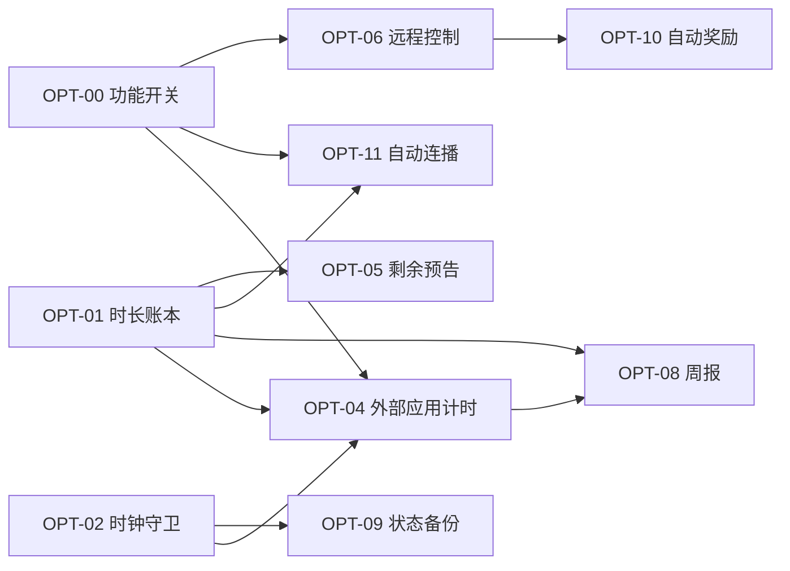

# 优化计划 ROADMAP

| 项目 | 内容 |
|---|---|
| 产品 | 小剧场 · KidTvCurated |
| 文档 | 优化计划 V2.2 |
| 日期 | 2026-11-10（最后更新 2026-11-11 夜 · OPT-15） |
| 基线 | `main` @ `3e7193b` |
| 输入 | [PRD](PRD.md) 的风险与待办、[用户使用说明书](用户使用说明书.md) 的常见问题、一次代码评审结论、[外部应用计时方案对比](外部应用计时方案对比.md) 与 [ADR-01](ADR-外部应用计时.md) |
| 目标 | 从「能用」到「可信 + 有反馈」：规则绕不过、数据丢不了、家长看得见 |

**V1.1 变更**：孩子体验由 Wave 3 提前到 Wave 2；周报确定只做电视端。

**V1.2 变更**：采纳 A+C 分层架构，外部应用计时（OPT-04）**由「待定」转为正式排期**，落在 Wave 2 之后、Wave 3 之前；架构定稿见 [ADR-01](ADR-外部应用计时.md)；规则闭环目标由「3 条绕过路径降到 1 条」改为**本期清零**。Wave 顺序不变，孩子体验不因此后移。

**V1.4 变更（2026-11-10 晚）**：用户重开电视后实机确认「从应用入口跳到第三方应用就一直能看」，
`dumpsys usagestats` 显示优酷当天 2 小时 1 分 / 启动 8 次，而 `watch_<day>` 只涨了 6 分钟 ——
每日上限**从未触发**。这不是「以后再优化」的体验问题，而是核心承诺已经失效，
因此 **OPT-04 从 Wave 2 之后提前到 Wave 0 之后立刻实施**，发 `versionCode 3 / v1.2`。
V1–V5 验证门同批跑完（见第 14 节），Wave 1 顺延。

**V1.5 变更（2026-11-10 深夜）**：Wave 1 的 OPT-05 / OPT-06 / OPT-07 全部落地并实机验收通过，
发 `versionCode 4 / versionName 1.3`（见第 14 节）。同时修正第 10 节异常用例的编号：
PRD 15.4 已把 EX-11～EX-20 用在 Wave 0 与 OPT-04 上，原提案里 Wave 1 的 EX-14 / EX-15
与 PRD 冲突，统一改为 **EX-21 / EX-22**，以 PRD 为准。

**V1.6 变更（2026-11-11 凌晨）**：Wave 2 孩子体验四项（OPT-11 / OPT-12 / OPT-13 / OPT-14）全部落地并实机验收，
发 `versionCode 5 / versionName 1.4`（见第 14 节）。与计划的偏差：**连播队列由剧集页整串传给播放页**，
播完不再回 SMB 列目录（避免刚播完时连接半死、也避免播放期间抢主连接）；
另新增 `features.continueWatching` 作为「继续看」的远程回滚闸门。下一步改为 Wave 3。

**V1.8 变更（2026-11-11 傍晚）**：Wave 3 第二批落地 —— **OPT-08 电视端周报**与 **OPT-10 完成必看自动奖励加时**，
发 `versionCode 7 / versionName 1.6`（见第 14 节）。两处与计划的偏差：① 奖励加时**没有**用 `Extras.grantTemp`，
改成记在当天额度 `bonus_<day>` 上（理由见第 6 节，`grantTemp` 是从此刻开始倒计时的放行窗口，孩子吃完饭回来就过期了）；
② 周报「反复看」需要日期维度，新增 `wplay_<day>` 集合（同一天同一部只记一次，只留 14 天），不新增任何 NAS 读写。

**V1.9 变更（2026-11-11 晚）**：**OPT-17 异常落盘**落地，发 `versionCode 8 / versionName 1.7`（见第 14 节）。
原先 `KidApp.tick` 的 `catch` 是空的（「守卫不能把应用搞崩」），代价是电视上出任何问题都没有线索。
现在改成 `Diag`：**先写本地 `filesDir/diag`，再在后台合并上传** NAS 的 `data:curated/logs/tv-yyyyMMdd.txt`
（单文件 200 KB 滚动、保留 7 天、同一处异常 60 秒只记一条），并接管未捕获异常。
另有 `Smb.withIsolatedShare()`：一条独立短连接里做完「建目录 / 列目录 / 删 / 读 / 写」，不碰主连接。

**V2.0 变更（2026-11-11 夜）**：**OPT-16 文案收口**落地（`versionCode 9 / 1.8`）：
设置页、锁屏页、家长工具三处共 **236 条**中文硬编码搬进 `res/values/strings.xml`（现 223 条资源），
**文案一字未改**（有脚本做过逐字符比对）。同时加 `tools/check_strings.py` 守卫：
Kotlin 里再写中文界面文字会直接报错，剩下的 271 处按文件记了基线，只许降不许升。
两处与计划的偏差见第 14 节。

**V2.1 变更（2026-11-11 晚）**：**OPT-18 设置页拆分**落地，发 `versionCode 10 / versionName 1.9`（见第 14 节）。
`SettingsActivity` 从 1094 行降到 **256 行**，只留外壳（布局 / 列表 / 写回 / 焦点保持）；
每一行设置是什么、点了弹什么框，按分组搬进 `settings/`：概览、时间与时长、规则、维护、系统五个 `SettingsGroup`。
**行为与文案一字未改**：`R.string.set_*` 的 201 处使用点逐条对齐（脚本比对出现次数与顺序），单测仍 112 条全绿。
另外把「关于」框里 `开 / 关` 两个字收进资源（223 → 225 条），设置页至此**零 UI 硬编码**（只剩一条时段时间正则）。
另：**周一到周五白天不做实机安装测试**，实机项统一登记在[待实机验证清单](待实机验证.md)。

**V2.2 变更（2026-11-11 夜）**：**OPT-15 CI + 时段解析单测**落地。
新增 `.github/workflows/android.yml`：每次 push / PR 跑两个 job —— **文案守卫**（`tools/check_strings.py`，半分钟）
与 **单测 + 打包**（`testDebugUnitTest assembleDebug`，有缓存约 1 分半）；单测从 112 条涨到 **130 条**。
同时把电视端「可看时段」的解析从 `TimeGroup` 搬进 `data/WindowMath.kt` 并补 18 条单测（跨零点、全角符号、
`18-20` 这种缺分钟的写法必须返回 `null` 而不是悄悄变成「全天」）。顺带修掉两个只在 Linux 上暴露的问题：
`gradlew` 在 Git 里是 `100644`（Windows 勾不出可执行位），runner 上 `./gradlew` 直接 `Permission denied`，
已改 `100755` 并在 workflow 里 `chmod +x` 兜底；新增 `.gitattributes` 把 `*.yml` / `*.sh` / `*.py` / `gradlew`
钉死为 LF，否则 workflow 的 bash 会报 `$'\r': command not found`。
**本次零运行时改动、不新增版本号**，APK 仍是 `v1.9(10)`。

**V1.3 进度（2026-11-10）**：**Wave 0（OPT-00 / OPT-01 / OPT-02）+ OPT-03 已落地，`versionCode 2`**。
落地范围与偏差见第 14 节「落地记录」。可绕过路径：**3 → 2**（「改时钟」已闭合；「外部应用不计时」待 OPT-04、「重装清零」待 OPT-09）。

---

## 1. 一页结论

现在的问题不是功能少，是**核心承诺有缺口**：白名单和限额可以被绕过（改电视时间、从应用入口看外部 App、卸载重装清空记录），家长掏心经营了一套规则却看不到效果。

所以计划只追三条主线，不铺功能：

| 主线 | 一句话 | 判定标准 |
|---|---|---|
| **A. 规则闭环** | 规则在任何一条路径上都成立 | 可绕过路径 3 → 0（OPT-04 已定架构，Wave 3 前落地） |
| **B. 家长可感** | 家长能远程干预、能看到结果 | 远程动作 0 → 3，周报 0 → 1 |
| **C. 工程底座** | 以后敢改、坏了自己能查 | 单测 0 → ≥30 条，CI 常绿，异常可回溯 |

三条主线之外的一切（多孩、分级、语音、自更新）都排队，理由见第 12 节「明确不做」。

---

## 2. 成功指标（验收口径）

| 指标 | 现状 | 目标 | 怎么量 |
|---|---|---|---|
| 可绕过限额的路径 | 3 条（改时钟 / 外部应用不计时 / 重装清零） | **本期 0 条** | 手工用例 EX-11、EX-12、EX-13 全通过 |
| 外部应用观看时长归集 | 不计时（0） | 10 分钟误差 ≤ 60 秒；无授权自动降级预扣，绝不漏记 | ADR-01 的 A-01、EX-12、EX-17 |
| 家长远程可控动作 | 0 | 3（立即锁屏 / 加时 / 暂停） | `control.json` 三条指令实测 15 秒内生效 |
| 家长可见数据 | 0 页 | 1 个周报页（电视端） | 能答出「这周看了几小时、哪集反复看」 |
| 孩子看完整季的按键次数 | 12+ 次（每集点一次） | 1 次（首集点开） | 自动连播实测 |
| 自动化回归 | 0 | ≥30 条单测 + CI | `gradlew test` 全绿 |
| 崩溃可定位 | 无（异常被吞） | NAS `logs/` 可查最近 7 天 | 人为造一次崩溃能查到栈 |

---

## 3. Wave 0 · 基座（3 个改动，先做，约 2 人日）

后续每一项都依赖这三块地基，顺序不能乱。

### OPT-00 远程功能开关（灰度与回滚闸门）✅

- **问题**：现在改一个行为只能重装 APK；新逻辑出问题，家长只能跑 `adb`。
- **做法**：在 `tv.json` 增加 `features` 段（`extWatchMs`、`autoNext`、`remoteControl`、`report` 等布尔开关），由 `PlaylistSync.applyToLocal()` 写进 `Extras`；每处新逻辑用 `if (Extras.feature("xxx"))` 包一层，默认关闭。
- **价值**：**任何新功能出问题，家长在编辑器改一行、15 秒后生效**，不用卸载重装。这是整份计划里性价比最高的一个改动。
- **验收**：`features.autoNext=false` 时连播不触发；改回 true 15 秒内生效。
- **估时**：0.5 人日。

### OPT-01 观看时长统一账本 `WatchClock` ✅

- **问题**：`Extras.addWatchMs()` 只被 `PlayerActivity`（275、353 行）调用，口径单点，外部应用完全不计时。
- **做法**：新增 `data/WatchClock.kt`，单例 + 单一 owner（同一时刻只允许一个来源计时，避免重复计数）：`start(owner)` / `stop(owner)` / `tick()` / `add()`，另加 `preCharge()` / `refund()` 供外部应用兜底预扣使用；每 10 秒落盘一次；`KidApp` 的 1 秒 tick 驱动。`PlayerActivity` 改为 start/stop，删除自身累加逻辑。总账仍写 `watch_<day>`，另记 `ext_<day>` 明细。
- **风险**：播放页与前台守卫同时计时 → 用 owner 令牌 + 断言，重进页面必须 stop 旧的。
- **为谁铺路**：[ADR-01](ADR-外部应用计时.md) 的 `ExtWatchTracker` 直接复用这本账；`GateKeeper.status()` 读同一个 `watch_<day>`，OPT-04 落地时**门禁一行都不用改**。这一版就要把 `preCharge/refund` 预留好，避免返工。
- **验收**：播放 3 分钟，`watch_今天` 增加 180±5 秒；暂停 1 分钟不增加；切后台不增加。
- **估时**：1 人日。

### OPT-02 时钟回退守卫 `ClockGuard` ✅

- **问题**：`Extras.day()` 用 `System.currentTimeMillis()` 生成日期键，`tempUntil`/`kioskExitUntil` 也挂在墙上时间上。改电视日期 → 限额归零；自动对时回拨 → 误判。
- **做法**：新增 `data/ClockGuard.kt`：持久化 `lastWall`、`dayMaxUsedMs`；`now()` 若发现墙上时间倒退超过 2 分钟，返回「单调递增」的校正时间并累加 `anomalyCount`；当日已用量取 `max(实际, dayMaxUsedMs)` 只增不减。放行类倒计时改用 `SystemClock.elapsedRealtime()` 差值而不是墙上截止时间。
- **验收**：EX-11：看满限额后把系统时间改到明天，仍处于锁定；改回后当日用量不回退。
- **估时**：1 人日。

---

## 4. Wave 1 · 规则闭环（约 3.5 人日）

| 编号 | 项 | 依赖 | 估时 | 优先级 |
|---|---|---|---|---|
| OPT-03 | 版本可见 ✅ | — | 0.2 | P0 |
| OPT-05 | 剩余时间预告 ✅ | OPT-01 | 1 | P1 |
| OPT-06 | 远程控制卡 `control.json` ✅ | OPT-00 | 1.5 | P0 |
| OPT-07 | 设置写回失败阻断 + 未同步标记 ✅ | — | 0.8 | P1 |

> OPT-04（外部应用计时）不放在本波，也不插到 Wave 2 之前——避免把已经提前的「孩子体验」再往后推 1.5 人日。它的位置见第 8 节。

### OPT-03 版本可见 ✅

- **做法**：`versionCode` 1 → 2；`SettingsActivity` 页脚显示 `versionName + 构建时间`（`BuildConfig.BUILD_TIME` 或 `build.gradle` 注入字段）。
- **理由**：排障第一句永远是「电视上装的是哪版」。现在答不上来。
- **验收**：设置页底部可见；APK 属性里版本一致。

### OPT-05 剩余时间预告 ✅

- **做法**：播放页右上角小字「还剩 12 分钟」；剩 5 分钟一次 Toast；剩 1 分钟再提示；到点走现有 `stopForLock()`。外部应用在放行结束前 2 分钟同样提示（`Toast` + 守卫倒计时）。
- **理由**：低龄产品的体验差异不在「能不能锁」，在「锁得有没有预期」。
- **验收**：限额 30 分钟，三个时点各提示一次，不重复刷屏。

### OPT-06 远程控制卡 `control.json` ✅

- **做法**：新增 `data/RemoteControl.kt`，用现成的 `Smb.readAllIsolated()` 每 15 秒读 `data:curated/control.json`（与 `PlaylistSync` 共用同一次轮询周期，不额外开连接）：
  ```json
  { "lockNow": false, "addMinutes": 0, "pauseNow": false, "updatedAt": "2026-11-10T20:15:00+08:00" }
  ```
  - `lockNow` → `Extras.grantTemp(0)` + 跳 `LockActivity`；
  - `addMinutes` → `Extras.grantTemp(n)`（家长主动加时，即使不在时段内）；
  - `pauseNow` → 播放器 `pause()`。
  - 幂等：按 `updatedAt` 去重，执行后 `Smb.writeIsolated()` 写 `control.ack.json` 回执，网页端能显示「已生效」。
- **验收**：在电脑上改文件，电视 15 秒内响应；重复轮询不重复执行。
- **注意**：`control.json` 与 `tv.json` 分开文件，避免家长手改控制指令时碰坏片单。

### OPT-07 设置写回失败阻断 ✅

- **做法**：`PlaylistWriter.patch()` 返回失败时，设置页停留在原页 + 明显错误条，并置 `hasUnsyncedEdit=true`；下次 `applyToLocal()` 前若发现未同步，弹「NAS 上仍是你上次保存的内容，是否用电视上的覆盖」。
- **理由**：现在「以为改好了、下次同步被回滚」是最伤信任的失败方式。

---

## 5. Wave 2 · 孩子体验（约 7 人日，已提前）

孩子每天真实接触的就是这一层。放在规则闭环之后、家长报表之前，是因为它不需要任何新权限，纯客户端改动，性价比高。

> **与 OPT-04 的取舍**：外部应用计时需要一次 `appops` 授权且有待验证的 ROM 行为，把它插到本波之前会让孩子体验整体后移。所以 OPT-04 排在本波之后（第 8 节），两者不互相阻塞。

| 编号 | 项 | 依赖 | 估时 |
|---|---|---|---|
| OPT-11 | 自动连播下一集 ✅ | OPT-00、OPT-01 | 2 |
| OPT-12 | 首页「继续看」 ✅ | — | 1.5 |
| OPT-13 | 占位封面（缺图不再灰块） ✅ | — | 1.5 |
| OPT-14 | 分区图标 + 今日任务进度条 ✅ | — | 2 |

### OPT-11 自动连播

- **做法**：`PlayerActivity` 监听 `Player.STATE_ENDED`（现在完全没有处理）→ 5 秒倒计时浮层「下一集：xx（取消）」→ 取同目录下一集（`Repo` 已能列目录）→ 复用现有 `EXTRA_*` 启动自身。受三件事约束：门禁未解锁 / 当日限额用尽 / `features.autoNext` 关闭 → 不连播，回到剧集列表。
- **验收**：一季 10 集，从第 1 集点开能连到第 10 集；第 5 集时限额到点则停止并锁屏。
- **风险**：连播会加快时长消耗，家长可能觉得「怎么比以前看得多」——上线时在说明书写一句。
- **落地（V1.6）**：新增 `data/AutoNext.kt`。**与计划的偏差**：队列由 `EpisodesActivity` 一次编码好
  （≤200 集，URL 编码的纯文本协议，不用 `org.json` 才能在纯 JVM 单测里跑），播放页 `STATE_ENDED`
  只做数组取下一个，**不再回 SMB 列目录** —— 一集刚播完时连接最容易半死，播放期间主连接也本该全留给视频读。
  倒计时 5 秒浮层可取消（返回）/ 立即播（确认）；`features.autoNext`（默认关）、`GateKeeper` 门禁、
  家长远程暂停三道闸门；启动时 `finish()` 自身，连播 10 集也只占一层 Activity。
- **实机**：ABC Book 26 集目录，第 1 集播完 → `自动连播倒计时：lv01-002…（5s）` → 自动进第 2 集；
  第 2 集倒计时按返回 → `自动连播已取消` 回剧集页；关开关后 `不连播：autoNext=false`；
  把限额压到已用量以下，清单同步后 1 秒内前台变 `LockActivity`。

### OPT-12 首页「继续看」

- **做法**：动态分区 key 固定为 `p:continue`（守住「id 必须路径派生」的原则，不能用下标），取 `Store.progress` 最近 5 条，封面复用现有缓存；无进度则不显示。
- **落地（V1.6）**：新增 `data/ContinueMath.kt`；`Store.notePlayed()` 单独记「点开过」的时间，
  不拿进度落盘时间当排序依据（暂停 / 自动重连都会写进度，会把老片刷到最前）。
  分区内的条目一律沿用原路径派生 key；剧集页动态列出的单集按路径现造，但必须仍落在当前片单的
  `file` / `folder` 范围内，片单删了内容首页就不会留下打不开的卡。新增 `features.continueWatching` 默认开，可远程关掉。
- **实机**：播 20 秒返回首页出现「继续看 · 1 个」；把片单前两项对调后仍指向同一张卡；
  快速滚动后诊断日志 `继续看: recent=3 eligible=1 items=1`（分区始终存在，
  UI dump 偶发看不到只是 RecyclerView 把上方分区滚出屏幕后不再创建 ViewHolder）。

### OPT-13 占位封面

- **做法**：`Covers` 在 `markNoCover()` 分支不再返回 null，而用 `Canvas` 画一张「渐变色 + 标题大字」的 Bitmap（按条目 key 取稳定色相），进同一个 LRU。零 SMB 请求、零额外内存峰值。
- **落地（V1.6）**：新增 `data/PlaceholderMath.kt`（色相 / 折行纯函数）；`Covers.placeholder()`
  按卡片实际尺寸画 `RGB_565` 渐变 + 同心圆 + 标题，`cachedOrPlaceholder()` 收进同一个 24MB LRU，
  `load()` 找不到图时也不再回调 null。播放中 8 次探测仍腾不出 SMB 连接时同样先给占位图，不让孩子看灰块。
- **实机**：强制缺图卡片下 `ivCover` 全部 `V.ED`（可见）、`tvFallback` 全部 `G.ED`（隐藏）；
  海报墙连续左右移动 30 次无 ANR / OOM / 崩溃，进程存活、首页继续响应。

### OPT-14 分区图标与任务进度条

- **做法**：`Section` 增加可选 `icon` 字段（内置几套矢量图标，家长在编辑器选）；首页顶部一条「今天任务 2/5」进度条，替代现在只靠文案提示的 `gateRemaining()`。
- **落地（V1.6）**：`Section.icon` + 6 个内置矢量（`star / play / book / heart / game / moon`），
  只传名字不传图片路径，不认识的名字当「不显示」；两个编辑器都加了下拉、schema 加了枚举。
  首页 `taskBar` 进度条用 `gateTotal() / gateRemaining()`，没有必修分区就整行隐藏。
- **实机**：`ivSectionIcon` 出现在 view hierarchy 且 `V.ED`，`tvTask` 显示「今天任务 0/3」、`pbTask` 可见。

---

## 6. Wave 3 · 家长可感（约 5 人日）

| 编号 | 项 | 依赖 | 估时 |
|---|---|---|---|
| OPT-08 | 周报页 `ReportActivity`（**电视端**）✅ | OPT-01 | 2 |
| OPT-09 | 打卡与进度备份 `state.json` 🟡 代码完成，实机待验 | OPT-02 | 1.5 |
| OPT-10 | 完成必看自动奖励加时 ✅ | OPT-06 | 1 |

### OPT-08 周报页（电视端）✅

- **范围**：只做电视端，不做网页端。理由是数据在电视本地、家长坐在沙发上就能看，多写一个网页端要多一套 NAS 读写与鉴权。
- **做法**：新增 `ReportActivity`（入口放设置页顶部，与「我的奖励」并列）。数据全部来自本地，无需新埋点：`watch_*`（近 14 天）、`vids_*`、`stamps`、`front_*`。
  展示三块：① 近 7 天每天时长条形图（自绘 View，不引图表库，省内存）；② 连续打卡与最长连击；③「这周反复看的 3 部」与「总看到一半就退出的 2 部」——后者用 `front_/duration` 比值判断。
- **验收**：数字与 `shared_prefs` 实际值一致；无数据时显示空状态而不是 0。
- **本期即包含**：OPT-04 排在本波之前（第 8 节），条形图多一条「外部应用」分段，读 `ext_<day>`；若 OPT-04 降级为估算模式，该分段标注「估算」。
- **落地**：`data/ReportMath.kt`（日期算术、7 天序列、反复看、看到一半，17 条单测）+
  `ui/WeekBarView.kt`（自绘两段柱子 + 每日上限虚线，零图表库）+
  `ReportActivity` / `activity_report.xml`；入口在家长控制页顶部「概览 → 本周报告」，
  受 `features.report` 控制，**默认开**（只读页，不改任何行为；出问题关开关即收起入口）。
  「反复看」缺日期维度，新增 `wplay_<day>`（每天一个 key 集合），播放页点开时记一次，只留 14 天。

### OPT-09 打卡与进度备份

- **做法**：`Extras` 增加 `exportState()/importState()`，序列化 `stamps`、`front_*`、`pos_*`、`watch_*` 到 `data:curated/state.json`
  （落地时落在 `StateBackup` + 纯逻辑 `StateMerge`，`Extras` 只提供快照读写，见第 14 节）；触发时机：应用退到后台、每 5 分钟、每日首次打卡。冷启动若本地 `stamps` 为空且 NAS 有备份 → 提示家长「恢复上次记录」而不是静默导入。
- **理由**：卸载重装/恢复出厂会把 30 天连续记录清零——数据上无所谓，对孩子的意义不一样。
- **验收**：`pm clear` 后重启，能把打卡墙恢复。

### OPT-10 自动奖励加时 ✅

- **做法**：`schedule.rewardMinutes`（默认 0 = 关闭，上限 120）。当日必看全部完成 → 今天的上限加 N 分钟，
  提示「今天全部完成，奖励 10 分钟」。
- **落地偏差**：没有用 `Extras.grantTemp`。`grantTemp` 是「从此刻开始倒计时」的临时放行窗口，
  家长下一次手动放行会覆盖它，孩子做完任务先去吃饭、晚上回来再看时那 10 分钟已经过期 ——
  那不叫奖励。改成写 `bonus_<day>`（当日额度），`GateKeeper` 的 `limit` 直接加上它，
  与手动放行（`tempUntil`）**分开计数**，正合本节「避免互相覆盖」的初衷。
  只加「额度」，不改时段：不在允许时段里，奖励再多也进不去。纯逻辑在 `RewardMath`（8 条单测）。

---

## 7. Wave 4 · 工程底座（穿插进行，约 6 人日）

| 编号 | 项 | 估时 | 说明 |
|---|---|---|---|
| OPT-15 | 单测 + CI ✅ | 2 | 加 `testImplementation("junit:junit:4.13.2")` 与 `src/test/kotlin`；先覆盖纯函数：`Schedule` 时段解析与跨零点、`GateKeeper.nextOpening`、`Badges` 判定、`PlaylistParser` 路径解码（`+` 号事故回归）、`Kiosk` 解析。已落地：`junit` 早在 OPT-02 就引入，`src/test/kotlin` 现有 **130 条**（本轮新增 `WindowMathTest` 18 条：时段解析 / 跨零点 / 全角符号 / 缺分钟返回 `null`）；`.github/workflows/android.yml` 跑 `check_strings.py` + `testDebugUnitTest assembleDebug`，两 job 并行。`Schedule.parse` 的 JSON 分支上不了纯 JVM 单测（`org.json` 是桩），解析与判定改由 `WindowMath` + `TimeWindow.contains` 覆盖。见第 14 节 |
| OPT-16 | 文案收口 `strings.xml` ✅ | 1.5 | 已落地（`v1.8`）：设置页 / 锁屏页 / 家长工具 236 条搬进资源，文案未改；新增 `tools/check_strings.py` 守住回潮。见第 14 节 |
| OPT-17 | 异常落盘 ✅ | 1 | 已落地（`v1.7`）：`DiagMath` 纯逻辑 + `Diag`；本地先落盘、后台合并上传 `data:curated/logs/tv-yyyyMMdd.txt`（200 KB 滚动、留 7 天、60 秒去重）；接管崩溃兜底。见第 14 节 |
| OPT-18 | 设置页拆分 ✅ | 1.5 | 已落地（`v1.9`）：`SettingsActivity` 1094 → 256 行，只留外壳；按「概览 / 时间与时长 / 规则 / 维护 / 系统」拆成 5 个 `SettingsGroup` + 适配器 + 弹窗工具箱，行为与文案零变化（201 处文案使用点逐条比对）。见第 14 节 |
| OPT-19 | 家长工具收敛 | 视情况 | 三个入口（`tvjson_simple.py`、`console.py`、`PC exe`）先做「一个启动页 + 三个模式」，功能不合并 |

---

## 8. OPT-04 · 外部应用计时（架构已定，Wave 2 后 / Wave 3 前）

**状态**：**已排期，架构定稿**。方案选型见[方案对比](外部应用计时方案对比.md)，完整设计见 [ADR-01 · 外部应用计时](ADR-外部应用计时.md)。本节只写排期、验收与开工门控。

**位置**：Wave 2 结束之后、Wave 3 开始之前，约 1.5 人日（A+C）或 0.5 人日（仅 C）。依赖 OPT-00 / OPT-01 / OPT-02；**不阻塞 Wave 0–2**，且是 OPT-08 周报「外部应用分段」的数据来源。

**决策**：UsageStats 精确计时（A）+ 零权限预扣（C）分层。有授权走 A，无授权自动降级 C，绝不出现「少扣」。两条硬约束：复用 `KidApp.tick` 的 1 秒节拍（不新增线程、服务、定时器）；账写进现有 `watch_<day>`（**门禁不改**），另记 `ext_<day>` 明细。

**三个决定架构的约束**（详见 ADR 第 4 节）：

| # | 约束 | 后果 |
|---|---|---|
| 1 | 计时不能挂 `enforceKiosk()`：它第 67 行在儿童锁未启用时直接 return | 挂进去等于不工作，必须在 `KidApp.tick` 独立调用 |
| 2 | 插入点只能是 `KidApp.tick` 第 34 行 | 第 35 行 `clearAppLaunch()` 会先清放行标志，放后面会丢掉整段时长 |
| 3 | `UNKNOWN` 不等于 `LEFT` | 优酷静置 5 分钟无事件时保持会话，不能误判孩子已退出 |

**实现要点**：`AppGuard` 扩事件窗口、补 `MOVE_TO_BACKGROUND`、输出三态；新增 `ExtUsageProbe`（事件流 + `totalTimeInForeground` 双读）与 `ExtWatchTracker`（状态机、5 秒节流、幂等结算）；实时用 `elapsedRealtime`，退出时按系统累计值校准（偏差 > 20% 以系统为准）；全程 `ClockGuard.day()` 做日期键。落点：`KidApp.kt`（34 / 122 行）、`MainActivity.kt`（313 行）、`data/Apps.kt`、3 个新增类、`data/Extras.kt`；`GateKeeper.kt` 不改。

**验收**：EX-12、EX-16～EX-20 与 ADR 第 10 节 A-01～A-08。核心两条 —— 应用入口看 10 分钟，`watch_<day>` 增加 600±60 秒；`features.extWatchMs=false` 时行为与现状完全一致。

**开工门控（仍是硬前置）**：电视开机后跑[方案对比文档](外部应用计时方案对比.md)第 5 节 V1–V5。2026-11-10 16:20 探测电视离线，尚未实测；本架构按 API 语义与现有代码推断。

| 验证结论 | 执行范围 | 估时 |
|---|---|---|
| V1–V5 全通过 | 完整 A + C（ADR 全部内容） | 1.5 人日 |
| V2 通过但拿不到事件流 | 只做 C（预扣 + 退还 + 估算标注），`ExtUsageProbe` 不实现 | 0.5 人日 |
| V1 授权失败 | 只做 C + 编辑器推荐「关闭应用入口」 | 0.5 人日 |

**无论哪条分支都实现 C** —— 它是永不失效的底线，也是 A 不可用时唯一的闭合手段。`features.extWatchMs` 默认 `false`，出问题改回 `false` 等 15 秒即可，不重装 APK。

---

## 9. 排期建议

```
Wave 0（基座）        ██░░░░░░░░░  2.0 人日
Wave 1（规则闭环）    ░░███░░░░░░  3.5 人日
Wave 2（孩子体验）    ░░░░░█████░  7.0 人日   ← V1.1 提前
OPT-04（外部计时）    ░░░░░░░░░█  1.5 人日   ← V1.2 定稿，Wave 3 前
Wave 3（家长可感）    ░░░░░░░░░██  5.0 人日
Wave 4（工程底座）    穿插           6.0 人日
```

- **建议节奏**：Wave 0 + OPT-03 先发一版（约 2.2 人日），验证「改 JSON 关功能」这条链路，再往下走。
- **验证门尽量提前**：Wave 0/1 期间只要电视开过机，就顺手跑 V1–V5（10 分钟），不必等到 Wave 2 结束。结论只决定 OPT-04 是 1.5 还是 0.5 人日，不再决定「要不要做」。
- **每个 Wave 结束发一个版本**（`versionCode` 递增），出问题用 `features` 关掉，不靠回滚 APK。
- **每个 Wave 结束同步更新**：PRD 的对应 FR 与验收、说明书的常见问题、`README` 的功能清单。

### 依赖关系



---

## 10. 测试策略（跟着 Wave 走）

> **排期约定（2026-11-11 起）**：周一到周五 09:00–18:00 **不做实机安装测试**（装包会重启应用、
> 改动片单与设置，打断家里人正常观看，出问题也来不及还原）；只读排查与 NAS 侧准备随时可以做。
> 实机验收集中在工作日晚上或周末，一轮跑完清单里的全部待验证项。
> 「代码写完但没上电视」的用例一律登记在 [待实机验证清单](待实机验证.md)，不再散落在对话里。

| Wave | 必测 | 手段 |
|---|---|---|
| 0 | 功能开关远程生效/失效；3 分钟计时准确；时间回拨不重置 | 实机 + 手工改 `tv.json` |
| 1 | control 三条指令幂等；写回失败提示；剩余预告三个时点 | 实机 + EX-21、EX-22（已全部通过，见第 14 节） |
| 2 | 连播受限额/门禁约束；占位封面不卡顿；继续看不错位 | 实机 + 51 条单测（2026-11-11 全部通过，见第 14 节） |
| OPT-04 | 10 分钟误差 ≤ 60 秒；无授权降级 C；时段到点不丢时长；静置不误判退出 | 实机 + ADR 第 10 节 A-01～A-08、PRD EX-14～EX-20 |
| 3 | `pm clear` 后恢复；周报数字与 prefs 一致；外部应用分段 | 实机 + `run-as` 读 prefs 对账 |
| 4 | 纯函数单测；CI 在 PR 上跑 | GitHub Actions |

异常用例（**以 [PRD 15.4](PRD.md) 的编号为唯一事实来源**）：

> 本节最初的提案占用了 EX-11～EX-20，但 OPT-04 提前落地时 PRD 已用这组编号登记了它的用例，
> 造成 EX-14 / EX-15 一号两义。V1.5 统一纠正：PRD EX-11～EX-20 保持不动，
> Wave 1 新增的两条顺延为 **EX-21 / EX-22**。

- EX-21 `control.json` 写坏 JSON → 忽略，不崩、不影响片单同步（Wave 1，原提案 EX-14）
- EX-22 NAS 写保护时在电视上改时段 → 应阻断并提示，不静默回滚（Wave 1，原提案 EX-15）
- Wave 3 的 `pm clear` 后重开 → 打卡可恢复（EX-24）

---

## 11. 风险与回滚

| 风险 | 影响 | 对策 |
|---|---|---|
| `WatchClock` 双重计时 | 孩子被冤枉扣时长 | owner 令牌 + 单测覆盖；上线首日家长对账一次 |
| `feature` 开关本身写坏 | 全部功能回到默认 | `Extras.feature()` 缺字段读默认值（关闭新功能），不抛异常 |
| 连播让时长消耗变快 | 家长误以为孩子看多了 | 说明书写明；限额到点仍会锁 |
| `state.json` 备份写频繁 | 增加 SMB 负载、诱发老问题 | 走 `writeIsolated`，10 分钟一次上限，失败静默退避 |
| 新逻辑把 SMB 主连接搞挂（历史事故） | 主界面全卡 | 所有新读取一律 `readAllIsolated`，禁止在 `PlaylistSync` 之外复用主连接 |
| `KidApp.tick` 插入点错位 | 时段到点时整段外部时长蒸发 | 状态机固定在第 34 行「先结算、再清放行、再锁屏」；EX-19 专项回归 |
| usage 事件流被 ROM 裁剪 | A 不可用 | 自动降级 C；开工前 V1–V5 门控，不在 A 上耗时间 |
| 系统累计值跳变 | 结算时长忽大忽小 | 双读校准 + 20% 阈值，系统值只做退出后纠偏；偏差记日志 |
| 预扣多扣、孩子被冤枉 | 家长不信任数字 | 结算自动退还 + 结算卡片 + 家长手动退还 + `ext_<day>` 明细 |

**回滚方式统一为**：`tv.json` 里把对应 `features.*` 改回 `false`，等 15 秒。不需要重装 APK。

---

## 12. 明确不做（本期）

| 项 | 为什么不做 |
|---|---|
| 多孩 profile | 数据模型要全局改 key（`pos_`/`done_`/`stamps` 都带 profile 前缀），是破坏性变更，等真有需求再一次性做 |
| 内容分级标签 | 需要给 1970 个文件打标，人工成本远大于收益；先在编辑器里用分区替代 |
| per-day 时段（周二四不同） | 表达力提升有限，家长用 `weekday/weekend` 够用 |
| 语音交互 / TTS 朗读 | 电视无麦克风，TTS 收益不确定，等孩子识字多一点再说 |
| 自更新（OTA） | 家里只有一台电视，换 APK 的频率远低于改片单；`features` 开关已经解决 80% 的「回滚」需求 |
| 周报网页端 | 已定只做电视端，网页端等真有远程看数据的需求再说 |
| 重构 `MainActivity` | 485 行尚可维护，没有正在咬人的问题；优先级低于规则闭环 |

---

## 13. 下一步

1. ~~落 Wave 0 三项 + OPT-03（约 2.2 人日），发 `versionCode 2`~~ ✅ 已完成，见第 14 节。
2. ~~电视开机后跑 V1–V5~~ ✅ 已完成（V1/V2 授权通过、V3 事件流完整、V5 累计值可读但实时不刷新），见第 14 节。
3. ~~按 [ADR-01](ADR-外部应用计时.md) 实施 OPT-04~~ ✅ **提前完成**（实机缺陷驱动，发 `versionCode 3 / v1.2`），见第 14 节。
4. ~~Wave 1 的 OPT-05 / OPT-06 / OPT-07~~ ✅ 已完成并实机验收，发 `versionCode 4 / v1.3`，见第 14 节。
5. ~~Wave 2（孩子体验）~~ ✅ 已完成并实机验收，发 `versionCode 5 / v1.4`，见第 14 节。
6. ~~Wave 3（OPT-09 / OPT-08 / OPT-10）~~ ✅ **代码全部完成**，`versionCode 6 / v1.5` 与 `7 / v1.6` 两版；
   **OPT-09 的实机 EX-13 / EX-24 未跑**（2026-11-11 16:00 电视离线），
   与 OPT-08 / OPT-10 的新用例一起登记在 [待实机验证清单](待实机验证.md)。
   **周一到周五白天不做实机安装测试**，这部分只能在晚上或周末集中跑。
7. ~~Wave 4 的 OPT-17 / OPT-16 / OPT-18 / OPT-15~~ ✅ 已完成（`v1.7` / `v1.8` / `v1.9`，CI 为零版本号变更），
   见第 14 节。**Wave 4 只剩 OPT-19（家长工具收敛，视情况）**，代码侧的四个 Wave 到此收口；
   接下来优先级：① 把待实机验证清单跑完（含 v1.5~v1.9 的存量），② OPT-19，③ Wave 5 的体验项。
   文案还剩 271 处：`MainActivity` 55、`Badges` 30（勋章名）、`PlayerActivity` 16、`ReportActivity` 16 是主要头寸；
   数据层（`Diag` / `StateBackup` / `ReportMath`）那些是**回给 UI 显示的消息**，要动就得改成 `@StringRes + args`，单独排一项。
8. Wave 3 周报读 `ext_<day>` 分段时，注意这台 ROM 的 `totalTimeInForeground` 实时增量为 0，
   结算实际走的是 `elapsedRealtime` 估算（ADR 第 13 节未决事项 1 已有实测结论）。
9. 待补（非阻塞）：换一个长视频补验「主动按 OK 暂停」不计时；
   A-02 / A-06「已在第三方 App 内被拉回盖锁屏」在允许时段内补跑；
   连播「恰好在第 5 集播完那一秒限额到点」未做端到端构造（5 秒倒计时窗口短于 15 秒同步周期，
   已由 `AutoNext.allowed` 单测 + 实机「限额到点 1 秒内切锁屏」覆盖）。

---

## 14. 落地记录

### 2026-11-10 · Wave 0 + OPT-03（`versionCode 2` / `versionName 1.1`）

| 项 | 落地内容 | 新增 / 改动 |
|---|---|---|
| OPT-00 | `features` 段解析 + `Extras.feature()` + `applyToLocal()` 下发；编辑器「规则」页与电视设置页都能改；**当前真正被消费的开关是 `kioskPullback`** | `Model.kt`（`Features`）、`Extras.kt`、`PlaylistSync.kt`、`KidApp.kt`、`SettingsActivity.kt`、`tools/static/index.html`、`docs/tv.schema.json` |
| OPT-01 | `WatchClock`：单一 owner、1 秒 tick、10 秒落盘、`watch_<day>` + `ext_<day>`、跨零点分账、`preCharge/refund` 预留 | 新增 `data/WatchClock.kt`；`PlayerActivity` 改为 `onIsPlayingChanged` 起停，删掉自带累加 |
| OPT-02 | `ClockGuard`：日期键统一、时间跳变冻结、改回自动解除、`daymax_<day>` 只增不减；放行倒计时改单调时间 | 新增 `data/ClockGuard.kt`、`data/ClockMath.kt`（纯计算）；`Extras`、`GateKeeper`、`SettingsActivity` |
| OPT-03 | `versionCode 2`、`versionName 1.1`、`BuildConfig.BUILD_TIME`；设置页页脚常显 | `app/build.gradle.kts`、`SettingsActivity.kt` |

**与计划的偏差（都是有意的）**

1. **OPT-00 多了一个 `kioskPullback` 开关**。计划用 `features.autoNext` 做验收，但 autoNext 要到 Wave 2 才有逻辑，
   Wave 0 阶段无从验证「15 秒生效」。所以把已有的「被切走后拉回」提升为可远程开关的项（默认 `true`，行为不变），
   让这条链路从第一天起就是活的。其余四个开关按计划先占位。
2. **ClockGuard 的数学部分拆成 `ClockMath` 并补了 6 条单测**。单测整体排在 Wave 4，但这段逻辑错一次就是
   「孩子被冤枉」或「规则被绕开」，先单独盖住。`gradlew test` 已可跑。
3. **放行倒计时存两份（墙上 + `elapsedRealtime`），取剩余小者**。计划只写「改用 elapsedRealtime」，
   但只存单调时间会在重启后失效（`elapsedRealtime` 归零 → 截止点看起来远在未来 → 放行永不结束）。
4. **已用量读取改为 `max(watch_<day>, daymax_<day>)` 且 `GateKeeper` 计入未落盘零头**，否则「到点」最晚迟 10 秒。

**已知限制**

- 时钟跳变只在一次运行期间比对（`elapsedRealtime` 重启归零）。「改日期 + 重启电视」这一组合识别不了，
  但那需要进系统设置再断电，不在本期威胁模型内（README 与 PRD 都已写明）。
- `features` 里的 `autoNext` / `remoteControl` / `report` 目前只是占位，改了不影响行为。
  `extWatchMs` 已随 OPT-04 提前落地（见下）。
  > 以上是 **Wave 0 当时**的状态：Wave 1 之后 `remoteControl` / `remainingNotice` 已生效，
  > Wave 2 之后 `autoNext` / `continueWatching` 也已生效，仍占位的只剩 `report`（Wave 3），见第 14 节。

---

### 2026-11-10 晚 · OPT-04 提前 + 四个绕过漏洞修复（`versionCode 3` / `v1.2`）

**触发**：用户重开电视后反馈「跳到第三方应用就一直能看」。实机取证：
`dumpsys usagestats` 的 `com.cibn.tv totalTime="2:01:27" appLaunchCount=8`，
19:10:30→19:40:32、19:40:34→20:10:32 每 30 分钟一轮；同期 `watch_2026-11-10 = 381280`（6.4 分钟），
`dailyLimitMinutes: 50` 从未触发。电视上还装的是 `versionCode 1`（v1.0）。

| 根因 | 修法 | 落点 |
|---|---|---|
| 外部应用时长完全不入账 | `ExtWatchTracker` 每 5 秒写 `watch_<day>` + `ext_<day>`；`GateKeeper` 不改 | 新增 `data/ExtWatchTracker.kt`、`data/ExtUsageProbe.kt`、`data/ExtClockMath.kt` |
| 点应用入口不查门禁 | `launchAllowedApp()` 开头查 `GateKeeper.status()`，不可用时直接拒绝 | `MainActivity.kt` |
| `current == null` 时锁屏盖不到第三方 App | `KidApp.pullbackForGate()` 主动拉回主界面盖锁屏，**与 `kioskPullback` 无关** | `KidApp.kt` |
| 升级 / 重装后本地缺 `kiosk` 键（`enabled` 默认 false → 拉回全程没工作） | `PlaylistSync.init()` 冷启动用缓存清单幂等重放 `applyToLocal()` | `PlaylistSync.kt` |

**A + C 分层按 ADR-01 落地**：有 usage 授权走精确计时（事件流三态 + 系统累计值纠偏）；无授权降级 C
（进入即预扣 `maxMinutes`、结算退还）。为让退还真的生效，给 `ClockGuard` 加了**唯一**的合法下调入口
`lowerUsageFloor()`，只由 `Extras.addWatchMs(refund=true)` 调用 —— 否则 `daymax_<day>` 只增不减会让
30 分钟预扣永远退不掉，反而冤枉孩子。

**V1–V5 验证门结论**：V1/V2 `GET_USAGE_STATS: allow` 通过；V3 事件流完整（含
`MOVE_TO_FOREGROUND` / `MOVE_TO_BACKGROUND`）；V4 应用内探针可用；V5 `totalTimeInForeground`
能读到（`dumpsys` 里 `totalTime=2:01:27`），但**会话期间实时增量恒为 0**（这台 ROM 退到后台才 flush），
`calibrate()` 的 `sys <= 0 → est` 分支自动生效。即：这台机器上实际是「精确计时 = elapsedRealtime 估算 +
事件流判离开」，系统值只作为结算时的兜底，不构成功能缺口。ADR 第 13 节未决事项 1 已有实测结论。

**实机验收**（21:15–21:22，PIN 1234 临时放行）：

| 用例 | 结果 |
|---|---|
| 进优酷 5 秒 | `watch_` 381280→386760，`ext_` +5480，日志「精确计时，系统基线 7287s」 |
| 静置 125 秒无事件 | 两者同步 +156744 ms（156.7 s），探针不误判退出 |
| 回小剧场结算 | 总增量 192760 ms ≈ 192 s 会话时长，日志「结算 192s（估算 192s / 系统 0s）」，无重复入账，`appLaunch*` 清空 |
| 撤销 `appops` 后进入 | 预扣 1800000 ms（30 分钟），日志「无授权，预扣 30 分钟」 |
| 25 秒后退出 | `watch_` / `ext_` / `daymax_` 都回落到 598915，顶栏「今天 9/50 分钟」，**没有冤枉孩子** |
| 冷启动补下发 | `kid_extras.xml` 从「无 `kiosk` / 无 `features`」变为 `kiosk.enabled=true`、`extWatchMs=true` |

**与 ADR-01 的偏差（有意的）**

1. **`features.extWatchMs` 默认由 `false` 改为 `true`**：ADR 按「新功能灰度」定默认关，但这次是
   **已实机确认的缺陷修复**，装上不生效等于没修。开关保留，改回 `false` 15 秒回滚；编辑器 normalize
   与 `tv.schema.json` 同步改成 `true`，否则家长在网页保存一次就会把修复写关掉。
2. **状态机不用 `WatchClock.start/stop`，改用 `WatchClock.add()` 每 5 秒直接入账**：`WatchClock` 的
   owner 机制是给播放页设计的，外部会话有独立的「放行窗口 + 三态探针」结束信号；走 `add()` 更直接，
   也避免两套 owner 相互抢占。`WatchClock.stopCurrent()` 在会话开始时清掉播放页残留 owner，仍保证互斥。
3. **`settle()` 的精确模式只补正差额、不退负差额**：`dayMax` 只增不减是防改日期绕过的，
   为几秒校准误差开一个下调口子不划算，按「宁可多算几秒」处理。
4. **C 模式退款必须同步下调 `dayMax`**：ADR 只写了「退还」，没写 `ClockGuard` 会挡住它。
   这是本轮最容易漏、也最容易冤枉孩子的一处。

**仍未端到端实测**：限额用尽 / 时段到点时「已在第三方 App 内被拉回盖锁屏」——
当前处于时段外且靠家长临时放行才进得去应用入口，而 TEMP 优先级高于限额判定（R-09），
造不出「门禁不可用但能点入口」的组合。逻辑已覆盖（`KidApp.pullbackForGate()`），
下次在允许时段内补跑 A-02 / A-06。其余 A-01 / A-04 / A-05 / A-07 已实测通过。

---

### 2026-11-10 深夜 · Wave 1（`versionCode 4` / `versionName 1.3`）

| 项 | 落地内容 | 新增 / 改动 |
|---|---|---|
| OPT-05 | `TimeNoticeMath` 纯计算取「最早会锁住孩子」的约束（限额 / 时段结束 / 跨零点 / 临时放行 / 远程锁定）；播放页右上角常显「今天还剩 12 分钟」；剩 5 分钟、1 分钟各一次 Toast，用 `notice_<day>_<tag>` 当天去重；外部应用放行结束前 2 分钟提醒 | 新增 `data/TimeNoticeMath.kt`、`data/TimeNotice.kt`、`TimeNoticeMathTest.kt`（13 条）；`PlayerActivity.kt`、`activity_player.xml`、`KidApp.kt` |
| OPT-06 | `control.json` / `control.ack.json` 分文件；15 秒轮询、独立短连接、播放期间也生效；`updatedAt` 幂等；`lockNow` 走 `GateKeeper.Reason.REMOTE`（否则下一秒守卫会 finish 掉锁屏）；`lockNow=false` 解锁；`addMinutes` 加时；`pauseNow` 用单调版本号让播放页暂停；坏 JSON 只打一次日志且不阻断片单同步 | 新增 `data/RemoteControl.kt`、`data/RemoteCommand.kt`、`RemoteCommandTest.kt`（6 条）；`PlaylistSync.kt`、`Store.kt`、`Extras.kt`、`GateKeeper.kt`、`PlayerActivity.kt`、`SettingsActivity.kt` |
| OPT-07 | `PlaylistWriter.Result` 带 `pendingText` / `baseHash`；失败时留在原页、挂红色错误条、`Store.unsynced_*` 六个键；弹窗三选「覆盖 NAS / 放弃 / 稍后」；重放前重读 NAS 比对基线，被改过就拒绝覆盖；`PlaylistSync` 在有未同步修改时跳过设置下发（片单照常刷新） | `PlaylistWriter.kt`、`Store.kt`、`PlaylistSync.kt`、`ParentTools.kt`、`SettingsActivity.kt`、`MainActivity.kt`、`activity_settings.xml` |
| 编排侧 | 网页控制台与极简编辑器都加「远程控制」页与 `/api/control`；`updatedAt` 带毫秒，保证连点两次也不是同一条指令 | `tools/static/index.html`、`tools/console.py`、`tools/tvjson_simple.py`、`docs/tv.schema.json` |

`features` 新增 `remainingNotice`（默认 **开**，装上即生效）与 `remoteControl`（默认 **关**，
家长需在编辑器打开）；`tv.schema.json` / 编辑器 normalize / 电视端默认值三处保持一致。

**构建**：`gradlew assembleDebug testDebugUnitTest --offline` 通过，
`ClockMath 6 + ExtClockMath 5 + RemoteCommand 6 + TimeNoticeMath 13 = 30` 条，
`failures=0 errors=0 skipped=0`；两处内嵌 JS `node --check`、两个 Python 文件 `py_compile` 均通过。
APK 26542672 字节，已装电视（`dumpsys package` → `versionCode=4 versionName=1.3`），
工作区 `小剧场.apk` 同步更新。

**实机验收**（22:55–23:36，沿用「备份 NAS 原字节 → 临时测试配置 → 原字节还原」策略）：

| 用例 | 结果 |
|---|---|
| 剩余预告三个时点 | limit 28 → 「今天还剩 12 分钟」；21 → 「还剩 5 分钟」+ Toast；17 → 「还剩 1 分钟」+ Toast；临时放行 → 「临时放行还剩 10 分钟」 |
| 阈值不刷屏 | 重复进入同一阈值只有预告日志，`grep -c "阈值提示"` = 0；`notice_2026-11-10_5min / _1min` 各写一次 |
| `lockNow=true` | ack `["lockNow"]`；前台变 `LockActivity`；`kid_extras.xml` 出现 `remoteLockUntil/remoteLockRt`；20 秒后重复轮询仍只有 1 条执行日志 |
| `lockNow=false` | ack `["unlock"]`；前台回 `MainActivity`；`remoteLock*` 无残留 |
| `addMinutes=10` | ack `["addMinutes:10"]`；`tempUntil*` 写入、无 `remoteLockUntil`；播放页显示「临时放行还剩 10 分钟」 |
| `pauseNow=true` | ack `["pauseNow"]`；播放页 `远程暂停指令已执行（version=1）` |
| **EX-21 坏 JSON** | 写 `{ broken json oops`，同时把 tv.json limit 改 27；20 秒后坏 JSON 警告只有 1 条，`dailyLimitMinutes:27` 正常下发、App 存活、片单同步不受影响 |
| **EX-22 写保护** | 用 SMB 只读属性造「读得到、写不回」（不是改密码、不是删文件）：`STATUS_ACCESS_DENIED (0xc0000022)`；设置页停留原页 + 红色错误条 + 「重试保存到 NAS」入口；`unsynced_*` 六键齐全；`Extras.schedule` 与 NAS 都仍是旧值，**没有静默回滚** |
| 同步不抹平 | 未同步期间从 PC 改 `lockMessage`，日志 `清单已自动更新（poll）…（电视有未同步修改，本次跳过设置下发）`，本地 `Extras.schedule` 保持旧值、红色错误条仍在 |
| 基线防覆盖 | NAS 期间被改过后点「覆盖 NAS」：重放被拒，`enabled` 仍为 true、`unsynced_edit` 仍为 true，不会抹掉家长在网页上的改动 |
| 放弃修改 | 点「放弃这次修改」→ `unsynced_*` 清空、错误条与重试行消失 |
| 重放成功 | 写保护解除后重新生成一份待重放记录，点「覆盖 NAS」→ `未同步的修改已重新写入 NAS` → `清单已自动更新（settings）` → NAS 与本地同时变为新值、错误条消失 |

**与计划的偏差（有意的）**

1. **`lockNow` 做成 `GateKeeper` 的一个 reason，而不是只跳 `LockActivity`**：全局守卫每秒都在按
   `status()` 决定要不要 finish 锁屏，不加 `REMOTE` 的话远程锁屏会在下一秒被自己拆掉。
2. **`lockNow=false` 且字段存在 = 解锁**：只靠 `addMinutes` 无法表达「撤销刚才的锁屏」，
   但必须区分「字段缺失」与「显式 false」，否则每份不含 `lockNow` 的旧指令都会误解锁。
3. **`pauseNow` 用单调版本号而不是广播**：播放器可能不在前台，直接发 Intent 会丢；
   `RemoteControl.pauseVersion` 由播放页 ticker 比对，回到播放页也能补执行。
4. **预告取「最早锁住」的约束，不是只看每日限额**：时段结束、临时放行结束、远程锁定都可能比
   限额更早到点，只说「还剩 X 分钟」会骗孩子；跨零点窗口在 `TimeNoticeMath` 里单独算。
5. **写回失败时存「完整 tv.json + 远端指纹」**：只存改动字段，重放时 NAS 已被别人改过就无从判断；
   指纹不一致时宁可让家长重设一次，也不能覆盖。
6. **补了 `SettingsActivity` 的同步监听**：重放成功后 `PlaylistWriter` 是异步触发同步的，
   原先弹窗 `onResolved()` 先渲染，家长会短暂看到旧开关值；现在只对 `reason=settings*` 补一次渲染。

**已知限制**

- `remoteControl` 默认关，需在编辑器「规则」页勾选后 15 秒生效；控制文件不存在 / 坏 JSON 都是静默忽略
  （坏 JSON 只记一条日志），不会在电视上提示家长。
- `addMinutes` 上限 240 分钟；`lockNow` 的远程锁定固定 8 小时后自动失效，也可显式发 `lockNow:false`
  或在电视上用 PIN 临时放行解除。
- `control.ack.json` 是电视单向写的回执，网页端只轮询读取；控制卡依赖 NAS 时钟与 `updatedAt` 字符串，
  同一毫秒内连点两次会被当成同一条指令（编辑器已带毫秒时间戳）。
- EX-22 的失败点选在「写 tv.json」；若连读都读不到，`pendingText` 为空，弹窗只提供「放弃 / 稍后」，
  需要家长重新设置一次。

**现场还原**：NAS `tv.json` 逐字节还原到 `e4cb4d445f903d6e…`（8125 字节，
`weekday 17:30-20:30`、`weekend 09:00-11:30 / 16:00-23:30`、50 分钟），`tv.backup.json` 同步写成正式内容，
`tv.json` 只读属性已清除，`control.json` / `control.ack.json` / `.control.json.tmp` 已删除；
电视 `curated_prefs.xml` / `kid_extras.xml` 还原为装 v1.3 之前的备份，重启后无崩溃、无测试残留键，
前台按正式时段规则停在 `LockActivity`（当天周二 23:36，属时段外，属预期行为）。

---

### 2026-11-11 凌晨 · Wave 2 孩子体验（`versionCode 5` / `versionName 1.4`）

| 项 | 落地内容 | 新增 / 改动 |
|---|---|---|
| OPT-11 | 自动连播：剧集页整季队列 → 播放页 `STATE_ENDED` → 5 秒可取消倒计时 → 复用 `EXTRA_*` 启动自身；`autoNext` / 门禁 / 远程暂停三道闸门 | 新增 `data/AutoNext.kt`；`EpisodesActivity.kt`、`PlayerActivity.kt`、`activity_player.xml`、`next_overlay_bg.xml` |
| OPT-12 | 首页「继续看」动态分区，最近 5 条未看完进度，路径派生 key 不错位 | 新增 `data/ContinueMath.kt`；`Store.notePlayed/recentPlayed`、`MainActivity.kt`；新增 `features.continueWatching` |
| OPT-13 | 缺图不再灰块：稳定色相渐变 + 标题大字占位图进同一 LRU | 新增 `data/PlaceholderMath.kt`；`Covers.kt`、`ui/PosterAdapter.kt` |
| OPT-14 | 分区图标（6 套内置矢量）+ 首页「今天任务 n/m」进度条 | 新增 `ui/SectionIcons.kt` 与 6 个 `ic_sec_*.xml`；`Model.kt`（`Section.icon`）、`ui/SectionsAdapter.kt`、`item_section.xml`、`activity_main.xml` |
| 配置层 | schema 加 `sections[].icon` 枚举与两个新开关；两个编辑器加分区图标下拉与功能开关；设置页加「首页继续看 / 自动连播」 | `docs/tv.schema.json`、`tools/static/index.html`、`tools/tvjson_simple.py`、`SettingsActivity.kt`、`Model.kt` |
| 测试 | 51 条单测全绿（新增 AutoNext 9 / ContinueMath 8 / PlaceholderMath 4） | `app/src/test/kotlin` 三个新测试类 |

**与计划的偏差（都是有意的）**

1. **连播队列不回 SMB 列目录**：由 `EpisodesActivity` 用纯文本协议编码整季（≤200 集）交给播放页。
   一集刚播完时 SMB 连接最容易半死，而且播放期间主连接要留给视频读。纯文本而非 `org.json`
   是为了让这段闸门逻辑能在纯 JVM 单测里真跑（`org.json` 在单测里是 Android 桩类，一调用就抛异常）。
2. **新增 `features.continueWatching`**：项目约定「新功能要有远程回滚闸门」，OPT-12 原计划没写开关，
   这里按约定补上，默认开（纯展示、不改变计时）；`autoNext` 仍按计划默认关。
3. **`Store.notePlayed()` 独立记「点开过」**：不复用 `setProgress()` 的落盘时间，
   否则暂停 / 自动重连会把刚翻过的老片刷到继续看最前面。

**实机验证（沿用「备份 NAS → 测试片单 → 还原」策略）**

- 连播：ABC Book 26 集，第 1 集播完 → `自动连播倒计时：lv01-002…（5s）` → 自动进第 2 集；
  第 2 集倒计时按返回 → `自动连播已取消` 回剧集页；队列下标正确递增到第 3 集。
- 约束：`autoNext=false` 时 `不连播：autoNext=false 有下一集=true`；限额压到已用量以下，
  清单同步后 1 秒内前台变 `LockActivity`；`AutoNext.allowed(gateOpen=false)` 单测覆盖。
- 继续看：播 20 秒返回首页出现「继续看 · 1 个」；片单前两项对调后仍指向同一张卡。
- 占位封面：强制缺图卡下 `ivCover` 全 `V.ED`、`tvFallback` 全 `G.ED`；
  海报墙连续左右 30 次无 ANR / OOM / 崩溃。
- 图标与进度条：`ivSectionIcon` 可见，首页显示「今天任务 0/3」，`pbTask` 可见。
- **已知限制**：`uiautomator dump` 在 RecyclerView 滚到下方后会只输出当前创建的 ViewHolder，
  曾误判「继续看消失」；诊断日志 `继续看: recent=3 eligible=1 items=1` 与重启后的首页确认分区始终存在，
  不是功能 bug。连播「恰好在第 5 集播完那一秒到点」未端到端构造，见第 13 节第 8 条。

**现场还原**：NAS `tv.json` 逐字节还原到 `e4cb4d445f903d6e…`（8125 字节），`tv.backup.json` 同步写成正式内容，
只读属性清除，`curated/` 只剩 `tv.json` / `tv.backup.json` / `covers`；电视三份 prefs
（`curated_prefs` / `kid_extras` / `kid_clock`）还原为装 v1.4 之前的备份，`played_*` 与
`continueWatching` 无残留，重启无崩溃，前台按正式时段规则停在 `LockActivity`（周二 00:30，时段外，预期）。

### 2026-11-11 下午 · Wave 3 第一批：OPT-09 打卡与进度备份（`versionCode 6` / `v1.5`）

**实现了什么**：`StateMerge`（纯逻辑）+ `StateBackup`（读写 NAS）+ `Extras` 快照读写 +
`Store` 的备份状态键；`data:curated/state.json` 存打卡与进度，和片单分文件。

**三个触发点**（按第 6 节设计）：退到后台（`KidApp.onActivityPaused` 里 `nudge`）、
每 5 分钟（`KidApp.tick` 驱动）、每日首次打卡（`MainActivity` 打卡成功处 `nudge`）。
全部复用 `PlaylistSync.submit()` 的同一条后台线程与 `Smb.writeIsolated()` 的独立短连接，
不新增线程 / 定时器，也不抢正在供视频的那条主连接。

**四条实现期定下的硬规矩**

1. **本地记录为空时绝不回写**：重装后 5 分钟自动备份会拿空数据把 NAS 上的好备份冲掉。
   `exportNow()` 在 `snapshot.isEmpty` 时直接返回，日志留一行「跳过备份」。
2. **用量自动合回、打卡与进度要问家长**：`watch_` / `ext_` / `vids_` 决定今天还剩多少额度，
   重装后归零等于白送一段（EX-13），必须静默补；`stamps` / `pos_` / `front_` 可能是家长
   刚用「清空播放进度」故意清掉的，静默导入会把他的操作悄悄撤销，所以走确认弹窗。
3. **`pm clear` 后仍要读得到备份**：清数据会把 `nas_*` 一起清空，`Store.nas()` 返回 null。
   所以 `StateBackup.nasCfg()` 和 `Repo.load()` / `PlaylistSync` 一样退回 `Store.DEFAULT_NAS`
   （内置地址与账号）——否则「重装能恢复」就是一句空话。
4. **清空进度后立刻把空的写回 NAS**：`SettingsActivity` 的「清空播放进度」加了一次
   `StateBackup.exportAsync("reset")`，否则下次恢复会把旧进度合回来，家长的操作等于没做。

**合并策略**：只升不降 —— 同键取大值、打卡取并集（`StateMerge.merge`），
于是导入天然幂等，重复导、导一半断电再导都不会把孩子的记录弄小；
也意味着这套机制**不能**用来回退数据，回退只有设置页那条显式路径。

**单测**：`StateMergeTest` 15 条（白名单前缀、日期校验、打卡去重与 400 天截断、
负数/超长键过滤、只升不降、并集、幂等、`raised` 计数、`onlyUsage` / `onlyRecords`、
何时该问家长、摘要文案）。累计 **66 条全绿**。

**实机验证：待跑（阻塞在电视开机）**。2026-11-11 16:00 电视 `192.168.31.147` 离线
（ARP 表里已消失，NAS `192.168.31.72` 正常），`adb connect` 超时。开机后要补：

- EX-13：`pm clear com.family.curated` → 重启 App → 今日 `watch_<day>` 自动回补、
  弹出「发现上次的观看记录」→ 点「恢复」后 `stamps` 与 `pos_*` 回来。
- 空记录保护：清数据后先等一轮自动备份，确认日志是「跳过备份」而不是覆盖。
- 家长入口：设置页「维护 → 记录备份」的「立即备份 / 从 NAS 恢复」。
- 还原现场：`state.json` 删除、三份 prefs 还原、`appops` 的 `GET_USAGE_STATS` 重新授权。

### 2026-11-11 傍晚 · Wave 3 第二批：OPT-08 周报 + OPT-10 奖励加时（`versionCode 7` / `v1.6`）

**实现了什么**

| 项 | 落地内容 | 新增 / 改动 |
|---|---|---|
| OPT-08 | 电视端周报：7 天两段条形图 + 每日上限虚线 + 打卡 + 反复看 + 看到一半 | `data/ReportMath.kt`、`ui/WeekBarView.kt`、`ReportActivity.kt`、`activity_report.xml`、`res/values/colors.xml`（`ext_blue`）、`AndroidManifest`、`SettingsActivity`（顶部入口 + 开关） |
| OPT-08 埋点 | 「反复看」需要日期维度：每天一个 key 集合 `wplay_<day>`，点开记一次，只留 14 天 | `Extras.notePlayedVideo / playedDaysOn`、`PlayerActivity`、`Store.allProgress()` |
| OPT-10 | `schedule.rewardMinutes`（0 = 关闭，上限 120）：必看全完成 → 今天上限 +N 分钟，一天一次 | `data/RewardMath.kt`、`Schedule`、`Extras.bonusMinutes / grantBonus`、`GateKeeper`、`MainActivity`、`SettingsActivity` |
| 配置 | schema + 两个编辑器同步（`rewardMinutes` 输入框、`report` 默认开） | `docs/tv.schema.json`、`tools/static/index.html`、`tools/tvjson_simple.py` |

**两处与计划的偏差（都是有意为之）**

1. **奖励加时没用 `grantTemp`**。`grantTemp` 是「从此刻开始倒计时」的放行窗口，家长再点一次放行就覆盖它；
   孩子做完任务先去吃饭、晚上回来再看，那 10 分钟已经过期 —— 那叫抽奖不叫奖励。
   改成 `bonus_<day>`（当日额度），`GateKeeper.limit = dailyLimitMinutes + bonus`，
   与手动放行分开计数；只加额度不改时段，时段外奖励再多也进不去。
   `RewardMath.limitWith` 特意处理了「基础上限 0 = 不限制」：0 + 10 若当成 10 分钟，
   反而比不配置更严格。
2. **周报没有引图表库**。7 根柱子的需求用一个 200 行的 `WeekBarView` 就够了，
   MPAndroidChart 进来的方法数与内存对这台 2GB 电视不划算。

**几条实现期定下的规矩**

- **没有数据就显示空状态，不显示一排 0**：0 会被读成「孩子真的一分钟没看」，
  而实际可能只是今天刚装好。`ReportMath.isEmpty` 决定是传 7 行还是空列表给 View。
- **平均只按「有记录的天」算**：周一打开周报不该显示「平均 5 分钟」，那是被后面 6 个空白天拉出来的。
- **`ext_<day>` 夹到不超过 `watch_<day>`**：两个键分开存，被手改坏时条形图会画出负数段。
- **日期算术不用 `Calendar` 也不用 `java.time`**：前者要时区，后者在 minSdk 24 上要 desugaring。
  用 epoch day 的整数算法，跨月/跨年/闰年都能单测（周一 = 0 这个约定也一起测了）。
- **奖励只发一次、只升不降**：`reward_<day>` 标记 + `bonusAfter` 取大值，重绘不会 10→20→30 滚下去；
  `gateTotal == 0` 时不发 —— 否则「没有任务」等于「一秒完成」，等于天天白送时间。

**单测**：`ReportMathTest` 16 条 + `RewardMathTest` 8 条，累计 **90 条全绿**。

**实机验证：未跑（按约定，周一到周五白天不做实机安装测试）**。用例已登记在
[待实机验证清单](待实机验证.md)：周报空状态与数字对账、外部应用分段、反复看/看到一半、
奖励加时到账与 `1.6` 的版本号显示；连同 OPT-09 的 EX-13 / EX-24 一起，等晚上或周末一轮跑完。

### 2026-11-11 晚 · Wave 4 首项：OPT-17 异常落盘（`versionCode 8` / `v1.7`）

**实现了什么**

| 项 | 落地内容 | 新增 / 改动 |
|---|---|---|
| 纯逻辑 | `DiagMath`：文件名（`2026-11-11` → `tv-20261111.txt`）、按日期过期、**200 KB 整行滚动**、格式化（时间/级别/标签/栈帧）、去重指纹 | 新增 `data/DiagMath.kt` + `DiagMathTest` 22 条 |
| 落盘 | `Diag`：`record()` 追加到 `filesDir/diag/tv-yyyyMMdd.txt`（毫秒级、同步完成）；`tick()` 每 60 秒在后台合并上传 NAS；失败退避 5 分钟；播放中不传 | 新增 `data/Diag.kt` |
| SMB | `Smb.withIsolatedShare()`：一条独立短连接里做完「建目录 / 列目录 / 删 / 读 / 写」，超时只掐自己 | `data/Smb.kt` |
| 接线 | `KidApp.tick` 的空白 catch、`pullbackForGate`、`enforceKiosk`、`BootReceiver` 全部改为记一笔；`Thread.setDefaultUncaughtExceptionHandler` 接管崩溃（落盘后原样交回系统，不吞） | `KidApp.kt`、`BootReceiver.kt` |
| 入口 | 设置页「维护 → 诊断日志」：待上传条数 / 上次上传时间 / 最近几条 / 立即上传 / 清空 | `SettingsActivity.kt`、`Store.diagUploadedAt` |

**为什么不是「catch 里直接写 NAS」**（这条最重要）

心跳是 1 秒一次，而写 NAS 是一次网络往返：直接在 catch 里写，等于每秒在 UI 线程上等网络。
而且 NAS 不通、断网、会话过期这些情况，恰恰是最容易产生异常的时候 —— 那时候写不上去，
线索就没了。所以拆成两段：**本地先落盘（一定成功），后台再传（失败了就攒着）**。

**几条实现期定下的规矩**

- **日志代码自己绝不抛异常**：`record()` 整个套在 try 里，内部再出错也只 `Log.w`。
  查日志的代码把应用搞崩，是这类模块最典型的死法。
- **同一个坑 60 秒只记一条**：心跳一秒钟抛一次，不去重能把 200 KB 在十分钟内填满，
  真正的第一条反而被滚动丢掉。指纹取「标签 + 异常类 + 第一个栈帧」。
- **滚动必须整行丢**：截半个 UTF-8 中文字会留下读不懂的残句；丢过内容时在开头插一句
  `# 更早的日志已滚动丢弃`，让人知道这里断过。
- **字节上限按 UTF-8 算，不按字符数**：中文 3 字节/字，按 `length` 算会超三倍。
- **读失败 ≠ 文件不存在**：只有 `STATUS_OBJECT_NAME_NOT_FOUND / PATH_NOT_FOUND` 才当空文件，
  其它错误直接让这次上传失败、下次重试。否则网络抖一下就把 NAS 上攒了几天的日志整份覆盖掉。
- **只删自己起的文件名**：`logs` 目录里家长自己放的东西，日期解析不出来的一律不动。
- **崩溃兜底不吞异常**：写完日志原样调用前一个 handler —— 带着记错的账继续跑比崩掉更糟。

**单测**：`DiagMathTest` 22 条，累计 **112 条全绿**。

**实机验证：未跑（按约定，周一到周五白天不做实机安装测试）**。用例已登记在
[待实机验证清单](待实机验证.md)：造一次 `tick` 异常看本地文件与 NAS 归档、断网时退避与不丢、
`logs` 目录自动创建、7 天清理、设置页「诊断日志」对话框。

### 2026-11-11 夜 · Wave 4 第二项：OPT-16 文案收口（`versionCode 9` / `v1.8`）

**实现了什么**

| 项 | 落地内容 | 规模 |
|---|---|---|
| 资源 | `res/values/strings.xml` 从 1 条 → **223 条**，按「通用 / 概览 / 时间与时长 / 规则 / 维护 / 系统 / 关于 / 对话框 / 锁屏页 / 家长工具」分组，带分隔注释 | 资源 223 条 |
| 设置页 | `SettingsActivity` 全部界面文字改走 `getString`，含时段预设、上限/奖励对话框、关于框、记录备份、诊断日志 | 193 处 |
| 锁屏页 | `LockActivity`：今日已看、卡片提示、名画缺图、临时放行 PIN 框 | 17 处 |
| 家长工具 | `ParentTools`：PIN 框、选应用、退出桌面、未同步冲突框（object 无 Context，用 `activity.getString`） | 26 处 |
| 守卫 | 新增 `tools/check_strings.py` + `tools/string_budget.json`：按文件记基线，新增中文硬编码就返回 1 | 271 处基线 |

**文案一个字都没改**（这是这次唯一的验收底线）。做法是「对照表驱动 + 逐条断言命中」：
迁移脚本里每条都写明原文与期望命中次数，跑完必须全是「命中」，最后再用另一个脚本做双向比对 ——
把旧文件的字面量（`${...}` 归一成 `%`）与新资源值（`%1$d` 归一成 `%`）互相比，
未匹配项只能落在「跨行拼接被合并成一条」这类已知情形上，逐条核对过。

**两处与计划的偏差**

1. **`footer` 改成 `by lazy`**。它原来是个类级 `val`，直接写 `getString` 会在构造期取 Context ——
   那时 Activity 还没 `attach()`，必崩。`by lazy` 让它第一次用到（onCreate）时才求值。
2. **两个默认参数改成可空**。`save(label: String = "设置")` 与 `askPin(title: String = "家长选项")`
   的默认值不能用 `getString`（默认参数在调用方求值，那里没有 Context）。改成 `String? = null`，
   在使用处兜底 `?: getString(...)`。

**几条实现期定下的规矩**

- **教学数据不进资源**：`data/builtin/`（唐诗 / 课文 / 单词 / 名画）是**数据**，塞进 `strings.xml`
  等于把资源文件变成第二个数据源，改内容还得重新编译。`check_strings.py` 整目录跳过。
- **日志不进资源**：`Log.*` 的实参保持中文，它不上界面，进资源只会让排障时多绕一层。
- **`全天 / 全天不限` 既是显示文字又是解析取值**：原来 `parseWindows` 拿字面量比对，
  文案一旦改进资源就会失配。这次把比较也改成 `getString(...)`，两处口径合成一处。
- **`关闭` 拆两个键**：`common_off`（开关状态值）与 `common_close`（对话框按钮）文字相同、语义不同，
  分开放，以后要改按钮措辞不会连带把开关值改掉。
- **不给文案加开关**：文案是基础设施，不是 feature flag，出错时不能在 `features` 里关掉它。

**守卫怎么用**

```bash
python tools/check_strings.py            # 检查（超基线返回 1，可直接挂 CI）
python tools/check_strings.py --list     # 列每一处的文件与行号
python tools/check_strings.py --update   # 认账：把当前值写成新基线
```

**剩下的 271 处**（已写入基线，只许降不许升）：`MainActivity` 55、`Badges` 30（勋章名，纯 UI）、
`PlayerActivity` 16、`ReportActivity` 16、`EpisodesActivity` 5 是界面侧主要头寸；
`Diag` / `StateBackup` / `ReportMath` / `PlaylistWriter` 那些是**回给 UI 显示的消息**，
要收就得把返回值改成 `@StringRes + args`（数据层不能拿 Context），单独排一项更合适。

**验证**：单测 **112 条全绿**；`assembleDebug` 通过；`aapt2 dump resources` 核对过编译后的
`%1$s / %2$d` 与换行都没走样；`check_strings.py` 自测（故意加一句硬编码 → 返回 1，删掉 → 通过）。

**实机验证：未跑（按约定，周一到周五白天不做实机安装测试）**。用例已登记在
[待实机验证清单](待实机验证.md)：设置页 / 锁屏页 / 家长工具逐屏过一遍（重点看有没有丢字、
折行、占位符没填），页脚版本号显示 `v1.8(9)`。

### 2026-11-11 晚 · Wave 4 第三项：OPT-18 设置页拆分（`versionCode 10` / `v1.9`）

**实现了什么**

| 项 | 落地内容 | 规模 |
|---|---|---|
| 外壳 | `SettingsActivity` 只留布局、列表装配、写回、焦点保持；新增 `SettingsHost` 定下分组能用到的四件事（`save` / `refresh` / 底部占位 / 文案） | 1094 → **256 行** |
| 分组 | `OverviewGroup`（周报 / 未同步重试）、`TimeGroup`（上限 / 时段 / 开关 / 奖励）、`RulesGroup`（PIN / 通过率 / 应用）、`MaintGroup`（放行 / 清记录 / 备份 / 日志 / 重载 / 退出）、`SystemGroup`（7 个开关 / 时钟 / 版本） | 5 个文件，872 行 |
| 列表 | `Entry`（分组 / 行）+ `SettingsGroup` 接口 + `SettingsAdapter` 独立成文件 | 145 行 |
| 弹窗 | `darkDialog()` / `inputField()` / `confirmDialog()` / `pickDialog()`：原先手抄四五份的输入框样式只剩一份 | 65 行 |

**三层分工（这是这次拆分唯一要守的东西）**

- **分组只产出 `Entry`**：某一行叫什么、点了弹什么框、改完写哪个字段。它不知道列表怎么渲染。
- **外壳只管落盘与显示**：`save()` 的「写成功才更新本机」、失败挂红色错误条、`busy` 占位都在一处，
  任何分组都绕不开 OPT-07 定下的这条规矩。
- **弹窗工具箱只有样式**：深色主题、20sp、留白，不含任何业务判断。

**行为和文案零变化怎么保证**

1. 先做 `R.string.set_*` 的**使用点对齐**：把旧文件与新文件里所有 `R.string.xxx` 抓出来按次数比对，
   201 处逐条相等。这一步最便宜也最有效 —— 「漏搬一行」「同一行搬了两遍」都能立刻看出来。
2. 行的**顺序**按分组物理顺序对回原来的 30 行：概览 → 未同步重试 → 时间 → 规则 → 维护 → 系统。
3. 单测 112 条不变、全绿；`assembleDebug` 通过；`aapt2` 核对 `versionCode 10 / versionName 1.9`。

**两处顺带的改动（都不改显示文字）**

- 「关于」框里的 `开 / 关` 两个短词收进资源（`word_on` / `word_off`，资源 223 → **225 条**）。
  原先它写在字符串模板里（`"${if (...) "开" else "关"}"`），守卫的正则抓不到这种嵌套引号，
  所以一直是「看不见的硬编码」。搬完设置页只剩一条「时段时间正则」被计为硬编码。
- `tools/string_budget.json` 重新认账：总数仍 **271**，只是那 1 处正则从 `SettingsActivity.kt`
  记到了 `settings/TimeGroup.kt`。

**没做的事（有意为之）**

- **没有顺手把 `parseWindows` 抽成纯函数**。它确实该进 `data/*Math` 并配单测（OPT-15 的清单里就有
  「时段解析与跨零点」），但那样要连「全天」这种显示文字与解析取值一起搬 —— 属于行为边界改动，
  不该混进「零变化」的重构。留给 OPT-15。
- **没有把分组做成可配置顺序**。电视上的顺序是产品决策，不是配置项。

**遗留**：`TimeGroup` 仍 312 行（4 个对话框 + `schedule` 段写回都在里面）。如果后面还往时段上加能力
（例如按星期几不同），再按「上限 / 时段 / 奖励」拆二级文件。

**验证**：单测 **112 条全绿**；`assembleDebug` 通过；APK 26.6 MB / `v1.9(10)`；
`python tools/check_strings.py` 通过（271 处基线，设置页 0 处界面硬编码）。

**实机验证：未跑（按约定，周一到周五白天不做实机安装测试）**。用例已登记在
[待实机验证清单](待实机验证.md)：五个分组逐项点一遍、改动是否真的写回 `tv.json`、
改完焦点是否还停在原行、页脚显示 `v1.9(10)`。

---

### 2026-11-11 夜 · Wave 4 第四项：OPT-15 CI + 时段解析单测（零版本号变更，APK 仍 `v1.9(10)`）

| 项 | 落地内容 | 新增 / 改动 |
|---|---|---|
| CI | `.github/workflows/android.yml`：`strings` job（`check_strings.py`，半分钟）与 `unit-test` job（`testDebugUnitTest assembleDebug` + 用例数汇总 + 失败上传测试报告）；`concurrency` 取消同分支的旧任务 | 新增 `.github/workflows/android.yml`、`.gitattributes` |
| 时段解析 | `WindowMath`：解析 / 显示 / 写回 / 紧凑四种转换，全部纯 JVM；`TimeGroup` 只剩两行包装 | 新增 `data/WindowMath.kt`、`WindowMathTest.kt`；`settings/TimeGroup.kt` 净减约 30 行 |
| 权限 | `gradlew` 在 Git 里是 `100644`（Windows 勾不出可执行位），Linux runner 上 `./gradlew` 报 `Permission denied` | `git update-index --chmod=+x gradlew` → `100755` |

**为什么这次不发新版本号**：代码侧唯一的运行时改动是「全角减号 `－` 也算时段分隔符」，
用户可见行为与 `v1.9(10)` 一致；再发一版只会让待实机清单里那条「页脚应该是 `vX`」又飘一次。

**两个只在 Linux 上暴露的坑**
1. **`gradlew` 权限位**：Windows 的文件系统不记录可执行位，本机永远跑得通，到 runner 上必挂。
   修两处 —— 仓库改 `100755`，workflow 里再加一句 `chmod +x` 兜底（历史克隆的旧工作区不会自动拿到新权限位）。
2. **workflow 的行尾**：`run:` 是 bash 脚本，行尾带 `\r` 会报 `$'\r': command not found`，
   而且报错位置毫无提示性（看起来像是某条命令本身有问题）。加 `.gitattributes` 把 `*.yml` / `*.sh` /
   `*.py` / `gradlew` 钉死为 LF；**故意没写全局 `* text=auto`** —— 那会让所有历史文件在下次检出时变行尾，
   一次提交冒出几千行「只是换行符」的假改动，diff 就没法看了。

**为什么 `Schedule.parse` 没上单测**：它读 `org.json`，纯 JVM 单测里 `org.json` 是桩（`RuntimeException: Stub!`）。
可拆，但要动 `Schedule` 的公开 API，收益不抵风险。现在的覆盖是两头：
`WindowMath.parse`（家长输入框那条路）与 `TimeWindow.contains`（判断「现在能不能看」那条路）；
中间只剩「JSON 数组 → 时间窗」这一小段没测（三个分支：字符串 / 对象 / 数组），已在 PRD 第 15 节记为未覆盖。

**顺带钉住的四条边界**（都是真实会遇到的输入）
- `18-20`（只写小时不写分钟）→ **`null`**，提示格式不对、**不写回**。若误判成「全天」，家长以为设了 18:00–20:00，
  实际孩子全天可看 —— 这是本节最贵的一条单测。
- `22:00-01:00` 真的跨到凌晨（`00:30` 可看、`01:00` 整不可看）。
- 起止相同（`22:00-22:00`）按全天算，不是「一分钟都不许看」。
- `18：00－20：00`（中文输入法的全角冒号与全角减号）也认。

**验证**：单测 **130 条全绿**（新增 18 条）；`assembleDebug` 通过；APK 26.7 MB / `v1.9(10)` / 构建时间 11-11 18:30；
`python tools/check_strings.py` 通过（271 处基线，唯一变化是那条时段正则从 `TimeGroup.kt` 记到了 `WindowMath.kt`）。
workflow 先做静态校验：YAML 能被解析、5 段 `run:` 脚本逐个 `bash -n` 通过、用例汇总脚本喂真数据与空数据各跑一次。
推送后第一次真跑：`文案守卫` **34 秒绿**，`单测与打包` 在**编译阶段**失败。
失败原因不是 workflow 写错，而是**仓库本身不能独立构建** —— 见下一小节。

**第一次跑 CI 就红了，但红得值**

- 现象：`unit-test` job 在「跑单测并构建调试包」这步失败，`文案守卫` 正常。
- 原因：`data/LocalSecrets.kt` 被 `.gitignore` 排除（里面是明文 NAS 账号密码），
  而 `Store.kt` 直接引用 `LocalSecrets.USER / PASS` 当首次启动的默认账号。
  本机有这份文件所以永远编得过，**任何干净检出都必然 `Unresolved reference: LocalSecrets`**。
- 讽刺的是仓库里一直有一份 `docs/LocalSecrets.example.kt.txt`，要求「复制 → 去掉说明 → 填密码」，
  三步都能忘，而且忘了只在别人机器上炸。

改法（`versionCode` 不变，仍是 `v1.9(10)`）：

| 之前 | 现在 |
|---|---|
| gitignore 掉的 `LocalSecrets.kt` 里写 `const val USER / PASS` | `LocalSecrets.kt` **进 Git**，只读 `BuildConfig.NAS_USER / NAS_PASS` |
| — | `app/build.gradle.kts` 从 `local.properties` 的 `nas.user` / `nas.pass`（或环境变量 `NAS_USER` / `NAS_PASS`）生成 `buildConfigField` |
| 缺文件就编不过 | 两边都没有时是空串，照样编译；`LocalSecrets.isConfigured` 可判断有没有配 |

顺带删掉过时的 `docs/LocalSecrets.example.kt.txt`，并把 README / `CONFIG.md` / `tv.schema.json` /
`examples/tv.json` 里「用编译时 `LocalSecrets.kt` 里的账号」这类说法统一改成
「`BuildConfig.NAS_USER / NAS_PASS`」。

**怎么验证的**（不必真推两遍）：把 `local.properties` 换成只剩 `sdk.dir`，
`./gradlew :app:compileDebugKotlin --rerun-tasks` 编过且 `BuildConfig.NAS_USER` 是空串；
还原后又跑一遍 `testDebugUnitTest assembleDebug`，130 条全绿、`NAS_USER` 回到真值。

**留下的规矩**：**「本机能编过」≠「仓库能编过」**。任何被 `.gitignore` 排除却被源码 `import` 的文件，
都会在第一次 CI 上现形。以后的本机私有配置一律走 `local.properties` / 环境变量 → `BuildConfig`，
源码里不留对 gitignore 文件的引用。
