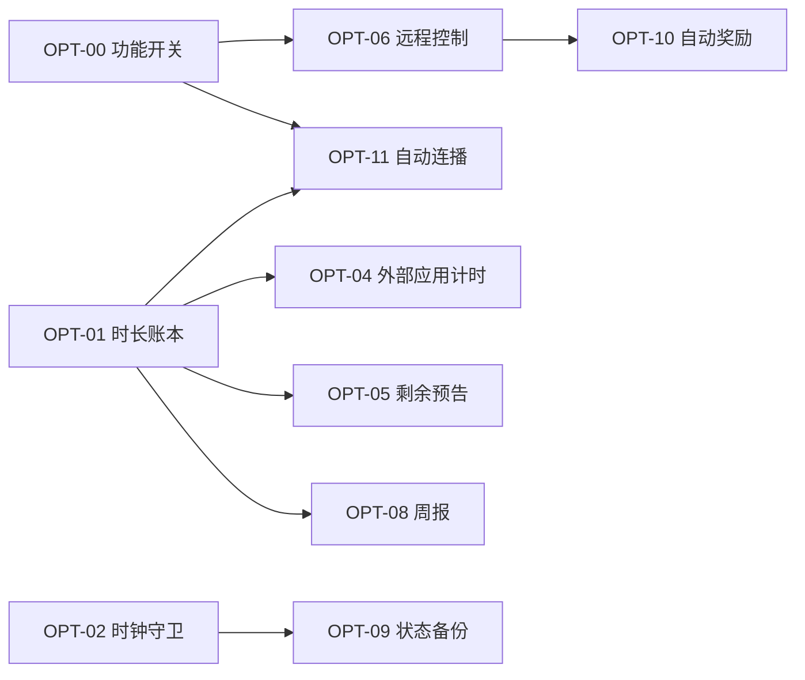

# 优化计划 ROADMAP

| 项目 | 内容 |
|---|---|
| 产品 | 小剧场 · KidTvCurated |
| 文档 | 优化计划 V1.0 |
| 日期 | 2026-11-10 |
| 基线 | `main` @ `387ab8c` |
| 输入 | [PRD](PRD.md) 的风险与待办、[用户使用说明书](用户使用说明书.md) 的常见问题、一次代码评审结论 |
| 目标 | 从「能用」到「可信 + 有反馈」：规则绕不过、数据丢不了、家长看得见 |

---

## 1. 一页结论

现在的问题不是功能少，是**核心承诺有缺口**：白名单和限额可以被绕过（改电视时间、从应用入口看外部 App、卸载重装清空记录），家长掏心经营了一套规则却看不到效果。

所以计划只追三条主线，不铺功能：

| 主线 | 一句话 | 判定标准 |
|---|---|---|
| **A. 规则闭环** | 规则在任何一条路径上都成立 | 可绕过路径 3 → 0 |
| **B. 家长可感** | 家长能远程干预、能看到结果 | 远程动作 0 → 3，周报 0 → 1 |
| **C. 工程底座** | 以后敢改、坏了自己能查 | 单测 0 → ≥30 条，CI 常绿，异常可回溯 |

三条主线之外的一切（多孩、分级、语音、自更新）都排队，理由见第 8 节「明确不做」。

---

## 2. 成功指标（验收口径）

| 指标 | 现状 | 目标 | 怎么量 |
|---|---|---|---|
| 可绕过限额的路径 | 3 条（改时钟 / 外部应用不计时 / 重装清零） | 0 条 | 手工用例 EX-11~EX-13 全通过 |
| 家长远程可控动作 | 0 | 3（立即锁屏 / 加时 / 暂停） | `control.json` 三条指令实测 15 秒内生效 |
| 家长可见数据 | 0 页 | 1 个周报页 | 能答出「这周看了几小时、哪集反复看」 |
| 孩子看完整季的按键次数 | 12+ 次（每集点一次） | 1 次（首集点开） | 自动连播实测 |
| 自动化回归 | 0 | ≥30 条单测 + CI | `gradlew test` 全绿 |
| 崩溃可定位 | 无（异常被吞） | NAS `logs/` 可查最近 7 天 | 人为造一次崩溃能查到栈 |

---

## 3. Wave 0 · 基座（3 个改动，先做，约 2 人日）

后续每一项都依赖这三块地基，顺序不能乱。

### OPT-00 远程功能开关（灰度与回滚闸门）

- **问题**：现在改一个行为只能重装 APK；新逻辑出问题，家长只能跑 `adb`。
- **做法**：在 `tv.json` 增加 `features` 段（`extWatchMs`、`autoNext`、`remoteControl`、`report` 等布尔开关），由 `PlaylistSync.applyToLocal()` 写进 `Extras`；每处新逻辑用 `if (Extras.feature("xxx"))` 包一层，默认关闭。
- **价值**：**任何新功能出问题，家长在编辑器改一行、15 秒后生效**，不用卸载重装。这是整份计划里性价比最高的一个改动。
- **验收**：`features.autoNext=false` 时连播不触发；改回 true 15 秒内生效。
- **估时**：0.5 人日。

### OPT-01 观看时长统一账本 `WatchClock`

- **问题**：`Extras.addWatchMs()` 只被 `PlayerActivity`（275、353 行）调用，口径单点，外部应用完全不计时。
- **做法**：新增 `data/WatchClock.kt`，单例 + 单一 owner（同一时刻只允许一个来源计时，避免重复计数）：`start(owner)` / `stop(owner)` / `tick()`，每 10 秒落盘一次；`KidApp` 的 1 秒 tick 驱动。`PlayerActivity` 改为 start/stop，删除自身累加逻辑。
- **风险**：播放页与前台守卫同时计时 → 用 owner 令牌 + 断言，重进页面必须 stop 旧的。
- **验收**：播放 3 分钟，`watch_今天` 增加 180±5 秒；暂停 1 分钟不增加；切后台不增加。
- **估时**：1 人日。

### OPT-02 时钟回退守卫 `ClockGuard`

- **问题**：`Extras.day()` 用 `System.currentTimeMillis()` 生成日期键，`tempUntil`/`kioskExitUntil` 也挂在墙上时间上。改电视日期 → 限额归零；自动对时回拨 → 误判。
- **做法**：新增 `data/ClockGuard.kt`：持久化 `lastWall`、`dayMaxUsedMs`；`now()` 若发现墙上时间倒退超过 2 分钟，返回「单调递增」的校正时间并累加 `anomalyCount`；当日已用量取 `max(实际, dayMaxUsedMs)` 只增不减。放行类倒计时改用 `SystemClock.elapsedRealtime()` 差值而不是墙上截止时间。
- **验收**：EX-11：看满限额后把系统时间改到明天，仍处于锁定；改回后当日用量不回退。
- **估时**：1 人日。

---

## 4. Wave 1 · 规则闭环（约 5 人日）

| 编号 | 项 | 依赖 | 估时 | 优先级 |
|---|---|---|---|---|
| OPT-03 | 版本可见 | — | 0.2 | P0 |
| OPT-04 | 外部应用时长计入限额 | OPT-01 | 1.5 | P0 |
| OPT-05 | 剩余时间预告 | OPT-01 | 1 | P1 |
| OPT-06 | 远程控制卡 `control.json` | OPT-00 | 1.5 | P0 |
| OPT-07 | 设置写回失败阻断 + 未同步标记 | — | 0.8 | P1 |

### OPT-03 版本可见

- **做法**：`versionCode` 1 → 2；`SettingsActivity` 页脚显示 `versionName + 构建时间`（`BuildConfig.BUILD_TIME` 或 `build.gradle` 注入字段）。
- **理由**：排障第一句永远是「电视上装的是哪版」。现在答不上来。
- **验收**：设置页底部可见；APK 属性里版本一致。

### OPT-04 外部应用时长计入限额（最关键的一条）

- **问题**：应用入口给 30 分钟优酷，一秒都不算进 `dailyLimitMinutes`。孩子会发现「从应用入口看更划算」。
- **做法**：
  1. `KidApp` tick 中用 `AppGuard.foregroundPackage()` 判断当前前台包名是否等于 `Extras.appLaunchPackage()`；
  2. 是 → `WatchClock.start("extapp")`；离开 → `stop`。时长与播放共用同一本账。
  3. 无 `GET_USAGE_STATS` 授权时（`foregroundPackage()` 返回 null）：降级为「进入外部应用即按 `maxMinutes` 预扣」，并在首页给孩子一条提示、在设置页给家长一条「去授权」的说明（附 `adb appops` 命令）。
- **验收**：打开优酷看 10 分钟回小剧场，`watch_今天` 增加 600 秒；无授权时预扣生效且提示可见。
- **风险**：MTK 固件的事件流可能不完整 → 以 `maxMinutes` 超时兜底，不追求 100% 精确。

### OPT-05 剩余时间预告

- **做法**：播放页右上角小字「还剩 12 分钟」；剩 5 分钟一次 Toast；剩 1 分钟再提示；到点走现有 `stopForLock()`。外部应用在放行结束前 2 分钟同样提示（`Toast` + 守卫倒计时）。
- **理由**：低龄产品的体验差异不在「能不能锁」，在「锁得有没有预期」。
- **验收**：限额 30 分钟，三个时点各提示一次，不重复刷屏。

### OPT-06 远程控制卡 `control.json`

- **做法**：新增 `data/RemoteControl.kt`，用现成的 `Smb.readAllIsolated()` 每 15 秒读 `data:curated/control.json`（与 `PlaylistSync` 共用同一次轮询周期，不额外开连接）：
  ```json
  { "lockNow": false, "addMinutes": 0, "pauseNow": false, "updatedAt": "2026-11-10T20:15:00+08:00" }
  ```
  - `lockNow` → `Extras.grantTemp(0)` + 跳 `LockActivity`；
  - `addMinutes` → `Extras.grantTemp(n)`（家长主动加时，即使不在时段内）；
  - `pauseNow` → 播放器 `pause()`。
  - 幂等：按 `updatedAt` 去重，执行后 `Smb.writeIsolated()` 写 `control.ack.json` 回执，网页端能显示「已生效」。
- **验收**：在电脑上改文件，电视 15 秒内响应；重复轮询不重复执行。
- **注意**：`control.json` 与 `tv.json` 分开文件，避免家长手改控制指令时碰坏片单。

### OPT-07 设置写回失败阻断

- **做法**：`PlaylistWriter.patch()` 返回失败时，设置页停留在原页 + 明显错误条，并置 `hasUnsyncedEdit=true`；下次 `applyToLocal()` 前若发现未同步，弹「NAS 上仍是你上次保存的内容，是否用电视上的覆盖」。
- **理由**：现在「以为改好了、下次同步被回滚」是最伤信任的失败方式。

---

## 5. Wave 2 · 家长可感（约 5 人日）

| 编号 | 项 | 依赖 | 估时 |
|---|---|---|---|
| OPT-08 | 周报页 `ReportActivity` | OPT-01 | 2 |
| OPT-09 | 打卡与进度备份 `state.json` | OPT-02 | 1.5 |
| OPT-10 | 完成必看自动奖励加时 | OPT-06 | 1 |

### OPT-08 周报页

- **做法**：新增 `ReportActivity`（入口放设置页顶部与「我的奖励」并列）。数据全部来自本地，无需新埋点：`watch_*`（近 14 天）、`vids_*`、`stamps`、`front_*`。
  展示三块：① 近 7 天每天时长条形图（自绘 View，不引图表库，省内存）；② 连续打卡与最长连击；③「这周反复看的 3 部」与「总看到一半就退出的 2 部」——后者用 `front_/duration` 比值判断。
- **验收**：数字与 `shared_prefs` 实际值一致；无数据时显示空状态而不是 0。

### OPT-09 打卡与进度备份

- **做法**：`Extras` 增加 `exportState()/importState()`，序列化 `stamps`、`front_*`、`pos_*`、`watch_*` 到 `data:curated/state.json`；触发时机：应用退到后台、每 5 分钟、每日首次打卡。冷启动若本地 `stamps` 为空且 NAS 有备份 → 提示家长「恢复上次记录」而不是静默导入。
- **理由**：卸载重装/恢复出厂会把 30 天连续记录清零——数据上无所谓，对孩子的意义不一样。
- **验收**：`pm clear` 后重启，能把打卡墙恢复。

### OPT-10 自动奖励加时

- **做法**：`schedule.rewardMinutes`（默认 0 = 关闭）。当日必看全部完成 → `Extras.grantTemp(rewardMinutes)` 且提示「今天全部完成，奖励 10 分钟」。与家长手动放行分开计数，避免互相覆盖。

---

## 6. Wave 3 · 孩子侧体验（约 7 人日）

| 编号 | 项 | 依赖 | 估时 |
|---|---|---|---|
| OPT-11 | 自动连播下一集 | OPT-00、OPT-01 | 2 |
| OPT-12 | 首页「继续看」 | — | 1.5 |
| OPT-13 | 占位封面（缺图不再灰块） | — | 1.5 |
| OPT-14 | 分区图标 + 今日任务进度条 | — | 2 |

### OPT-11 自动连播

- **做法**：`PlayerActivity` 监听 `Player.STATE_ENDED`（现在完全没有处理）→ 5 秒倒计时浮层「下一集：xx（取消）」→ 取同目录下一集（`Repo` 已能列目录）→ 复用现有 `EXTRA_*` 启动自身。受三件事约束：门禁未解锁 / 当日限额用尽 / 功能开关关闭 → 不连播，回到剧集列表。
- **验收**：一季 10 集，从第 1 集点开能连到第 10 集；第 5 集时限额到点则停止并锁屏。

### OPT-12 首页「继续看」

- **做法**：动态分区 `__continue`，key 固定为 `p:continue`（守住「id 必须路径派生」的原则，不能用下标），取 `Store.progress` 最近 5 条，封面复用现有缓存；无进度则不显示。

### OPT-13 占位封面

- **做法**：`Covers` 在 `markNoCover()` 分支不再返回 null，而用 `Canvas` 画一张「渐变色 + 标题大字」的 Bitmap（按条目 key 取稳定色相），进同一个 LRU。零 SMB 请求、零额外内存峰值。

### OPT-14 分区图标与任务进度条

- **做法**：`Section` 增加可选 `icon` 字段（内置几套矢量图标，家长在编辑器选）；首页顶部一条「今天任务 2/5」进度条，替代现在只靠文案提示的 `gateRemaining()`。

---

## 7. Wave 4 · 工程底座（穿插进行，约 6 人日）

| 编号 | 项 | 估时 | 说明 |
|---|---|---|---|
| OPT-15 | 单测 + CI | 2 | 加 `testImplementation("junit:junit:4.13.2")` 与 `src/test/kotlin`；先覆盖纯函数：`Schedule` 时段解析与跨零点、`GateKeeper.nextOpening`、`Badges` 判定、`PlaylistParser` 路径解码（`+` 号事故回归）、`Kiosk` 解析。新增 `.github/workflows/android.yml` 跑 `gradlew test` |
| OPT-16 | 文案收口 `strings.xml` | 1.5 | 现在 `strings.xml` 只有 1 条，中文全散在 Kotlin 里；先收设置页与锁屏页 |
| OPT-17 | 异常落盘 | 1 | `KidApp.tick` 的 `catch (e: Exception)` 目前静默吞异常；改为写 `data:curated/logs/tv-yyyyMMdd.txt`（单文件 200 KB 滚动，最多 7 天） |
| OPT-18 | 设置页拆分 | 1.5 | `SettingsActivity` 667 行，改任何开关都在动同一个文件；按「时段 / 规则 / 应用 / 学习角 / 系统」拆 5 个数据驱动的分组渲染器 |
| OPT-19 | 家长工具收敛 | 视情况 | 三个入口（`tvjson_simple.py`、`console.py`、`PC exe`）先做「一个启动页 + 三个模式」，功能不合并 |

---

## 8. 排期建议

```
Wave 0（基座）        ██░░░░░░░░  2 人日   ← 先做，后续全靠它回滚
Wave 1（规则闭环）    ░░█████░░░  5 人日   ← 价值最高
Wave 2（家长可感）    ░░░░░█████  5 人日
Wave 3（孩子体验）    ░░░░░░░░██  7 人日
Wave 4（工程底座）    穿插         6 人日
```

- **建议节奏**：Wave 0 + OPT-03 先一起发一版（约 2.2 人日），验证功能开关这条链路通了，再动后面的。
- **每个 Wave 结束发一个版本**（`versionCode` 递增），出问题用 `features` 关掉，不靠回滚 APK。
- **每个 Wave 结束同步更新**：PRD 的对应 FR 与验收、说明书的常见问题、`README` 的功能清单。

### 依赖关系



---

## 9. 测试策略（跟着 Wave 走）

| Wave | 必测 | 手段 |
|---|---|---|
| 0 | 功能开关远程生效/失效；3 分钟计时准确；时间回拨不重置 | 实机 + 手工改 `tv.json` |
| 1 | 外部应用计时（含无授权降级）；control 三条指令幂等；写回失败提示 | 实机 + `EX-11~EX-14` |
| 2 | `pm clear` 后恢复；周报数字与 prefs 一致 | 实机 + `run-as` 读 prefs 对账 |
| 3 | 连播受限额/门禁约束；占位封面不卡顿 | 实机 10 集连播 |
| 4 | 纯函数单测；CI 在 PR 上跑 | GitHub Actions |

新增异常用例（补进 PRD 的 EX 表）：

- EX-11 改系统时间绕过限额 → 应仍锁定
- EX-12 从应用入口看外部 App 30 分钟 → 应计入并到点锁
- EX-13 `pm clear` 后重开 → 打卡可恢复
- EX-14 `control.json` 写坏 JSON → 忽略，不崩、不影响片单同步
- EX-15 NAS 写保护时在电视上改时段 → 应阻断并提示，不静默回滚

---

## 10. 风险与回滚

| 风险 | 影响 | 对策 |
|---|---|---|
| `WatchClock` 双重计时 | 孩子被冤枉扣时长 | owner 令牌 + 单测覆盖；上线首日家长对账一次 |
| `foregroundPackage()` 在 MTK 上拿不到 | 外部应用仍不计时 | `maxMinutes` 预扣降级；不阻塞发版 |
| `feature` 开关本身写坏 | 全部功能回到默认 | `Extras.feature()` 缺字段读默认值（关闭新功能），不抛异常 |
| `state.json` 备份写频繁 | 增加 SMB 负载、诱发老问题 | 走 `writeIsolated`，10 分钟一次上限，失败静默退避 |
| 新逻辑把 SMB 主连接搞挂（历史事故） | 主界面全卡 | 所有新读取一律 `readAllIsolated`，禁止在 `PlaylistSync` 之外复用主连接 |

**回滚方式统一为**：`tv.json` 里把对应 `features.*` 改回 `false`，等 15 秒。不需要重装 APK。

---

## 11. 明确不做（本期）

| 项 | 为什么不做 |
|---|---|
| 多孩 profile | 数据模型要全局改 key（`pos_`/`done_`/`stamps` 都带 profile 前缀），是破坏性变更，等真有需求再一次性做 |
| 内容分级标签 | 需要给 1970 个文件打标，人工成本远大于收益；先在编辑器里用分区替代 |
| per-day 时段（周二四不同） | 表达力提升有限，家长用 `weekday/weekend` 够用 |
| 语音交互 / TTS 朗读 | 电视无麦克风，TTS 收益不确定，等孩子识字多一点再说 |
| 自更新（OTA） | 家里只有一台电视，换 APK 的频率远低于改片单；`features` 开关已经解决 80% 的「回滚」需求 |
| 重构 `MainActivity` | 485 行尚可维护，没有正在咬人的问题；优先级低于规则闭环 |

---

## 12. 下一步

1. 确认本计划的**取舍**：三条主线是否认可，Wave 3 是否整体后移。
2. 先落 Wave 0 三项（2 人日），发出 `versionCode 2`。
3. Wave 0 验证通过后，再决定 Wave 1 里的 OPT-06（远程控制）是否提前——它单独就能显著提升家长感知。
