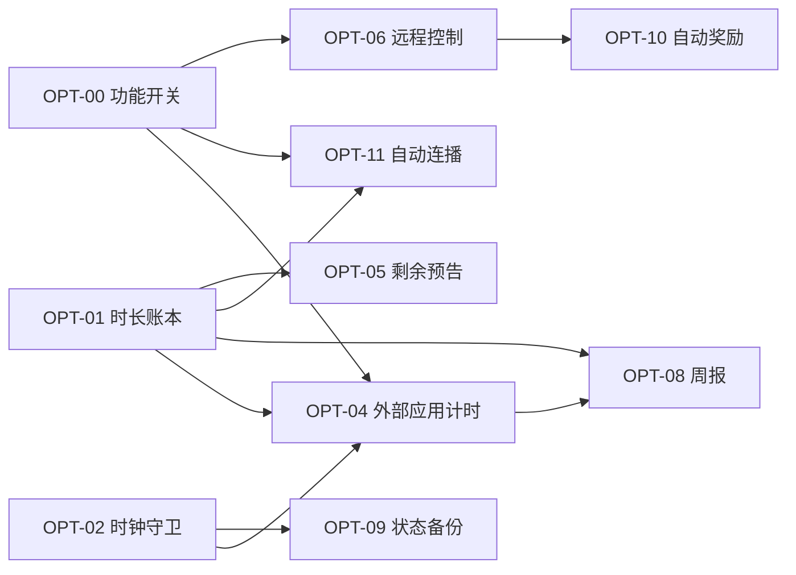

# 优化计划 ROADMAP

| 项目 | 内容 |
|---|---|
| 产品 | 小剧场 · KidTvCurated |
| 文档 | 优化计划 V1.4 |
| 日期 | 2026-11-10 |
| 基线 | `main` @ `3e7193b` |
| 输入 | [PRD](PRD.md) 的风险与待办、[用户使用说明书](用户使用说明书.md) 的常见问题、一次代码评审结论、[外部应用计时方案对比](外部应用计时方案对比.md) 与 [ADR-01](ADR-外部应用计时.md) |
| 目标 | 从「能用」到「可信 + 有反馈」：规则绕不过、数据丢不了、家长看得见 |

**V1.1 变更**：孩子体验由 Wave 3 提前到 Wave 2；周报确定只做电视端。

**V1.2 变更**：采纳 A+C 分层架构，外部应用计时（OPT-04）**由「待定」转为正式排期**，落在 Wave 2 之后、Wave 3 之前；架构定稿见 [ADR-01](ADR-外部应用计时.md)；规则闭环目标由「3 条绕过路径降到 1 条」改为**本期清零**。Wave 顺序不变，孩子体验不因此后移。

**V1.4 变更（2026-11-10 晚）**：用户重开电视后实机确认「从应用入口跳到第三方应用就一直能看」，
`dumpsys usagestats` 显示优酷当天 2 小时 1 分 / 启动 8 次，而 `watch_<day>` 只涨了 6 分钟 ——
每日上限**从未触发**。这不是「以后再优化」的体验问题，而是核心承诺已经失效，
因此 **OPT-04 从 Wave 2 之后提前到 Wave 0 之后立刻实施**，发 `versionCode 3 / v1.2`。
V1–V5 验证门同批跑完（见第 14 节），Wave 1 顺延。

**V1.3 进度（2026-11-10）**：**Wave 0（OPT-00 / OPT-01 / OPT-02）+ OPT-03 已落地，`versionCode 2`**。
落地范围与偏差见第 14 节「落地记录」。可绕过路径：**3 → 2**（「改时钟」已闭合；「外部应用不计时」待 OPT-04、「重装清零」待 OPT-09）。

---

## 1. 一页结论

现在的问题不是功能少，是**核心承诺有缺口**：白名单和限额可以被绕过（改电视时间、从应用入口看外部 App、卸载重装清空记录），家长掏心经营了一套规则却看不到效果。

所以计划只追三条主线，不铺功能：

| 主线 | 一句话 | 判定标准 |
|---|---|---|
| **A. 规则闭环** | 规则在任何一条路径上都成立 | 可绕过路径 3 → 0（OPT-04 已定架构，Wave 3 前落地） |
| **B. 家长可感** | 家长能远程干预、能看到结果 | 远程动作 0 → 3，周报 0 → 1 |
| **C. 工程底座** | 以后敢改、坏了自己能查 | 单测 0 → ≥30 条，CI 常绿，异常可回溯 |

三条主线之外的一切（多孩、分级、语音、自更新）都排队，理由见第 12 节「明确不做」。

---

## 2. 成功指标（验收口径）

| 指标 | 现状 | 目标 | 怎么量 |
|---|---|---|---|
| 可绕过限额的路径 | 3 条（改时钟 / 外部应用不计时 / 重装清零） | **本期 0 条** | 手工用例 EX-11、EX-12、EX-13 全通过 |
| 外部应用观看时长归集 | 不计时（0） | 10 分钟误差 ≤ 60 秒；无授权自动降级预扣，绝不漏记 | ADR-01 的 A-01、EX-12、EX-17 |
| 家长远程可控动作 | 0 | 3（立即锁屏 / 加时 / 暂停） | `control.json` 三条指令实测 15 秒内生效 |
| 家长可见数据 | 0 页 | 1 个周报页（电视端） | 能答出「这周看了几小时、哪集反复看」 |
| 孩子看完整季的按键次数 | 12+ 次（每集点一次） | 1 次（首集点开） | 自动连播实测 |
| 自动化回归 | 0 | ≥30 条单测 + CI | `gradlew test` 全绿 |
| 崩溃可定位 | 无（异常被吞） | NAS `logs/` 可查最近 7 天 | 人为造一次崩溃能查到栈 |

---

## 3. Wave 0 · 基座（3 个改动，先做，约 2 人日）

后续每一项都依赖这三块地基，顺序不能乱。

### OPT-00 远程功能开关（灰度与回滚闸门）✅

- **问题**：现在改一个行为只能重装 APK；新逻辑出问题，家长只能跑 `adb`。
- **做法**：在 `tv.json` 增加 `features` 段（`extWatchMs`、`autoNext`、`remoteControl`、`report` 等布尔开关），由 `PlaylistSync.applyToLocal()` 写进 `Extras`；每处新逻辑用 `if (Extras.feature("xxx"))` 包一层，默认关闭。
- **价值**：**任何新功能出问题，家长在编辑器改一行、15 秒后生效**，不用卸载重装。这是整份计划里性价比最高的一个改动。
- **验收**：`features.autoNext=false` 时连播不触发；改回 true 15 秒内生效。
- **估时**：0.5 人日。

### OPT-01 观看时长统一账本 `WatchClock` ✅

- **问题**：`Extras.addWatchMs()` 只被 `PlayerActivity`（275、353 行）调用，口径单点，外部应用完全不计时。
- **做法**：新增 `data/WatchClock.kt`，单例 + 单一 owner（同一时刻只允许一个来源计时，避免重复计数）：`start(owner)` / `stop(owner)` / `tick()` / `add()`，另加 `preCharge()` / `refund()` 供外部应用兜底预扣使用；每 10 秒落盘一次；`KidApp` 的 1 秒 tick 驱动。`PlayerActivity` 改为 start/stop，删除自身累加逻辑。总账仍写 `watch_<day>`，另记 `ext_<day>` 明细。
- **风险**：播放页与前台守卫同时计时 → 用 owner 令牌 + 断言，重进页面必须 stop 旧的。
- **为谁铺路**：[ADR-01](ADR-外部应用计时.md) 的 `ExtWatchTracker` 直接复用这本账；`GateKeeper.status()` 读同一个 `watch_<day>`，OPT-04 落地时**门禁一行都不用改**。这一版就要把 `preCharge/refund` 预留好，避免返工。
- **验收**：播放 3 分钟，`watch_今天` 增加 180±5 秒；暂停 1 分钟不增加；切后台不增加。
- **估时**：1 人日。

### OPT-02 时钟回退守卫 `ClockGuard` ✅

- **问题**：`Extras.day()` 用 `System.currentTimeMillis()` 生成日期键，`tempUntil`/`kioskExitUntil` 也挂在墙上时间上。改电视日期 → 限额归零；自动对时回拨 → 误判。
- **做法**：新增 `data/ClockGuard.kt`：持久化 `lastWall`、`dayMaxUsedMs`；`now()` 若发现墙上时间倒退超过 2 分钟，返回「单调递增」的校正时间并累加 `anomalyCount`；当日已用量取 `max(实际, dayMaxUsedMs)` 只增不减。放行类倒计时改用 `SystemClock.elapsedRealtime()` 差值而不是墙上截止时间。
- **验收**：EX-11：看满限额后把系统时间改到明天，仍处于锁定；改回后当日用量不回退。
- **估时**：1 人日。

---

## 4. Wave 1 · 规则闭环（约 3.5 人日）

| 编号 | 项 | 依赖 | 估时 | 优先级 |
|---|---|---|---|---|
| OPT-03 | 版本可见 | — | 0.2 | P0 |
| OPT-05 | 剩余时间预告 | OPT-01 | 1 | P1 |
| OPT-06 | 远程控制卡 `control.json` | OPT-00 | 1.5 | P0 |
| OPT-07 | 设置写回失败阻断 + 未同步标记 | — | 0.8 | P1 |

> OPT-04（外部应用计时）不放在本波，也不插到 Wave 2 之前——避免把已经提前的「孩子体验」再往后推 1.5 人日。它的位置见第 8 节。

### OPT-03 版本可见 ✅

- **做法**：`versionCode` 1 → 2；`SettingsActivity` 页脚显示 `versionName + 构建时间`（`BuildConfig.BUILD_TIME` 或 `build.gradle` 注入字段）。
- **理由**：排障第一句永远是「电视上装的是哪版」。现在答不上来。
- **验收**：设置页底部可见；APK 属性里版本一致。

### OPT-05 剩余时间预告

- **做法**：播放页右上角小字「还剩 12 分钟」；剩 5 分钟一次 Toast；剩 1 分钟再提示；到点走现有 `stopForLock()`。外部应用在放行结束前 2 分钟同样提示（`Toast` + 守卫倒计时）。
- **理由**：低龄产品的体验差异不在「能不能锁」，在「锁得有没有预期」。
- **验收**：限额 30 分钟，三个时点各提示一次，不重复刷屏。

### OPT-06 远程控制卡 `control.json`

- **做法**：新增 `data/RemoteControl.kt`，用现成的 `Smb.readAllIsolated()` 每 15 秒读 `data:curated/control.json`（与 `PlaylistSync` 共用同一次轮询周期，不额外开连接）：
  ```json
  { "lockNow": false, "addMinutes": 0, "pauseNow": false, "updatedAt": "2026-11-10T20:15:00+08:00" }
  ```
  - `lockNow` → `Extras.grantTemp(0)` + 跳 `LockActivity`；
  - `addMinutes` → `Extras.grantTemp(n)`（家长主动加时，即使不在时段内）；
  - `pauseNow` → 播放器 `pause()`。
  - 幂等：按 `updatedAt` 去重，执行后 `Smb.writeIsolated()` 写 `control.ack.json` 回执，网页端能显示「已生效」。
- **验收**：在电脑上改文件，电视 15 秒内响应；重复轮询不重复执行。
- **注意**：`control.json` 与 `tv.json` 分开文件，避免家长手改控制指令时碰坏片单。

### OPT-07 设置写回失败阻断

- **做法**：`PlaylistWriter.patch()` 返回失败时，设置页停留在原页 + 明显错误条，并置 `hasUnsyncedEdit=true`；下次 `applyToLocal()` 前若发现未同步，弹「NAS 上仍是你上次保存的内容，是否用电视上的覆盖」。
- **理由**：现在「以为改好了、下次同步被回滚」是最伤信任的失败方式。

---

## 5. Wave 2 · 孩子体验（约 7 人日，已提前）

孩子每天真实接触的就是这一层。放在规则闭环之后、家长报表之前，是因为它不需要任何新权限，纯客户端改动，性价比高。

> **与 OPT-04 的取舍**：外部应用计时需要一次 `appops` 授权且有待验证的 ROM 行为，把它插到本波之前会让孩子体验整体后移。所以 OPT-04 排在本波之后（第 8 节），两者不互相阻塞。

| 编号 | 项 | 依赖 | 估时 |
|---|---|---|---|
| OPT-11 | 自动连播下一集 | OPT-00、OPT-01 | 2 |
| OPT-12 | 首页「继续看」 | — | 1.5 |
| OPT-13 | 占位封面（缺图不再灰块） | — | 1.5 |
| OPT-14 | 分区图标 + 今日任务进度条 | — | 2 |

### OPT-11 自动连播

- **做法**：`PlayerActivity` 监听 `Player.STATE_ENDED`（现在完全没有处理）→ 5 秒倒计时浮层「下一集：xx（取消）」→ 取同目录下一集（`Repo` 已能列目录）→ 复用现有 `EXTRA_*` 启动自身。受三件事约束：门禁未解锁 / 当日限额用尽 / `features.autoNext` 关闭 → 不连播，回到剧集列表。
- **验收**：一季 10 集，从第 1 集点开能连到第 10 集；第 5 集时限额到点则停止并锁屏。
- **风险**：连播会加快时长消耗，家长可能觉得「怎么比以前看得多」——上线时在说明书写一句。

### OPT-12 首页「继续看」

- **做法**：动态分区 `__continue`，key 固定为 `p:continue`（守住「id 必须路径派生」的原则，不能用下标），取 `Store.progress` 最近 5 条，封面复用现有缓存；无进度则不显示。

### OPT-13 占位封面

- **做法**：`Covers` 在 `markNoCover()` 分支不再返回 null，而用 `Canvas` 画一张「渐变色 + 标题大字」的 Bitmap（按条目 key 取稳定色相），进同一个 LRU。零 SMB 请求、零额外内存峰值。

### OPT-14 分区图标与任务进度条

- **做法**：`Section` 增加可选 `icon` 字段（内置几套矢量图标，家长在编辑器选）；首页顶部一条「今天任务 2/5」进度条，替代现在只靠文案提示的 `gateRemaining()`。

---

## 6. Wave 3 · 家长可感（约 5 人日）

| 编号 | 项 | 依赖 | 估时 |
|---|---|---|---|
| OPT-08 | 周报页 `ReportActivity`（**电视端**） | OPT-01 | 2 |
| OPT-09 | 打卡与进度备份 `state.json` | OPT-02 | 1.5 |
| OPT-10 | 完成必看自动奖励加时 | OPT-06 | 1 |

### OPT-08 周报页（电视端）

- **范围**：只做电视端，不做网页端。理由是数据在电视本地、家长坐在沙发上就能看，多写一个网页端要多一套 NAS 读写与鉴权。
- **做法**：新增 `ReportActivity`（入口放设置页顶部，与「我的奖励」并列）。数据全部来自本地，无需新埋点：`watch_*`（近 14 天）、`vids_*`、`stamps`、`front_*`。
  展示三块：① 近 7 天每天时长条形图（自绘 View，不引图表库，省内存）；② 连续打卡与最长连击；③「这周反复看的 3 部」与「总看到一半就退出的 2 部」——后者用 `front_/duration` 比值判断。
- **验收**：数字与 `shared_prefs` 实际值一致；无数据时显示空状态而不是 0。
- **本期即包含**：OPT-04 排在本波之前（第 8 节），条形图多一条「外部应用」分段，读 `ext_<day>`；若 OPT-04 降级为估算模式，该分段标注「估算」。

### OPT-09 打卡与进度备份

- **做法**：`Extras` 增加 `exportState()/importState()`，序列化 `stamps`、`front_*`、`pos_*`、`watch_*` 到 `data:curated/state.json`；触发时机：应用退到后台、每 5 分钟、每日首次打卡。冷启动若本地 `stamps` 为空且 NAS 有备份 → 提示家长「恢复上次记录」而不是静默导入。
- **理由**：卸载重装/恢复出厂会把 30 天连续记录清零——数据上无所谓，对孩子的意义不一样。
- **验收**：`pm clear` 后重启，能把打卡墙恢复。

### OPT-10 自动奖励加时

- **做法**：`schedule.rewardMinutes`（默认 0 = 关闭）。当日必看全部完成 → `Extras.grantTemp(rewardMinutes)` 且提示「今天全部完成，奖励 10 分钟」。与家长手动放行分开计数，避免互相覆盖。

---

## 7. Wave 4 · 工程底座（穿插进行，约 6 人日）

| 编号 | 项 | 估时 | 说明 |
|---|---|---|---|
| OPT-15 | 单测 + CI | 2 | 加 `testImplementation("junit:junit:4.13.2")` 与 `src/test/kotlin`；先覆盖纯函数：`Schedule` 时段解析与跨零点、`GateKeeper.nextOpening`、`Badges` 判定、`PlaylistParser` 路径解码（`+` 号事故回归）、`Kiosk` 解析。新增 `.github/workflows/android.yml` 跑 `gradlew test` |
| OPT-16 | 文案收口 `strings.xml` | 1.5 | 现在 `strings.xml` 只有 1 条，中文全散在 Kotlin 里；先收设置页与锁屏页 |
| OPT-17 | 异常落盘 | 1 | `KidApp.tick` 的 `catch (e: Exception)` 目前静默吞异常；改为写 `data:curated/logs/tv-yyyyMMdd.txt`（单文件 200 KB 滚动，最多 7 天） |
| OPT-18 | 设置页拆分 | 1.5 | `SettingsActivity` 667 行，改任何开关都在动同一个文件；按「时段 / 规则 / 应用 / 学习角 / 系统」拆 5 个数据驱动的分组渲染器 |
| OPT-19 | 家长工具收敛 | 视情况 | 三个入口（`tvjson_simple.py`、`console.py`、`PC exe`）先做「一个启动页 + 三个模式」，功能不合并 |

---

## 8. OPT-04 · 外部应用计时（架构已定，Wave 2 后 / Wave 3 前）

**状态**：**已排期，架构定稿**。方案选型见[方案对比](外部应用计时方案对比.md)，完整设计见 [ADR-01 · 外部应用计时](ADR-外部应用计时.md)。本节只写排期、验收与开工门控。

**位置**：Wave 2 结束之后、Wave 3 开始之前，约 1.5 人日（A+C）或 0.5 人日（仅 C）。依赖 OPT-00 / OPT-01 / OPT-02；**不阻塞 Wave 0–2**，且是 OPT-08 周报「外部应用分段」的数据来源。

**决策**：UsageStats 精确计时（A）+ 零权限预扣（C）分层。有授权走 A，无授权自动降级 C，绝不出现「少扣」。两条硬约束：复用 `KidApp.tick` 的 1 秒节拍（不新增线程、服务、定时器）；账写进现有 `watch_<day>`（**门禁不改**），另记 `ext_<day>` 明细。

**三个决定架构的约束**（详见 ADR 第 4 节）：

| # | 约束 | 后果 |
|---|---|---|
| 1 | 计时不能挂 `enforceKiosk()`：它第 67 行在儿童锁未启用时直接 return | 挂进去等于不工作，必须在 `KidApp.tick` 独立调用 |
| 2 | 插入点只能是 `KidApp.tick` 第 34 行 | 第 35 行 `clearAppLaunch()` 会先清放行标志，放后面会丢掉整段时长 |
| 3 | `UNKNOWN` 不等于 `LEFT` | 优酷静置 5 分钟无事件时保持会话，不能误判孩子已退出 |

**实现要点**：`AppGuard` 扩事件窗口、补 `MOVE_TO_BACKGROUND`、输出三态；新增 `ExtUsageProbe`（事件流 + `totalTimeInForeground` 双读）与 `ExtWatchTracker`（状态机、5 秒节流、幂等结算）；实时用 `elapsedRealtime`，退出时按系统累计值校准（偏差 > 20% 以系统为准）；全程 `ClockGuard.day()` 做日期键。落点：`KidApp.kt`（34 / 122 行）、`MainActivity.kt`（313 行）、`data/Apps.kt`、3 个新增类、`data/Extras.kt`；`GateKeeper.kt` 不改。

**验收**：EX-12、EX-16～EX-20 与 ADR 第 10 节 A-01～A-08。核心两条 —— 应用入口看 10 分钟，`watch_<day>` 增加 600±60 秒；`features.extWatchMs=false` 时行为与现状完全一致。

**开工门控（仍是硬前置）**：电视开机后跑[方案对比文档](外部应用计时方案对比.md)第 5 节 V1–V5。2026-11-10 16:20 探测电视离线，尚未实测；本架构按 API 语义与现有代码推断。

| 验证结论 | 执行范围 | 估时 |
|---|---|---|
| V1–V5 全通过 | 完整 A + C（ADR 全部内容） | 1.5 人日 |
| V2 通过但拿不到事件流 | 只做 C（预扣 + 退还 + 估算标注），`ExtUsageProbe` 不实现 | 0.5 人日 |
| V1 授权失败 | 只做 C + 编辑器推荐「关闭应用入口」 | 0.5 人日 |

**无论哪条分支都实现 C** —— 它是永不失效的底线，也是 A 不可用时唯一的闭合手段。`features.extWatchMs` 默认 `false`，出问题改回 `false` 等 15 秒即可，不重装 APK。

---

## 9. 排期建议

```
Wave 0（基座）        ██░░░░░░░░░  2.0 人日
Wave 1（规则闭环）    ░░███░░░░░░  3.5 人日
Wave 2（孩子体验）    ░░░░░█████░  7.0 人日   ← V1.1 提前
OPT-04（外部计时）    ░░░░░░░░░█  1.5 人日   ← V1.2 定稿，Wave 3 前
Wave 3（家长可感）    ░░░░░░░░░██  5.0 人日
Wave 4（工程底座）    穿插           6.0 人日
```

- **建议节奏**：Wave 0 + OPT-03 先发一版（约 2.2 人日），验证「改 JSON 关功能」这条链路，再往下走。
- **验证门尽量提前**：Wave 0/1 期间只要电视开过机，就顺手跑 V1–V5（10 分钟），不必等到 Wave 2 结束。结论只决定 OPT-04 是 1.5 还是 0.5 人日，不再决定「要不要做」。
- **每个 Wave 结束发一个版本**（`versionCode` 递增），出问题用 `features` 关掉，不靠回滚 APK。
- **每个 Wave 结束同步更新**：PRD 的对应 FR 与验收、说明书的常见问题、`README` 的功能清单。

### 依赖关系



---

## 10. 测试策略（跟着 Wave 走）

| Wave | 必测 | 手段 |
|---|---|---|
| 0 | 功能开关远程生效/失效；3 分钟计时准确；时间回拨不重置 | 实机 + 手工改 `tv.json` |
| 1 | control 三条指令幂等；写回失败提示；剩余预告三个时点 | 实机 + EX-14、EX-15 |
| 2 | 连播受限额/门禁约束；占位封面不卡顿；继续看不错位 | 实机 10 集连播 |
| OPT-04 | 10 分钟误差 ≤ 60 秒；无授权降级 C；时段到点不丢时长；静置不误判退出 | 实机 + ADR 第 10 节 A-01～A-08、EX-16～EX-20 |
| 3 | `pm clear` 后恢复；周报数字与 prefs 一致；外部应用分段 | 实机 + `run-as` 读 prefs 对账 |
| 4 | 纯函数单测；CI 在 PR 上跑 | GitHub Actions |

异常用例（补进 PRD 的 EX 表）：

- EX-11 改系统时间绕过限额 → 应仍锁定（Wave 0）
- EX-12 从应用入口看外部 App 30 分钟 → 应计入并到点锁（OPT-04）
- EX-13 `pm clear` 后重开 → 打卡可恢复（Wave 3）
- EX-14 `control.json` 写坏 JSON → 忽略，不崩、不影响片单同步（Wave 1）
- EX-15 NAS 写保护时在电视上改时段 → 应阻断并提示，不静默回滚（Wave 1）
- EX-16 `queryEvents` 长时间返回空 → 不结算、不漏记、不崩（OPT-04）
- EX-17 `appops` 授权被系统回收 → 自动降级 C，不出现少扣（OPT-04）
- EX-18 外部应用已卸载 / 启动失败 → 预扣全额退还（OPT-04）
- EX-19 时段到点瞬间退出 → 时长完整落账，不因 `clearAppLaunch()` 丢失（OPT-04）
- EX-20 外部应用会话中跨零点 → 按 `ClockGuard.day()` 正确分账（OPT-04）

---

## 11. 风险与回滚

| 风险 | 影响 | 对策 |
|---|---|---|
| `WatchClock` 双重计时 | 孩子被冤枉扣时长 | owner 令牌 + 单测覆盖；上线首日家长对账一次 |
| `feature` 开关本身写坏 | 全部功能回到默认 | `Extras.feature()` 缺字段读默认值（关闭新功能），不抛异常 |
| 连播让时长消耗变快 | 家长误以为孩子看多了 | 说明书写明；限额到点仍会锁 |
| `state.json` 备份写频繁 | 增加 SMB 负载、诱发老问题 | 走 `writeIsolated`，10 分钟一次上限，失败静默退避 |
| 新逻辑把 SMB 主连接搞挂（历史事故） | 主界面全卡 | 所有新读取一律 `readAllIsolated`，禁止在 `PlaylistSync` 之外复用主连接 |
| `KidApp.tick` 插入点错位 | 时段到点时整段外部时长蒸发 | 状态机固定在第 34 行「先结算、再清放行、再锁屏」；EX-19 专项回归 |
| usage 事件流被 ROM 裁剪 | A 不可用 | 自动降级 C；开工前 V1–V5 门控，不在 A 上耗时间 |
| 系统累计值跳变 | 结算时长忽大忽小 | 双读校准 + 20% 阈值，系统值只做退出后纠偏；偏差记日志 |
| 预扣多扣、孩子被冤枉 | 家长不信任数字 | 结算自动退还 + 结算卡片 + 家长手动退还 + `ext_<day>` 明细 |

**回滚方式统一为**：`tv.json` 里把对应 `features.*` 改回 `false`，等 15 秒。不需要重装 APK。

---

## 12. 明确不做（本期）

| 项 | 为什么不做 |
|---|---|
| 多孩 profile | 数据模型要全局改 key（`pos_`/`done_`/`stamps` 都带 profile 前缀），是破坏性变更，等真有需求再一次性做 |
| 内容分级标签 | 需要给 1970 个文件打标，人工成本远大于收益；先在编辑器里用分区替代 |
| per-day 时段（周二四不同） | 表达力提升有限，家长用 `weekday/weekend` 够用 |
| 语音交互 / TTS 朗读 | 电视无麦克风，TTS 收益不确定，等孩子识字多一点再说 |
| 自更新（OTA） | 家里只有一台电视，换 APK 的频率远低于改片单；`features` 开关已经解决 80% 的「回滚」需求 |
| 周报网页端 | 已定只做电视端，网页端等真有远程看数据的需求再说 |
| 重构 `MainActivity` | 485 行尚可维护，没有正在咬人的问题；优先级低于规则闭环 |

---

## 13. 下一步

1. ~~落 Wave 0 三项 + OPT-03（约 2.2 人日），发 `versionCode 2`~~ ✅ 已完成，见第 14 节。
2. ~~电视开机后跑 V1–V5~~ ✅ 已完成（V1/V2 授权通过、V3 事件流完整、V5 累计值可读但实时不刷新），见第 14 节。
3. ~~按 [ADR-01](ADR-外部应用计时.md) 实施 OPT-04~~ ✅ **提前完成**（实机缺陷驱动，发 `versionCode 3 / v1.2`），见第 14 节。
4. Wave 1 的 OPT-05 / OPT-06 / OPT-07 现在开始；OPT-06（远程控制）与 Wave 2 的 OPT-11（自动连播）仍可并行。
5. Wave 3 周报读 `ext_<day>` 分段时，注意这台 ROM 的 `totalTimeInForeground` 实时增量为 0，
   结算实际走的是 `elapsedRealtime` 估算（ADR 第 13 节未决事项 1 已有实测结论）。

---

## 14. 落地记录

### 2026-11-10 · Wave 0 + OPT-03（`versionCode 2` / `versionName 1.1`）

| 项 | 落地内容 | 新增 / 改动 |
|---|---|---|
| OPT-00 | `features` 段解析 + `Extras.feature()` + `applyToLocal()` 下发；编辑器「规则」页与电视设置页都能改；**当前真正被消费的开关是 `kioskPullback`** | `Model.kt`（`Features`）、`Extras.kt`、`PlaylistSync.kt`、`KidApp.kt`、`SettingsActivity.kt`、`tools/static/index.html`、`docs/tv.schema.json` |
| OPT-01 | `WatchClock`：单一 owner、1 秒 tick、10 秒落盘、`watch_<day>` + `ext_<day>`、跨零点分账、`preCharge/refund` 预留 | 新增 `data/WatchClock.kt`；`PlayerActivity` 改为 `onIsPlayingChanged` 起停，删掉自带累加 |
| OPT-02 | `ClockGuard`：日期键统一、时间跳变冻结、改回自动解除、`daymax_<day>` 只增不减；放行倒计时改单调时间 | 新增 `data/ClockGuard.kt`、`data/ClockMath.kt`（纯计算）；`Extras`、`GateKeeper`、`SettingsActivity` |
| OPT-03 | `versionCode 2`、`versionName 1.1`、`BuildConfig.BUILD_TIME`；设置页页脚常显 | `app/build.gradle.kts`、`SettingsActivity.kt` |

**与计划的偏差（都是有意的）**

1. **OPT-00 多了一个 `kioskPullback` 开关**。计划用 `features.autoNext` 做验收，但 autoNext 要到 Wave 2 才有逻辑，
   Wave 0 阶段无从验证「15 秒生效」。所以把已有的「被切走后拉回」提升为可远程开关的项（默认 `true`，行为不变），
   让这条链路从第一天起就是活的。其余四个开关按计划先占位。
2. **ClockGuard 的数学部分拆成 `ClockMath` 并补了 6 条单测**。单测整体排在 Wave 4，但这段逻辑错一次就是
   「孩子被冤枉」或「规则被绕开」，先单独盖住。`gradlew test` 已可跑。
3. **放行倒计时存两份（墙上 + `elapsedRealtime`），取剩余小者**。计划只写「改用 elapsedRealtime」，
   但只存单调时间会在重启后失效（`elapsedRealtime` 归零 → 截止点看起来远在未来 → 放行永不结束）。
4. **已用量读取改为 `max(watch_<day>, daymax_<day>)` 且 `GateKeeper` 计入未落盘零头**，否则「到点」最晚迟 10 秒。

**已知限制**

- 时钟跳变只在一次运行期间比对（`elapsedRealtime` 重启归零）。「改日期 + 重启电视」这一组合识别不了，
  但那需要进系统设置再断电，不在本期威胁模型内（README 与 PRD 都已写明）。
- `features` 里的 `autoNext` / `remoteControl` / `report` 目前只是占位，改了不影响行为。
  `extWatchMs` 已随 OPT-04 提前落地（见下）。

---

### 2026-11-10 晚 · OPT-04 提前 + 四个绕过漏洞修复（`versionCode 3` / `v1.2`）

**触发**：用户重开电视后反馈「跳到第三方应用就一直能看」。实机取证：
`dumpsys usagestats` 的 `com.cibn.tv totalTime="2:01:27" appLaunchCount=8`，
19:10:30→19:40:32、19:40:34→20:10:32 每 30 分钟一轮；同期 `watch_2026-11-10 = 381280`（6.4 分钟），
`dailyLimitMinutes: 50` 从未触发。电视上还装的是 `versionCode 1`（v1.0）。

| 根因 | 修法 | 落点 |
|---|---|---|
| 外部应用时长完全不入账 | `ExtWatchTracker` 每 5 秒写 `watch_<day>` + `ext_<day>`；`GateKeeper` 不改 | 新增 `data/ExtWatchTracker.kt`、`data/ExtUsageProbe.kt`、`data/ExtClockMath.kt` |
| 点应用入口不查门禁 | `launchAllowedApp()` 开头查 `GateKeeper.status()`，不可用时直接拒绝 | `MainActivity.kt` |
| `current == null` 时锁屏盖不到第三方 App | `KidApp.pullbackForGate()` 主动拉回主界面盖锁屏，**与 `kioskPullback` 无关** | `KidApp.kt` |
| 升级 / 重装后本地缺 `kiosk` 键（`enabled` 默认 false → 拉回全程没工作） | `PlaylistSync.init()` 冷启动用缓存清单幂等重放 `applyToLocal()` | `PlaylistSync.kt` |

**A + C 分层按 ADR-01 落地**：有 usage 授权走精确计时（事件流三态 + 系统累计值纠偏）；无授权降级 C
（进入即预扣 `maxMinutes`、结算退还）。为让退还真的生效，给 `ClockGuard` 加了**唯一**的合法下调入口
`lowerUsageFloor()`，只由 `Extras.addWatchMs(refund=true)` 调用 —— 否则 `daymax_<day>` 只增不减会让
30 分钟预扣永远退不掉，反而冤枉孩子。

**V1–V5 验证门结论**：V1/V2 `GET_USAGE_STATS: allow` 通过；V3 事件流完整（含
`MOVE_TO_FOREGROUND` / `MOVE_TO_BACKGROUND`）；V4 应用内探针可用；V5 `totalTimeInForeground`
能读到（`dumpsys` 里 `totalTime=2:01:27`），但**会话期间实时增量恒为 0**（这台 ROM 退到后台才 flush），
`calibrate()` 的 `sys <= 0 → est` 分支自动生效。即：这台机器上实际是「精确计时 = elapsedRealtime 估算 +
事件流判离开」，系统值只作为结算时的兜底，不构成功能缺口。ADR 第 13 节未决事项 1 已有实测结论。

**实机验收**（21:15–21:22，PIN 1234 临时放行）：

| 用例 | 结果 |
|---|---|
| 进优酷 5 秒 | `watch_` 381280→386760，`ext_` +5480，日志「精确计时，系统基线 7287s」 |
| 静置 125 秒无事件 | 两者同步 +156744 ms（156.7 s），探针不误判退出 |
| 回小剧场结算 | 总增量 192760 ms ≈ 192 s 会话时长，日志「结算 192s（估算 192s / 系统 0s）」，无重复入账，`appLaunch*` 清空 |
| 撤销 `appops` 后进入 | 预扣 1800000 ms（30 分钟），日志「无授权，预扣 30 分钟」 |
| 25 秒后退出 | `watch_` / `ext_` / `daymax_` 都回落到 598915，顶栏「今天 9/50 分钟」，**没有冤枉孩子** |
| 冷启动补下发 | `kid_extras.xml` 从「无 `kiosk` / 无 `features`」变为 `kiosk.enabled=true`、`extWatchMs=true` |

**与 ADR-01 的偏差（有意的）**

1. **`features.extWatchMs` 默认由 `false` 改为 `true`**：ADR 按「新功能灰度」定默认关，但这次是
   **已实机确认的缺陷修复**，装上不生效等于没修。开关保留，改回 `false` 15 秒回滚；编辑器 normalize
   与 `tv.schema.json` 同步改成 `true`，否则家长在网页保存一次就会把修复写关掉。
2. **状态机不用 `WatchClock.start/stop`，改用 `WatchClock.add()` 每 5 秒直接入账**：`WatchClock` 的
   owner 机制是给播放页设计的，外部会话有独立的「放行窗口 + 三态探针」结束信号；走 `add()` 更直接，
   也避免两套 owner 相互抢占。`WatchClock.stopCurrent()` 在会话开始时清掉播放页残留 owner，仍保证互斥。
3. **`settle()` 的精确模式只补正差额、不退负差额**：`dayMax` 只增不减是防改日期绕过的，
   为几秒校准误差开一个下调口子不划算，按「宁可多算几秒」处理。
4. **C 模式退款必须同步下调 `dayMax`**：ADR 只写了「退还」，没写 `ClockGuard` 会挡住它。
   这是本轮最容易漏、也最容易冤枉孩子的一处。

**仍未端到端实测**：限额用尽 / 时段到点时「已在第三方 App 内被拉回盖锁屏」——
当前处于时段外且靠家长临时放行才进得去应用入口，而 TEMP 优先级高于限额判定（R-09），
造不出「门禁不可用但能点入口」的组合。逻辑已覆盖（`KidApp.pullbackForGate()`），
下次在允许时段内补跑 A-02 / A-06。其余 A-01 / A-04 / A-05 / A-07 已实测通过。
