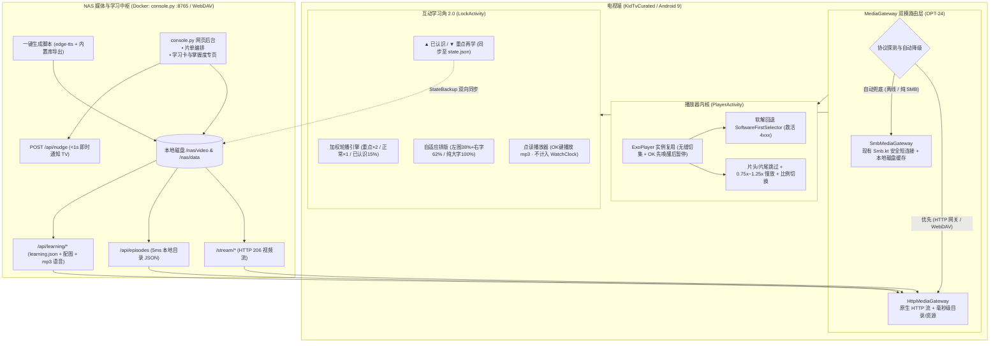

# KidTvCurated Wave 5 规划文档：轻量流媒体网关、影音越级与互动学习角 2.0
## 基于 v1.9.6(16) 基线，采纳「HTTP / WebDAV 优先，SMB 自动兜底」架构 + 学习角全面在线互动化

**文档版本**：`V2.0`（Wave 5 完整定稿版 · 含 `/grill-me` 学习角 2.0 决策）  
**基线代码**：`origin/main` @ `5ccbb84`（`v1.9.6(16)`）  
**基线状态**：Wave 0~4 全部完成（时长守卫、远程控制、周报、记录双向备份、异常落盘、设置页拆分、CI文案守卫、桌面启动器均已实机闭环；首页「继续看」已移除）  
**目标硬件**：海信 55E3F-MAX（VIDAA / Android 9 / API 28 / 2.5GB RAM / 1080p），兼容普通 Android TV / 投影仪  
**参考标杆与输入**：
1. `Selene-TV`（零体积软解回退、无缝连播、长按防穿透）
2. `LibreTV`（轻量流媒体网关代理、结构化分段跳过、探活熔断）
3. `docs/需求池.md`（RQ-001 学习配图与念诗、RQ-002 学习资源在线拉取与 APK 瘦身、RQ-003 视频海报卡缩窄）
4. **学习角 2.0 深度对齐结论（`/grill-me` 全票确认项）**

---

## 一、核心架构演进：双模媒体网关 + 互动学习角 2.0

### 1.1 现状盘点（学习区现有实现）
* **代码与资源现状**：
  * **文字写死在源码**：57 首唐诗（`Poems.kt`）、78 个英语单词（`Words.kt`）、70 张识字/成语（`Texts.kt`）、50 幅名画说明（`Arts.kt`）共 **255 张卡片**全部硬编码在 `app/src/main/kotlin/com/family/curated/data/builtin/` 中。
  * **图片占满安装包**：只有 50 幅名画带图，打包在 `app/src/main/assets/art/*.jpg`（共 **16 MB**），占了整个 26 MB APK 的 **62%**；唐诗、单词、识字全都是纯文字，无配图、无读音。
  * **零深度交互**：遥控器目前仅支持翻页与暂停，无法点读发音、无法标记「已认识 / 重点再学」。

### 1.2 学习角 2.0 架构设计（6 项核心拍板决策）

| 维度 | 拍板方案 | 技术实现要点 |
| :--- | :--- | :--- |
| **1. 资源解耦与瘦身** | **独立 `learning.json` + NAS 资源目录** | 与 `tv.json` 解耦，存放在 `data:curated/learning.json` 及 `learning/images/`、`learning/audio/`。APK 剥离 16MB 名画（**安装包从 26MB 降至 ~10MB**），TV 端本地缓存 JSON 与多媒体，断网照常可用。 |
| **2. 语音点读方案** | **后台预生成静态 `.mp3` + 支持上传真人录音** | 不依赖电视残缺的系统 TTS。由 PC/NAS 后台脚本（`edge-tts` 高质量神经语音）批量生成 `.mp3` 或家长上传真人录音；TV 端仅做轻量音频流/缓存播放，且**绝不计入 `WatchClock` 观看时长账本**。 |
| **3. 朗读内容规范** | **按题型定制语感文本（支持 `ttsText` 覆盖）** | • **唐诗**：诗名 + 朝代作者 + 诗句（不念白话注释，保持韵律）<br/>• **英语单词**：单词连读两遍 + 英文例句<br/>• **汉字/成语**：字词读音 + 组词/成语例句<br/>• **名画**：画名 + 画家 + 核心看点 |
| **4. 遥控器交互** | **◀ ▶ 翻页 + `OK` 点读 + ▲ ▼ 打标签** | • **◀ / ▶**：上一张 / 下一张<br/>• **`OK` 键**：立即播放当前卡片语音，并自动暂停本轮倒计时（读完恢复）<br/>• **▲（上键）**：标记 `✅ 已认识`（右上角亮绿色勋章）<br/>• **▼（下键）**：标记 `⭐ 重点再学`（右上角亮金色星标，再按一次取消） |
| **5. 智能轮播与同步** | **加权降频轮播 + `state.json` 双向同步** | • `⭐ 重点再学`：权重 ×2（优先高频出现）<br/>• `未标记`：正常权重 ×1<br/>• `✅ 已认识`：降频至 **15% 概率**抽查复习（艾宾浩斯防遗忘）<br/>• 标签存入 `Extras`（`ltag_<cardId>`），随 `StateBackup` 自动同步至 NAS `state.json`。 |
| **6. 图文排版与后台** | **左图 38% + 右大字 62% + `console.py` 专页** | • 有配图时采用**左图 38% + 右文 62%** 横向并排，大字隔 3 米依然清晰；无图时文字自动 100% 居中。<br/>• 在 `console.py :8765` 新增**「学习卡与掌握度」专页**，支持可视化增删改、一键生成/试听语音、上传配图/录音、查看与调整孩子的「已认识/重点」清单。 |

---

### 1.3 整体系统拓扑图（媒体网关 + 学习角 2.0）



---

## 二、Wave 5 完整任务矩阵（OPT-20 ~ OPT-33）

| 优先级 | 编号 | 任务名称 | 归属模块 | 核心涉及文件 | 改动量 | 预期收益 |
| :---: | :---: | :--- | :--- | :--- | :---: | :--- |
| **P0** | **OPT-20** | **剧集列表两级缓存 (Stale-While-Revalidate)** | 资源与加载 | `Repo.kt`<br/>`EpisodesActivity.kt`<br/>`Store.kt` | 小 (~65行) | 181 集目录从 **5.3s 降至 <50ms 秒开**，彻底消除进剧集页的白屏等待。 |
| **P0** | **OPT-21** | **零体积软解回退 (`SoftwareFirstSelector`) + 无效后缀清理** | 播放内核 | `PlayerActivity.kt`<br/>`Repo.kt`<br/>`console.py` | 小 (~55行) | **0 体积增加**救活 4xxx 解码崩溃；剔除无法播放的 `rmvb`/`iso`。 |
| **P0** | **OPT-22** | **播放器实例复用无缝连播 + OK 键先唤醒后暂停** | 播放内核 | `PlayerActivity.kt` | 小 (~50行) | 自动连播/换集**告别黑屏闪烁与 Activity 重建**；看进度不误暂停。 |
| **P0** | **OPT-23** | **NAS 端轻量 HTTP 媒体网关接口** | 协议演进 | `tools/console.py`<br/>`tools/test_launcher.py` | 中 (~90行) | 开放 `/stream/*` (HTTP 206) 与 `/api/episodes`，NAS 本地 5ms 出目录。 |
| **P0** | **OPT-28A** | **学习角 2.0 数据层：`learning.json` 在线拉取 + 本地缓存 + APK 剥离 16MB** | 学习角 2.0 | `Learning.kt`<br/>`ArtImages.kt`<br/>`tools/export_learning.py` | 中 (~110行) | 导出 255 张内置卡与语音/配图生成脚本；剥离 `assets/art/`，**APK 从 26MB 降至 ~10MB**。 |
| **P0** | **OPT-28B** | **学习角 2.0 交互层：左图右字排版 + OK 键点读 + ▲▼ 打标签与智能降频** | 学习角 2.0 | `LockActivity.kt`<br/>`activity_lock.xml`<br/>`LearningMath.kt`<br/>`StateMerge.kt` | 中 (~140行) | 支持左图38%+右字62%、OK 点读发音、▲已认识(15%抽查)/▼重点再学(优先)，标签随 `state.json` 备份。 |
| **P1** | **OPT-28C** | **网页控制台「学习卡与掌握度」专页** | 学习角 2.0 | `tools/console.py`<br/>`tools/static/index.html` | 中 (~150行) | 可视化管理学习卡、一键生成/试听 TTS 语音、上传配图或真人录音、查看并修改孩子掌握标签。 |
| **P1** | **OPT-24** | **TV 端 `MediaGateway` 双模路由（HTTP/WebDAV 优先，SMB 兜底）** | 协议演进 | `data/MediaGateway.kt`<br/>`PlayerActivity.kt`<br/>`Repo.kt` | 中 (~120行) | 优先走高并发无锁 HTTP；网关不可达时**无感透明降级为 SMB**。 |
| **P1** | **OPT-25** | **片头/片尾结构化跳过 (`skipIntroSec` / `skipOutroSec`)** | 播放体验 | `Model.kt`<br/>`PlayerActivity.kt`<br/>`console.py` | 中 (~85行) | 连播自动跳过重复片头曲和片尾字幕，精准计入 85% 完播打卡。 |
| **P1** | **OPT-26** | **慢放倍速 (`0.75x~1.25x`) 与画面比例切换 (`FIT/ZOOM`)** | 播放体验 | `PlayerActivity.kt`<br/>`activity_player.xml` | 中 (~75行) | 英语儿歌支持 **0.75x 慢速跟读**（不干扰真实时长记账）；4:3 老动画全屏铺满。 |
| **P1** | **OPT-27** | **首页视频海报卡尺寸缩小约 25%~30%（RQ-003）** | 界面布局 | `item_poster.xml`<br/>`MainActivity.kt` | 小 (~35行) | 一屏海报由 4 张提升至 5~6 张，保持焦点放大 `1.10f` 边距安全。 |
| **P2** | **OPT-29** | **TV 端内置轻量 HTTP 扫码配网与 `<1s` 实时推送** | 运维配网 | `SettingsActivity.kt`<br/>`console.py` | 中 (~120行) | 首次开机手机扫码配网；网页保存片单/学习卡 `<1s` 电视即时刷新。 |
| **P2** | **OPT-30** | **首页卡片长按管理菜单 (`CardContextMenu`) + 1080p 密度锁定** | 家长管理 | `MainActivity.kt`<br/>`Store.kt` | 中 (~80行) | 家长长按卡片输 PIN 直接「标记今日已学完」；`adjustDensity` 锁定 1080p。 |

---

## 三、学习角 2.0 详细技术规范（OPT-28A / 28B / 28C）

### 3.1 `learning.json` 数据模型扩展
在保持向后兼容的前提下，`LearningCard` 新增 `id`、`audio`、`ttsText` 字段：
```json
{
  "version": 2,
  "intervalSeconds": 20,
  "order": ["poem", "word", "art", "text"],
  "stage": 1,
  "stageSize": 50,
  "cards": [
    {
      "id": "poem_001",
      "type": "poem",
      "title": "静夜思",
      "sub": "唐 · 李白",
      "lines": ["床前明月光，疑是地上霜。", "举头望明月，低头思故乡。"],
      "note": "月夜思乡：抬头看明月，低头想念故乡。",
      "image": "learning/images/poem_001.jpg",
      "audio": "learning/audio/poem_001.mp3",
      "ttsText": "静夜思，唐，李白。床前明月光，疑是地上霜。举头望明月，低头思故乡。"
    },
    {
      "id": "word_apple",
      "type": "word",
      "title": "apple",
      "sub": "/ˈæp.əl/ · n.",
      "lines": ["I eat a red apple every day."],
      "note": "苹果 · 我每天吃一个红苹果",
      "image": "learning/images/word_apple.jpg",
      "audio": "learning/audio/word_apple.mp3",
      "ttsText": "apple. apple. I eat a red apple every day."
    }
  ]
}
```
* **稳定 ID 生成（`LearningMath.cardId(card)`）**：若 JSON 未显式填 `id`，自动按 `"${card.type.key}_${card.title.trim().lowercase()}"` 生成确定性 ID，确保打标签（`ltag_<id>`）跨设备同步不乱。

### 3.2 掌握度状态机与加权降频算法（`LearningMath.kt` 纯函数 + 单测）
* **三种掌握状态（`CardMastery`）**：
  * `UNMARKED (0)`：默认未标记，正常轮播（权重 `1.0`）。
  * `LEARNING (-1)`：按 **▼（下键）** 标记为「`⭐ 重点再学`」，在轮播池中复制 2 份（权重 `2.0`），优先高频强化。
  * `MASTERED (1)`：按 **▲（上键）** 标记为「`✅ 已认识`」，每次构建轮播序列时仅以 **15% 概率**抽中进入本轮复习池（若池中全部卡片均已掌握，则保底保留全部卡片轮播，绝不出现空列表）。
* **`state.json` 双向同步**：
  * 在 `Extras` 中以 `ltag_<cardId>` 存储（值为 `1` 或 `-1`），同时记时间戳 `ltag_ts_<cardId>`。
  * `StateMerge` 采用 **LWW（Last-Write-Wins，按时间戳取最新）** 策略合并本地与 NAS `state.json`，家长在网页后台改了某个字的掌握状态，或孩子在电视上按了 ▲/▼，两边自动同步。

### 3.3 锁屏学习角 UI 与点读交互（`LockActivity.kt` & `activity_lock.xml`）
1. **自适应左右分栏卡片内容区（`cardBody`）**：
   * **名画卡（`ART`）**：保持整幅画居中大图 + 底部看点。
   * **唐诗/单词/识字（`POEM` / `WORD` / `TEXT`）**：
     * **当 `c.image` 存在且加载成功**：左侧 `38%` 显示圆角配图（`ivCardIllust`），右侧 `62%` 显示大字标题、音标/作者与正文行（3米外清晰可读）。
     * **当 `c.image` 为空或未加载出**：隐藏左侧配图框，右侧文字区自动占满 `100%` 居中显示。
2. **右上角状态勋章与底部操作提示**：
   * 卡片顶栏右侧（序号旁）新增 `tvCardMastery` 勋章：显示 `✅ 已认识`（绿底白字）或 `⭐ 重点再学`（金底黑字），未标记时隐藏；若有配音文件，显示 `🔊` 图标提示可点读。
   * 底部提示栏更新为：`◀ ▶ 换一张 · OK 朗读 · ▲ 认识了 · ▼ 再学学`。
3. **点读播放器（`CardAudioPlayer`）**：
   * 使用轻量 `MediaPlayer`（或复用局部单轨音频播放器）播放本地缓存或 HTTP/SMB 拉取到的 `.mp3`。
   * **按 `OK` 键时**：
     * 开始播放当前卡片语音，同时**自动暂停本张卡片的 20s 轮播倒计时**（避免读到一半突然翻页）；语音播完后自动恢复倒计时。
     * 若正在朗读时孩子按 `◀ / ▶` 切换卡片，立即停止当前语音并切换。
     * **严守红线**：点读播放器完全独立于 `PlayerActivity`，**绝不调用 `WatchClock.start()`**，不会消耗孩子哪怕 1 秒钟的每日看片额度。

### 3.4 后台一键语音/题库生成工具与 Web 专页（`tools/`）
1. **`tools/export_learning.py`（初始化与批量生成工具）**：
   * 一键将现有 Kotlin 内置的 255 张卡片（57 首诗 + 78 单词 + 50 名画 + 70 识字）及 50 幅名画图片导出到 NAS 的 `curated/learning.json` 和 `curated/learning/images/`。
   * 调用 `edge-tts`（微软晓晓/云希中文神经语音 + Jenny 美式英语语音）按 3.1 节的语感规则，一键为全部 255 张卡片生成高音质 `.mp3` 存入 `curated/learning/audio/`。
2. **`console.py` 新增「学习卡与掌握度」Tab**：
   * **统计概览**：展示各分类（唐诗/英语/汉字/名画）总数、`✅ 已认识` 数量、`⭐ 重点再学` 数量及掌握进度条。
   * **卡片管理**：按分类/掌握状态筛选，支持在线新增/编辑卡片、上传配图、上传家长/孩子真人录音 `.mp3`、或点击「重新生成语音」。
   * **掌握度干预**：家长可在网页上一键把某张卡标为「重点再学」或重置为「未掌握」，保存后通过 `StateBackup` / `learning.json` 同步至电视。

---

## 四、实施顺序（3 个 Sprint 稳步推进）

```mermaid
timeline
    title KidTvCurated Wave 5 实施路线图
    section Sprint 1 : 学习角 2.0 与 HTTP 网关基座 (P0)
        OPT-28A 学习库导出与语音生成脚本 : learning.json + 255条 mp3 + APK 瘦身 16MB
        OPT-28B 锁屏左图右字 + OK点读 + ▲▼打标签 : 智能降频轮播 + state.json 同步
        OPT-23 NAS 端 console.py 流媒体与学习接口 : /stream/* + /api/episodes + /api/learning
        OPT-20 剧集列表两级秒开缓存 : 181 集 5.3s -> 50ms
    section Sprint 2 : 播放内核越级与后台学习专页 (P0 + P1)
        OPT-21 & OPT-22 软解回退 + 无缝连播 + OK键唤醒 : 救活 4xxx 视频 / 切集零黑屏
        OPT-24 TV 端 MediaGateway 双模路由 : HTTP/WebDAV 优先，SMB 自动兜底
        OPT-28C 网页控制台「学习卡与掌握度」专页 : 可视化编辑 + 录音上传 + 掌握看板
        OPT-25 & OPT-26 & OPT-27 跳片头 + 慢放 + 海报缩窄 : 0.75x 英语跟读 + 一屏 5~6 张海报
    section Sprint 3 : 扫码配网与快捷管理 (P2)
        OPT-29 TV 端轻量 HTTP 扫码配网与 <1s 实时推送 : 告别遥控器打字与 ADB 依赖
        OPT-30 卡片长按管理菜单 + 1080p 密度锁定 : 电视端一键标今日已学完
```

---

## 五、工程守卫与验收标准
1. **文案守卫零突破**：所有新增界面文案统一收口至 `res/values/strings.xml`，`python tools/check_strings.py` 保持全绿。
2. **纯函数单元测试**：新增 `LearningMathTest.kt`（覆盖 ID 生成、加权降频抽样、全掌握保底、标签 LWW 合并），确保 CI 三个 Job 全绿。
3. **离线韧性红线**：即使 NAS 断电或未启动 `console.py`，电视端依靠本地持久化的 `learning_cache.json` 与已缓存的图/音文件，锁屏学习角依然 100% 正常轮播、翻页、打标签，绝不白屏或崩溃。
