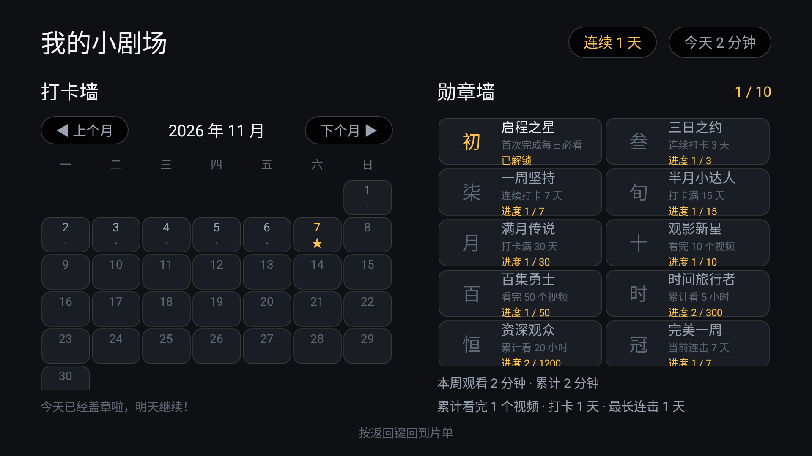

# 小剧场 使用说明书

**适用版本**：V1.9（2026-11-11）　**适用设备**：海信 55E3F-MAX（VIDAA / Android 9）+ 绿联 UGOS Pro NAS
**这份说明书给谁看**：家长。孩子不需要看，他只需要遥控器的方向键和 OK。

---

## 0. 一分钟速查

| 我想…… | 怎么做 |
|---|---|
| 给孩子加一部新动画 | 在电脑上双击项目里的 **`小剧场.bat`** 打开统一启动页 → 点「极简编辑器」→ 重新读取 → 添加条目 → 保存到 NAS |
| 换掉今天的必看 | 编辑器里改「今天要看的」分区的条目 → 保存 |
| 让孩子九点后不能看 | 电视：家长控制 → 时间与时长 → 周末/平日时段 |
| 每天最多看 1 小时 | 电视：家长控制 → 每日上限 → 60 |
| 做完任务多给 10 分钟 | 电视：家长控制 → 时间与时长 → 完成奖励 → 10 |
| 想知道这周孩子看了多久 | 电视：家长控制 → 概览 → 本周报告 |
| 电视出问题、想留个线索 | 电视：家长控制 → 维护 → 诊断日志（或直接看 NAS 的 `curated/logs/`） |
| 我自己要看电视 | 遥控器菜单键 → PIN → 退出到桌面（30 分钟内不回弹） |
| 孩子被锁屏了，想再给 15 分钟 | 锁屏上直接按 PIN 四个数字 |
| 改完片单电视没反应 | 等 15 秒；还没有就菜单键 → 重新读取清单 |
| 封面是灰的 | 双击 `tools/make-covers.bat`，或编辑器里「选图」 |
| 视频全黑、连优酷也没画面 | **把电视电源拔掉再插上**（不是只重启 App） |
| 忘了家长密码 | 见第 11.4 节（先试 1234） |
| 电脑上三个工具不知道开哪个 | 双击 `小剧场.bat`，启动页三张卡片写了各自适合什么 |

---

## 1. 小剧场是什么

一句话：**电视上只出现你挑过的内容，孩子每天先看完你指定的几集，才能看动画片。**

它和你用过的视频 App 有三点根本不同：

| 普通视频 App | 小剧场 |
|---|---|
| 首页推荐、自动连播、广告 | 只有你写进片单的内容，没有推荐流 |
| 内容在平台服务器上 | 视频就在你家 NAS 上，走局域网直读 |
| 你管不了「看多久、看什么」 | 时段、时长、必看门禁、儿童锁都由你定 |

它**不会**做的事，请先知道，免得误会：

- 不会联网刮削海报，也不会自动从视频里截封面。没配封面就是一张灰卡（第 7.6 节教你补）。
- 不会扫描全盘。NAS 里没写进 `tv.json` 的视频，电视上永远看不到。
- 不是万能的“锁”。Home 键靠“设为默认桌面”解决，输入源/电源这类硬件键拦不住（第 8 节说明）。

---

## 2. 开始之前

### 2.1 你需要有

| 东西 | 说明 |
|---|---|
| 电视 | Android 电视即可（本项目实测海信 55E3F-MAX，Android 9） |
| NAS | 开启 SMB 服务（445 端口）；一个可写共享（本项目用 `data`） |
| 电脑 | Windows，用来改片单；手机浏览器也可以 |
| 网线 / WiFi | 电视和 NAS 在同一个局域网 |

### 2.2 三个关键位置（记住这三行就够）

```
视频文件：    NAS 共享「儿童资源」下的任意目录（只读没关系）
片单文件：    NAS 共享「data」→ curated/tv.json      ← 唯一的“遥控器”
备份文件：    NAS 共享「data」→ curated/tv.backup.json ← 每次保存自动生成
```

片单 = 一份 JSON 文件。**你在电脑上改它，电视就跟着变**，不需要重装 App、也不需要拿遥控器操作。

### 2.3 电视上的 App

| 项 | 值 |
|---|---|
| 名称 | 小剧场 |
| 包名 | `com.family.curated` |
| 安装包 | 项目根目录 `小剧场.apk`，或 `app/build/outputs/apk/debug/app-debug.apk` |

---

## 3. 第一次安装（三件事）

### 3.1 装 APK

**方法一：用 adb（推荐，能顺带设默认桌面）**

```bash
adb connect 192.168.31.147:5555
adb install -r 小剧场.apk
```

电视需要先打开「网络 ADB 调试」（开发者选项里）。adb 显示 `offline` 时：

```bash
adb disconnect 192.168.31.147:5555
adb connect 192.168.31.147:5555
```

**方法二：U 盘**：把 APK 拷到 U 盘，插电视，用电视自带的文件管理器安装（需允许“未知来源”）。

### 3.2 第一次打开，确认能读到片单

打开后应该看到海报墙。如果显示「请在 NAS 的共享文件夹里放一份清单」：

1. 确认 NAS 上真的有 `data/curated/tv.json`；
2. 确认 `tv.json` 里的 `nas` 段账号密码正确；
3. 确认 NAS 的 SMB 服务开着、445 端口通。

### 3.3 立刻做两件事（强烈建议）

1. **改家长密码**：主界面右上「家长控制」→ 输 `1234` → 规则 → 家长密码 → 改成你自己的 4–8 位数字。
2. **决定要不要开儿童锁**：不做也能用，孩子按 Home 会回到别的桌面。要做见第 8 节。

---

## 4. 电视上都有什么

### 4.1 主界面（海报墙）


> 这张是较早的实拍，当前版本顶栏在「我的奖励」旁边还多了「家长控制」按钮。

顶栏从左到右：

| 元素 | 含义 |
|---|---|
| 「今天要看的」/ 鼓励语 | 完成必看后会变成「今天的都做完啦」之类 |
| **我的奖励** | 进打卡墙 + 勋章墙；有新勋章时显示「· N 枚新勋章」 |
| **家长控制** | 要 PIN；进设置页（改时段、上限、密码） |
| 今天 X/60 分钟 | 今日已看时长 / 上限；没设上限只显示已看 |
| 状态文字 | 例如「必修还剩 3 个」「必修已完成 5/5」 |

主体是一行行分区。每行标题右边显示这一行有几个条目。被锁住的分区，卡片上有锁标和「还差 N 个才解锁」。
家长在编辑器里给分区选了图标，标题前面就会出现一个小图标（星星 / 播放 / 书本 / 爱心 / 游戏 / 月亮）。

顶栏下面还有一条**「今天任务 0/3」进度条**：有几个必看条目就分成几格，看完一个涨一格。
没配「每日必看」分区时这一行会自动收起。

最上面可能会出现一个「**继续看**」分区：把最近没看完的最多 5 部片摆在这里，点开接着上次的进度播。
它不会因为你调整片单顺序而指错片，片单里删掉的内容也不会赖着不走。

### 4.2 剧集列表

点整季的卡片（如「汪汪队立大功」）进入，显示「共 85 个」，一集一行，看过的有进度条。上下选、OK 播放、返回回主界面。

打开「自动连播」后，一集播完会先浮出 5 秒倒计时「下一集：xx」：
**按返回键取消**（回到这一季的列表），**按确认键马上播**，什么都不按就自动接下一集。
到每日上限 / 时段结束时照样停并锁屏，连播不会变成「多看一会儿」的后门（详见 7.3）。

> 如果显示「读取超时」，按一下 OK 重试即可，不需要重启 App。

### 4.3 播放页

| 按键 | 作用 |
|---|---|
| OK | 暂停 / 继续 |
| 左 / 右 | 快退 / 快进 15 秒 |
| 返回 | 退出播放（进度自动记住） |

- 下次进来从上次的位置继续。
- **右上角有个小角标，写「今天还剩 12 分钟」**：它说的是最早会到点的那件事（每日上限、时段结束、临时放行结束或家长远程锁定），不一定只按今天的分钟数算。剩 5 分钟、1 分钟会各提醒一次，同一天不会反复念叨。想关掉：家长控制 → 系统 → 剩余时间预告。
- **必看分区的视频不能跳着看**：系统记住你“真正连续看到的最远位置”，快进越界会被拉回并提示。看过的部分可以回看。
- 播放出错时屏幕会显示「正在自动重连 1/3」之类，多数情况自己会好；彻底失败会按错误类型提示，按 OK 可重试。
- **一集看完会自己接下一集**：屏幕中间先出一条「5 秒后播放 第 2 集」的浮层，按返回键可以取消。
  连播不会绕过任何限制 —— 到点（额度用完 / 时段结束 / 家长远程锁屏）照样立刻锁屏，只是不用孩子自己回去点。
  不想连播：家长控制 → 系统 → 自动连播，或在编辑器「规则 → 功能开关」取消勾选，15 秒生效。

### 4.4 我的奖励（打卡墙 + 勋章墙）



- **打卡墙**：每天必看全部完成，当天自动盖一个章。月份可翻页，右上角显示「连续 N 天」。
- **勋章墙**：10 枚勋章，按累计打卡、连击、观看时长、视频数解锁。新解锁的勋章在主界面按钮上挂小红点。
- 遥控器「信息 / 指南」键可以从任何界面直接跳到这里。

### 4.5 锁屏与学习角

到了不可用时段，或今天的时长用完，会出现锁屏：


- **左边 42%**：大大的倒计时，告诉你还有多久能看（隔几米也看得清）。
- **右边 58%**：学习角，自动轮播唐诗、英语单词、名画、识字卡。
  - 遥控器 ◀ ▶ 可以手动翻一张；
  - 播放/暂停键可以暂停轮播；
  - 每张停留 20 秒（可改）。
- 内置 **255 张**卡片，断网也能用：57 首唐诗、78 个单词（A–Z 每字母 3 个）、50 幅名画、70 张识字/成语/短句。

### 4.6 家长控制（电视上直接改设置）

主界面「家长控制」→ 输 PIN → 两列设置页。方向键选，OK 改，返回回片单。

| 分组 | 能改什么 |
|---|---|
| 概览 | **本周报告**（近 7 天时长条形图、打卡、反复看、看到一半） |
| 时间与时长 | 每日上限（0/20/30/45/60/90/120/自定义）、平日时段、周末时段、时段限制开关、**完成奖励**（必看全做完额外加几分钟） |
| 规则 | 家长密码（4–8 位）、看完判定（80%–100%）、应用入口 |
| 维护 | 临时放行、今天全部重来、清空播放进度、重新读取清单、退出到桌面 |
| 系统 | 外部应用计时开关（显示精确 / 估算模式）、后台拉回开关、**剩余时间预告开关**、**远程控制开关**、**自动连播开关**、**本周报告入口开关**、电视时间校准（只有时间被改过才出现）、版本与构建时间 |

**这里改的东西会写回 NAS 的 `tv.json`**，所以电视和电脑上看到的永远是同一份配置。写入前会自动备份 `tv.backup.json`，写完会回读校验。

**如果 NAS 写不进去**（共享只读、磁盘满、NAS 离线），页面顶部会出现一条**红色的错误条**，还会多出一组「未同步的修改 → 重试保存到 NAS」。这时候电视本机**也没有改**，两边都保持旧设置，不会“界面改好了、下次同步又偷偷变回去”。点重试行可以选：

| 选项 | 什么时候用 |
|---|---|
| 覆盖 NAS | 故障排除了（NAS 恢复可写），想把刚才那次改动补写进去 |
| 放弃这次修改 | 不想改了，继续用 NAS 上那份设置 |
| 稍后再说 | 先留着红色提示，等会儿再处理 |

> 如果这期间你又在**电脑上动过片单**，电视会拒绝「覆盖 NAS」，免得把网页上的改动抹掉；这时重新在电视上设一次就行。

页脚一直显示 `v1.9(10) 11-11 18:30`，报问题时先把这个念给我听，能省掉一半排查。

> 小提示：遥控器没有 TAB 键，输入框里输完直接按 OK 就是“确定”。

---

## 5. 遥控器速查

| 场景 | 按键 |
|---|---|
| 主界面选片 | 上/下选分区，左/右选卡片，OK 进入 |
| 播放 | OK 暂停，左/右 ±15 秒，返回退出 |
| 家长菜单 | **菜单键** → 输 PIN |
| 锁屏时临时放行 | 直接按 PIN 数字（不用先按菜单） |
| 锁屏时翻学习卡 | ◀ ▶（或 ▲ ▼ / OK） |
| 锁屏时暂停轮播 | 播放/暂停键 |
| 打卡墙 / 勋章墙 | 信息 / 指南键 |

---

## 6. 孩子的一天（正常流程长什么样）

1. **17:30** 打开电视，主界面第一行「今天要看的」有 5 集，下面「动画片」「纪录片」「学习」都带锁。
2. 一集一集看完，右上角从「必修还剩 5 个」变成「必修已完成 5/5」。
3. 完成后：今天盖章、可能解锁新勋章、下面三个分区解锁。
4. 孩子去「动画片」挑一部，进入剧集列表选集。
5. **20:30** 或累计看满 60 分钟，画面切到锁屏：左边倒计时，右边开始放名画和唐诗。
6. 想再看？只能等明天，或者家长来输 PIN 放行 15 分钟。

---

## 7. 家长日常操作

> **电脑上现在只要记一个入口**：双击项目根目录的 **`小剧场.bat`**（可以给它建个桌面快捷方式），
> 会打开一个启动页，列出「极简编辑器 / 网页控制台 / PC 桌面助手」三张卡片，
> 各自写着适合什么用、当前有没有在跑，点一下就打开。
> **三个工具的功能没有合并**，只是入口收在一起；原来的三个 bat 也还能单独用。
> 下面 7.1 走的是最常用的「极简编辑器」。

### 7.1 加一部新动画（最常用，6 步）

先确认：视频已经拷进 NAS 的「儿童资源」共享里（`儿童资源/儿童视频/99.娱乐动画/新动画/...`）。

1. 电脑上双击 **`小剧场.bat`** 打开统一启动页，点 **「极简编辑器」** 的「启动并打开」，浏览器会打开 `127.0.0.1:8787`。（也可以继续双击旧的 `start-tvjson-editor.bat`，效果一样。）
2. 点顶部 **「重新读取」**。**这一步别省**——先读一遍，才不会把别人刚改的内容覆盖掉。
3. 找到「动画片」分区，点 **「＋ 添加条目」**。
4. 类型选 **folder（整季）**，点「浏览」逐层进入 NAS，选中剧集目录。
5. 填标题（电视上显示的名字），副标题可选（如「26 集」）。
6. 点 **「保存到 NAS」**。等 15 秒，电视上就出现了，不用碰遥控器。

> 加单集就选 **file**；想加一个别的 App 的入口就选 **app**。
> 编辑器顶部会显示当前清单，例如「192.168.31.72 · data:curated/tv.json · N 字节 · 4 分区 / 27 条目」。

### 7.2 调整顺序、换必看

- 在分区里用 **上移 / 下移** 调条目顺序（电视上就是这个顺序）。
- 分区顺序也是同理：分区的上下位置决定电视上第几行。
- 想让某个分区变成“每天必须先看”：在分区卡片上勾选 **「每日必看 gate」**（默认「今天要看的」已经勾上）。
- 想让「动画片」必须做完必看才能进：在它的分区卡片「解锁依赖 requires」里填 **`daily`**（即必看分区的 `key`）。
- 想让某个分区每天自动换一批：分区卡片里填 **「自动轮换 auto」**，如 `{"folder": "儿童视频/99.娱乐动画/Maisy", "count": 2}`。
- 想完全取消门禁：把所有分区的 `gate` 和 `requires` 删掉。

> 放心调顺序：条目的身份是按**路径**记的，不是按位置。上移下移不会让封面或观看进度错位。

### 7.3 设置“几点能看、能看多久”

**推荐在电视上改**（改完立刻生效，也会同步到 NAS）：

家长控制 → 时间与时长：

| 项 | 例子 | 说明 |
|---|---|---|
| 每日上限 | 60 | 只算真正播放的时间，暂停不算；0 = 不限 |
| 平日时段 | 17:30–20:30 | 周一至周五 |
| 周末时段 | 09:00–11:30、16:00–23:30 | 周末可以两段 |
| 时段限制 | 开 / 关 | 关掉就只看时长，不看时间 |

也可以在电脑上改 `tv.json` 的 `schedule` 段：

```json
"schedule": {
  "enabled": true,
  "weekday": [["17:30", "20:30"]],
  "weekend": [["09:00", "11:30"], ["16:00", "23:30"]],
  "dailyLimitMinutes": 60,
  "lockMessage": "电视休息时间，先去玩会儿别的吧"
}
```

规则：
- 结束时间比开始时间早 = 跨零点（如 `"22:00-01:00"`）。
- 不写 `weekend` = 周末跟平日一样；写 `[]` = 周末全天开放。
- `enabled: false` 或整段删掉 = 完全不限制。

**想给「做完任务」一点奖励**：家长控制 → 时间与时长 → **完成奖励**，选 5/10/15/20/30 分钟或自定义
（0 = 关闭，最多 120）。当天的必看全部看完，今天的额度就多这么多，孩子会看到一句
「今天全部完成，奖励 10 分钟，可以多看一会儿啦」，首页时长也会写成 `12/70 分钟（含奖励 10 分钟）`。

几个边界，先说清楚免得误会：

- **只加时间，不放宽时段**。时段外照样进不去，奖励不是「免死金牌」。
- **一天只发一次**。中途家长把奖励从 10 改成 20，当天就按 20 算，不会变成 30。
- **片单里没有必看分区时不发**。「没有任务」不等于「一秒完成」。
- **和「临时放行」互不影响**。临时放行是你手动开的窗口，会过期；奖励记在当天额度上，
  孩子吃完晚饭回来还在。两条各算各的，不会互相覆盖。
- 每日上限设成 0（不限制）时，奖励不产生任何效果（本来就没上限可加）。

### 7.4 改家长密码、看完判定

电视：家长控制 → 规则。

- **家长密码**：4–8 位数字。默认 `1234`，**一定要改**。
- **看完判定**：进度到多少算“看完”，默认 92%。孩子总差一点就卡住的，可以调到 85%；想更严格就 100%。

### 7.5 让某个 App 出现在电视上（可选）

比如允许孩子用「识字小游戏」或「优酷」：

1. 电视：菜单键 → PIN → **「选择允许显示的应用」**，OK 多选，保存。
2. 主界面最后会多一行「应用」，点开临时放行，到时间/按 Home/按返回就回小剧场。
3. 想让它“做完必看才出现”：`apps.showAfterDaily` 保持 `true`（默认），没做完时卡片显示「还差 N 个才解锁」。

也可以在编辑器「应用入口」卡片里改，点「从电视读取并勾选」能看到电视上装了什么。

> 注意：家长在电视上勾选的结果**优先于**网页里的列表。网页改完看不到时，去电视菜单点一次「恢复清单里的应用列表」。
> 新版 App 在网页改动 `apps` 段后会自动清掉本地勾选，通常不需要手动点。

### 7.6 换 / 补封面

App 只认 NAS 上现成的图片，不会自己截图。三条路，按省事程度排：

1. **一键截帧（推荐）**：双击 `tools/make-covers.bat`（等价于 `python tools/make_covers.py --from-nas --apply`）。
   它会为每个没封面的条目找一个视频，在 20% / 45% 处截一帧，拼成竖版海报，上传到 `data/curated/covers/`，再写回清单。
   - 只处理没有封面的条目；想全部重做加 `--force`。
   - 重复跑不会堆垃圾文件（文件名按路径 hash 固定）。
2. **用现成图片**：把图放进视频目录，命名成和视频同名 `.jpg`，或目录里放 `folder.jpg` / `poster.jpg` / `cover.jpg` / `封面.jpg`。
3. **手动指**：编辑器条目行的封面框里点「选图」，在 NAS 上点一张，自动写成 `共享名:路径`。

> 视频共享是只读的也没关系：封面统一放可写的 `data` 共享，写法是 `"cover": "data:curated/covers/xxx.jpg"`。

### 7.7 学习角怎么换内容

在编辑器的「高级字段」里改（`learning` 段整体是一个 JSON），或者用网页控制台「等待学习角」页（有可视化表单）：

| 想做的事 | 怎么改 |
|---|---|
| 只让孩子先学第一批 | `stage: 1`、`stageSize: 50`（每类前 50 张，一轮约 200 张） |
| 熟悉后进下一批 | 把 `stage` 改成 `2` |
| 不想分阶段 | 两项都改回 `0`（255 张全上） |
| 只出单词 | `order: ["word"]`（写几类就只出几类） |
| 每张停久一点 | `intervalSeconds: 30`（6–600 秒） |
| 换成家庭相册 / 孩子画作 | `artFolder: "curated/art"`、`artShare: "data"`，把图片放进 NAS 这个目录 |
| 加自己的卡片 | 网页控制台「等待学习角」页底部「自定义卡片」，按唐诗/单词/名画/识字四类添加 |

### 7.8 完全不想限制

把 `schedule` 整段删掉，或设 `"enabled": false`。锁屏和学习角都不会再出现，门禁（`gate` / `requires`）也删掉后就是纯点播。

### 7.9 在电脑上远程控制电视（不用走到电视前面）

网页控制台或简易编辑器里有一个 **「远程控制」** 页，能发四种指令：

| 按钮 | 电视上发生什么 | 最长多久生效 |
|---|---|---|
| 立即锁屏 | 直接出现锁屏页，孩子不能再点播 | 15 秒 |
| 解除锁定 | 撤销刚才的远程锁屏 | 15 秒 |
| 加 N 分钟 | 临时放行 N 分钟（最多 240），即使在不可用时段也能看 | 15 秒 |
| 暂停播放 | 当前视频暂停，遥控器 OK 可继续 | 15 秒 |

**第一次用要先开开关**：编辑器「规则 → 功能开关」勾选 **远程控制**，或电视上「家长控制 → 系统 → 远程控制」。开关默认关，改完 15 秒生效。

页面上会显示电视写回来的**回执**（`control.ack.json`），例如「已生效 · 立即锁屏 · 23:11:53」。看到回执才说明电视真的收到了；只显示「已发送」说明还在等下一次 15 秒轮询。

几个要注意的：

- 指令写在 `control.json`，和片单 `tv.json` **是两个文件**。改控制指令不会碰坏片单。
- 同一条指令只执行一次；想再锁一次，重新点一下按钮（会生成新的时间戳）。
- 加时和「立即锁屏」互斥：加了时间会自动解除远程锁定。
- 锁屏后也可以在电视上按菜单键 → 输 PIN → 临时放行解除，不必回电脑。
- 如果 `control.json` 写坏了（手改 JSON 打错括号），电视会忽略它，**不影响片单正常更新**，改对再保存即可。

### 7.10 记录备份（重装也不丢打卡）

电视会**自动**把打卡记录和「看到哪儿了」备份到 NAS 的 `data/curated/state.json`，
和片单是两个文件。备份时机是：App 退到后台、每 5 分钟、以及每天第一次打卡成功时。

想手动来一次：家长控制 → 维护 → **记录备份** → 「立即备份到 NAS」；
同一个弹窗里还有「从 NAS 恢复记录」。

**什么时候会问你要不要恢复**：重装 App、恢复出厂设置、或者在系统里「清除数据」之后，
电视上一条打卡都没有、NAS 上却有备份，主界面会弹一次「发现上次的观看记录」：

| 选项 | 会发生什么 |
|---|---|
| 恢复 | 打卡墙、播放进度接回来，今天已经看过的时间也会算回去 |
| 稍后 | 这次不恢复，下次启动再问 |
| 不用了 | 不再问（记录仍然留在 NAS 上，随时可以去设置页手动恢复） |

几条设计上的讲究，知道原因就不容易误会：

- **今天已看的时长会自动补回来，不用你确认**。清数据就等于把「今天看了多久」清零，
  那等于白送孩子一段额度，所以这一项是静默合回的（只会让时间变少，不会变多）。
- **合并只升不降**：同一个视频两边都有进度时取更靠后的那个，打卡取并集。
  所以重复恢复、或者恢复一半断电再来一次，都不会把孩子的记录弄小。
- **反过来它不能用来「倒回去」**。想清空进度就用「维护 → 清空播放进度」，
  那个操作会立刻把空的记录写回 NAS，之后恢复也不会把旧进度带回来。
- 播放中不写备份（除非你正好退到后台）：没必要在孩子看得正顺的时候去动 NAS。
- `state.json` 删掉也没关系，过几分钟会自动重新生成，只是那段时间的记录补不回来。

### 7.11 本周报告（在电视上看这周怎么样）

家长控制 → 最上面 **概览 → 本周报告**（只读，改不了任何东西，放心点）。

一页里四块内容：

| 块 | 看什么 |
|---|---|
| 每天看了多久 | 周一到周日 7 根柱子。**金色 = 在小剧场里看的，蓝色 = 从应用入口进第三方 App 的时间**；虚线是每天上限，今天那根有描边；还没到的日子是灰色轨道 |
| 打卡 | 连续几天、最长连击、本周盖了几天章、累计打卡与累计看完 |
| 这周的小发现 · 反复看 | 这周有两天以上点开过的片子（最多 3 部），后面括号是「几天」 |
| 这周的小发现 · 看到一半 | 只看到 5%–60% 就退出的片子（最多 2 部），括号是看到多少 |

几个说明：

- **一条记录都没有时显示「这周还没有记录」**，不会显示一排 0。0 容易被读成「孩子一分钟没看」，
  而实际可能只是今天刚装好。
- **平均时长按「有记录的天」算**。周一打开不会显示「平均 5 分钟」——那是被后面 6 个空白天拉出来的。
- 第三方应用那段是**按时长估算**的（这台电视系统不给实时精确值），图下面会写明。
  数字和设置页「今日 x 分钟」是同一本账，不会对不上。
- 「反复看 / 看到一半」里的名字优先用你在片单里填的标题；如果那部片已经从片单里删掉了，会显示文件名。
- 不想让这一页出现在设置页里：系统 → 本周报告 → 关闭（入口立刻消失，数据不会删）。

### 7.12 诊断日志（出问题时别再靠猜）

家长控制 → 维护 → **诊断日志**。

电视上出问题时（比如「说好 20 分钟，结果一直没锁」「开机没自己起来」「某个片子点进去黑屏」），
光凭描述很难判断原因。小剧场会自己把出错的瞬间记下来：

- **记什么**：程序里「本不该发生但没崩」的错误、以及真正的崩溃（带出错位置）。
  **不记**孩子看了什么片、不记路径、不记聊天内容。
- **记在哪**：先在电视自己的存储里（`filesDir/diag`），凑够一分钟自动传到 NAS 的
  `curated/logs/tv-YYYYMMDD.txt`。断网、NAS 关机期间也不会丢，等通了自动补传。
- **留多久**：每天一个文件，保留最近 7 天；单个文件最多 200 KB，写满就丢最旧的行。

这一页能做什么：

| 按钮 / 位置 | 作用 |
|---|---|
| 第一行文字 | 「待上传 N 条」说明还有多少没传上去；后面是上次上传的时间 |
| 最近的记录 | 最近 3 条，看一眼就知道「是不是一直在报同一个错」 |
| 立即上传到 NAS | 不想等那一分钟就点它 |
| 清空本地日志 | 只清电视上待传的，NAS 上已经归档的不动 |

几个说明：

- **同一个错误一分钟只记一条**，否则一秒一条能把文件撑满，真正的第一条反而被挤掉。
  被合并的会在后面写「同类异常在此之前又出现了 N 次」。
- **程序崩了照样会崩**：日志只是留下证据，不会为了让日志好看而把崩溃吞掉 ——
  带着记错的账继续跑，比崩掉更糟。
- 需要把日志发给我看时，去 NAS 的 `curated/logs/` 里把当天的 txt 拷出来即可，
  不用教家里人在电视上摸索。

---

## 8. 儿童锁：不让孩子退回桌面

### 8.1 先理解一件事

Android 的 Home 键由系统独占，App 收不到也拦不住。所以“不让孩子出去”必须分三层做，只改 App 一定被绕过：

| 层 | 挡住什么 | 怎么做 |
|---|---|---|
| ① 应用内 | 返回键、设置/输入源/最近任务等能收到的功能键 | 片单里 `kiosk.enabled: true` |
| ② 默认桌面 | **Home 键** | 一条 adb 命令（见下） |
| ③ 前台守卫 | 被切到后台 | App 自带，约 1 秒拉回 |
| ④ 硬件键 | 输入源 / 直播 / 电源 | 拦不住：贴住按键，或换简易遥控器 |

### 8.2 开启

**第 1 步**：编辑器「高级字段」里给 `kiosk` 打开（或直接编辑 JSON）：

```json
"kiosk": {
  "enabled": true,
  "exitComponent": "com.jamdeo.tv.vod/com.ju.main.launcher.LauncherActivity",
  "exitMinutes": 30,
  "reentryMs": 1000,
  "blockBack": true,
  "blockSystemKeys": true
}
```

保存到 NAS。`exitComponent` 是家长“退出到桌面”时打开的那个桌面（上面这个是海信原生桌面）。

**第 2 步**：电脑上执行（只需一次）：

```bash
adb shell cmd package set-home-activity --user 0 com.family.curated/.MainActivity
adb shell cmd package resolve-activity --brief -a android.intent.action.MAIN -c android.intent.category.HOME
```

第二条命令应该直接返回 `com.family.curated/.MainActivity`。如果返回 `ResolverActivity`，说明没写死，再执行一次第一条。

**第 3 步（如果装过 Aerial 桌面）**：Aerial 会不断把自己抢回桌面，必须停用它（可逆）：

```bash
adb shell cmd package disable-user --user 0 app.orchard.tv
```

撤销：

```bash
adb shell cmd package enable --user 0 app.orchard.tv
adb shell cmd package set-home-activity --user 0 app.orchard.tv/.MainActivity
```

### 8.3 家长怎么出去、怎么回来

- **出去**：菜单键 → PIN → 「退出到桌面」。默认放行 30 分钟（`exitMinutes`），期间不会被拉回。
- **回来**：放行到期自动恢复；也可以回小剧场后菜单键 → 「结束家长放行（恢复儿童锁）」提前恢复。

### 8.4 已知限制（不是坏了）

- **海信 VIDAA 开机不通知第三方 App**：开机后会停在海信原生桌面，**按一次 Home 就进小剧场**，之后再也出不去。这是固件限制。
- 输入源 / 直播 / 电源键属于硬件层，应用收不到。最省事的办法是把这几个键贴住，或换一把只有方向键 + OK + 返回的遥控器。
- 不要为了“开机直达”去给小剧场授无障碍 + 悬浮窗 + 写系统设置权限，权限面太大，且会和其它守护互相抢前台。

---

## 9. 出门在外也想改片单（可选）

前提：控制台已经常驻在 NAS 上（`docker compose up -d`，或导入 `dist/kidtv-console-ugospro.zip`）。电视完全不用动。

| 方案 | 怎么打开 | 安全性 | 适合 |
|---|---|---|---|
| **A. Tailscale（推荐）** | 手机连 Tailscale，浏览器开 `http://<NAS 的 100.x 地址>:8765/` | 不开放任何公网端口 | 自己手机改 |
| **B. UGREENlink** | 外网登录绿联账号 → 桌面点「控制台」快捷方式 | 绿联账号 + HTTPS + 访问码 | 最省事 |
| **C. Cloudflare Tunnel** | 自己的域名 + 邮箱验证码 | HTTPS + 二次认证 | 有域名 |
| **D. 绿联云 App** | 文件管理里直接编辑 `data/curated/tv.json` | 安全但容易写错 JSON | 应急 |

**红线**：不要把 8765 映射到公网，不要用 DDNS 裸奔，不要把网址发群里。
这个页面能读到 NAS 的明文账号密码、能改家长 PIN 和整份片单。

---

## 10. 常见问题

| 现象 | 先查这里 | 处理 |
|---|---|---|
| 改完片单，电视没变 | 是不是没保存成功 | 等 15 秒；编辑器看「已保存到 NAS」；再不行菜单键 → 重新读取清单 |
| 海报是彩色底 + 标题大字，但不是剧照 | 这个条目没配封面，用的是占位图 | 想换成真图就加封面：跑一次 `tools/make-covers.bat`，或在编辑器里「选图」。占位图是按片名算出来的固定颜色，不会每次都变 |
| 首页没有「继续看」 | 最近没有看了一半的片子 | 看过的片要看到一定进度（开头一小段不算）、且没看完，才会出现在「继续看」；最多 5 部，按最近看的排 |
| 一集播完不自动接下一集 | 开关关着 | 家长控制 → 系统 → 自动连播；或编辑器「规则 → 功能开关」勾选。另：播到最后一集、队列里没有下一集时不会连播 |
| 连播倒计时老是来不及按返回 | 只有 5 秒 | 这是有意的（防止孩子一直留在播放页）；不想连播就按上一条关掉开关 |
| 卡片有图，但图不对 | 封面路径写错 | 编辑器里看缩略图预览，重新「选图」 |
| 点整季提示「这个文件夹里没有视频」 | 目录层数 / 扩展名 | 目录不要超过 3 层；确认是 mp4/mkv 等视频文件（mp3 不进列表） |
| 播不了，提示「格式不支持」 | 多半是首次读 SMB 抖动 | 等它自动重连；不行按 OK 重试；反复失败再看错误码（2xxx NAS / 3xxx 文件头 / 4xxx 解码器） |
| 剧集页一直「正在读取…」 | SMB 连接卡住 | 退出 App 重进；仍不行断电重启电视 |
| 所有视频全黑，优酷也没画面 | 电视解码链路卡死 | **拔电源重启电视**，只重启 App 没用（见 11.1） |
| 锁屏一直不出来 / 一直锁着 | 时段设置 | 家长控制里看「时段限制」和当天时间窗；跨零点写法对不对 |
| 忘了 PIN | 默认 `1234` | 试 1234；不行看 11.4 |
| 保存时报错 | NAS 是否可写、磁盘满没满、账号权限 | 换 `data` 共享试试；看编辑器提示的具体错误 |
| 设置页顶部有红色错误条 | 上次改动没写进 NAS | **这是设计如此**：电视本机也没改，两边一致。排障后点「未同步的修改 → 重试保存到 NAS」选覆盖；不想改了选放弃 |
| 点「覆盖 NAS」提示清单被改过 | 这期间在电脑上动过片单 | 电视故意拒绝覆盖，避免抹掉网页上的改动；重新在电视上设一次即可 |
| 远程控制按钮点了没反应 | 开关没开 / 还没到下一次轮询 | 编辑器「规则 → 功能开关」勾选「远程控制」；等 15 秒看页面回执；确认 NAS 上生成了 `control.ack.json` |
| 重装了 App，打卡记录和进度都没了 | 有没有自动恢复 | 正常情况下今天已看的时长会自动补回，并弹窗问你要不要恢复打卡与进度。没弹窗就说明本地还有记录（不需要恢复），或者 NAS 上没有 `state.json`；也可以去「维护 → 记录备份 → 从 NAS 恢复记录」手动来 |
| 清空了进度，过一会又变成「看到一半」 | 备份把旧进度合回来了 | 现在「清空播放进度」会立刻把空记录写回 NAS，正常不会复现。如果还遇到，先确认电视上装的是 v1.5 及以上（设置页页脚），再把 `state.json` 删掉让它重新生成 |
| 改了设置却提示「本地没有任何记录，跳过备份」 | 日志里的正常保护 | 本地一条记录都没有时不会去覆盖 NAS 上的备份，免得重装后拿空数据冲掉好备份。看过一集或打过卡之后就会正常备份 |
| 播放页右上角的「还剩 X 分钟」跟今天分钟数对不上 | 它取最早到点的约束 | 时段结束、临时放行结束、家长远程锁定都可能比每日上限更早，显示的是这几样里最近的那个 |
| 剩 5 分钟 / 1 分钟没再提醒 | 同一天已经提醒过 | 阈值提示每天每档只弹一次，不刷屏；跨天会重新计 |
| 连不上 NAS | 445、账号、共享名、IP | 电视和 NAS 是否同网段；NAS 的 SMB 服务是否开着 |
| 开机停在海信桌面 | 固件不派发开机广播 | 按一次 Home，这是已知限制 |
| 孩子进了别的 App | 是否在允许列表里 | 菜单 → PIN → 选择允许显示的应用，取消勾选 |
| 从应用入口看优酷，时间怎么算 | 和在小剧场里看一样 | **计入每日上限**。设置页「系统 → 版本与开关」能看到今日外部应用分钟数，以及「精确计时（已授权）」/「估算扣时（未授权）」 |
| 点应用入口没反应 / 提示今天时间用完 | 门禁拦住了 | 时段外或当日上限用尽时不允许再进第三方 App；这是设计如此，不是坏了 |
| 只想让孩子看 30 分钟第三方 App | `apps.maxMinutes` | 单次放行窗口，到点自动回小剧场；看多久就计多久，不是一律按 30 分钟扣 |
| 想临时关掉外部应用计时 | 排查计时异常时用 | 设置页「系统 → 外部应用计时」关掉，或把 `tv.json` 的 `features.extWatchMs` 改成 `false`，15 秒生效 |
| 学习角不自动换 | 是不是按了暂停 | 再按一次播放键；或看 `intervalSeconds` 是否很大 |
| 时间窗里孩子还能看 | 家长放行没结束 | 菜单 → 结束家长放行 |
| 孩子说「我把日期改了，还是不能看」 | 这是设计如此 | 时间被改动时 App 按真实流逝继续算，改回日期后当日用量也不会退回（设置页「系统 → 电视时间」能看到被改过几次） |
| 临时放行到点了还没恢复 | 是否改过电视时间 | 放行倒计时不看墙上时间，改日期也续不了命；到点自动结束 |
| 想看看到底装的是哪一版 | 设置页页脚 | 页脚显示 `v1.9(10) 11-11 18:30`（版本 / versionCode / 构建时间）；「系统 → 版本与开关」也能看 |
| 按 Home 切走总被拉回来，想关掉 | 儿童锁第三道防线 | 设置页「系统 → 后台拉回」关掉，或编辑器「规则 → 功能开关」取消勾选，15 秒生效 |
| 电视存储不足装不上 | /data 剩余空间 | `adb shell pm trim-caches 999G` 清缓存；删不用的 App |

---

## 11. 出问题了怎么救

### 11.1 所有视频黑屏 / 一直缓冲（连优酷都没画面）

**这是电视系统级解码链路卡住，不是 App 也不是片单的问题。**

判断依据：小剧场和优酷同时“有声音没画面/一直转圈”；NAS 能 ping 通，SMB 也连着。

处理：**把电视电源拔掉，等 10 秒再插上**（待机不够，要断电）。开机后按一次 Home 进小剧场，再试播放。

**为什么会这样**：MTK9652 的硬件视频解码器是整机共享的，一旦卡住，所有 App 都没画面。
最早一次（2026-11-09）是跑 scrcpy 远程看画面、把分辨率/帧率调高做软编压测，触发硬编崩溃后卡死的；
**2026-11-11 晚上又复发了一次，这次完全没跑 scrcpy**，只是正常使用就出现「小剧场 + 优酷都黑屏」。
所以别以为不碰 scrcpy 就绝不会遇到；它和装了哪个版本的小剧场 App 无关。

除了拔电源，电脑上连着 ADB 时也可以直接 `adb reboot`，效果一样（这台电视 `persist.adb.tcp.port=5555`，
重启后网络 ADB 会自动回来）。**判断恢复没恢复**：同一部片能出画、首页「今天已看」的分钟数会继续涨；
只看到黑屏但这个数字不动，就是还没好。**以后不要提高 scrcpy 的分辨率或帧率做压测**，
也绝不要把 5555 端口映射到公网。

### 11.2 剧集页永远「正在读取…」/ 点播放没反应

1. 退出 App 再进（用遥控器返回回主界面，或 `adb shell am force-stop com.family.curated` 后重开）。
2. 仍然不行：断电重启电视。
3. 只在“刚保存完片单”时出现：等 2 分钟，或在电脑上重新保存一次（新版已修，长时间不恢复说明是旧 APK）。

### 11.3 电视连不上 NAS

按顺序查：

1. 电视和 NAS 是不是同一个网段（如都是 `192.168.31.x`）。
2. NAS 的 SMB 服务是否开启、445 是否可达。
3. `tv.json` 里的 `nas.host / user / password / share` 是否和现在一致。
4. 电视是否在用旧缓存（顶栏会有离线提示）。改完清单后菜单 → 重新读取清单。

### 11.4 忘了家长密码 / 密码被写坏

- 先试默认 `1234`。
- 忘了但能进电脑：打开编辑器，在「全局设置」里找到「家长 PIN」（或切到 JSON 原文看 `pin`），改成新的再保存。
- 密码位被写成一串星号、导致电视连不上 NAS（历史上发生过）：需要把 NAS 上 `data/curated/tv.json` 的 `nas.password` 改回真实密码。
  - 简单办法：绿联云 App → 文件管理 → 编辑 `data/curated/tv.json`；
  - 或者用上一份 `tv.backup.json` 覆盖回去。
  - 电视端缓存的密码可以重装 App（`adb install -r` 不会清数据；要清就 `adb shell pm clear com.family.curated`，但这会清掉打卡与进度，慎用）。

> 记住一个原则：**密码框里看到是星号或空白时，不要去动它**。编辑器和电视端都会把“空 / 全星号 / `__KEEP_NAS_PASSWORD__`”当成“沿用原密码”。

### 11.5 改错了，想退回上一版片单

NAS 上同目录有 `tv.backup.json`，那是**上一次保存前**的版本：

1. 绿联云文件管理里，把 `tv.backup.json` 复制一份、改名成 `tv.json` 覆盖；
2. 电视菜单 → 重新读取清单。

编辑器本机还留了更早的历史：`curated-tv/.tmp/tvjson-backups/tv.YYYYMMDD-HHMMSS.json`。

### 11.6 想彻底重来

```bash
adb shell pm clear com.family.curated     # 清掉本机进度、打卡、勾选（不可恢复）
adb install -r 小剧场.apk                  # 重装
```

NAS 上的 `tv.json` 不受影响。

---

## 12. 安全与保养

1. **改掉默认 PIN `1234`**，也不要设成孩子知道的生日。
2. `tv.json` 里有 NAS 明文账号密码，**不要发微信、不要传网盘、不要提交到 Git**。
3. 控制台默认只在本机 `127.0.0.1`；开手机访问后要访问码。不要把 8765 映射到公网。
4. 不要把 ADB 的 5555 暴露到公网（ADB 没有认证，等于把电视交出去）。
5. 用 scrcpy 看画面只用这套参数，不要提高分辨率/帧率：

   ```
   --no-audio --video-codec=h264 --video-encoder=OMX.google.h264.encoder
   --max-size=960 --max-fps=15 -b 2M
   ```

6. 电视只有 2.5 GB 内存，`/data` 曾经只剩 800 多 MB，别装太多用不上的 App。
7. 每次保存片单都会自动备份；重要改动（比如大改分区）前，可以自己再下载一份 JSON 存电脑。
8. 建议在路由器上给电视和 NAS 做 DHCP 保留，避免换 IP 后要重新配置。

---

## 13. 附录

### 13.1 一份最小可用的 tv.json

```json
{
  "nas": { "host": "192.168.31.72", "port": 445, "user": "你的账号", "password": "你的密码", "share": "儿童资源" },
  "playlistShare": "data",
  "pin": "1234",
  "passRatio": 0.92,
  "schedule": {
    "enabled": true,
    "weekday": [["17:30", "20:30"]],
    "weekend": [["09:00", "11:30"], ["16:00", "23:30"]],
    "dailyLimitMinutes": 60
  },
  "sections": [
    {
      "key": "daily", "title": "今天要看的", "gate": true,
      "items": [
        { "title": "识字 第3课", "file": "儿童视频/01.学习类视频/识字/03.mp4" }
      ]
    },
    {
      "key": "cartoons", "title": "动画片", "requires": "daily",
      "items": [
        { "title": "汪汪队立大功", "subtitle": "85 集", "folder": "儿童视频/99.娱乐动画/汪汪队立大功 PAW Patrol" }
      ]
    }
  ]
}
```

放在 NAS 的 `data/curated/tv.json`，电视按菜单 → 「重新读取清单」即可。

### 13.2 常用字段速查

| 字段 | 写在哪 | 作用 |
|---|---|---|
| `pin` | 顶层 | 家长密码（4–8 位） |
| `passRatio` | 顶层 | 看完比例，0.92 = 92% |
| `gate: true` | 分区 | 这是每日必看 |
| `requires: "daily"` | 分区 | 必看没做完就锁着 |
| `file` | 条目 | 单个视频文件 |
| `folder` | 条目 | 整个剧集目录（递归 3 层） |
| `app` | 条目 | 一个应用的入口 |
| `cover` | 条目 | 封面路径；`data:curated/xxx.jpg` 表示去 data 共享读；不写就用按片名生成的占位图 |
| `subtitle` | 条目 | 卡片副标题（如「26 集」） |
| `icon` | 分区 | 分区标题前的小图标：`star` / `play` / `book` / `heart` / `game` / `moon`，不写就没有 |
| `features.continueWatching` | 顶层 | 首页「继续看」开关，默认开 |
| `features.autoNext` | 顶层 | 自动连播下一集，默认关 |
| `schedule.weekday/weekend` | 顶层 | 可用时间窗 |
| `schedule.dailyLimitMinutes` | 顶层 | 每日分钟上限，0 = 不限 |
| `schedule.rewardMinutes` | 顶层 | 当日必看全做完额外加几分钟，0 = 关闭，最多 120 |
| `features.report` | 顶层 | 「本周报告」入口开关，默认开 |
| `learning.stage/stageSize` | 顶层 | 学习角分阶段 |
| `apps.showAfterDaily` | 顶层 | 应用入口是否要等必看完成 |
| `kiosk.enabled` | 顶层 | 儿童锁总开关 |
| `autoRefresh.intervalSeconds` | 顶层 | 自动刷新间隔，默认 15 秒 |

### 13.3 文件都放在哪

| 东西 | 位置 |
|---|---|
| 电视 App | 包名 `com.family.curated` |
| 片单 | NAS `data/curated/tv.json` |
| 片单备份 | NAS `data/curated/tv.backup.json` |
| 远程控制指令 | NAS `data/curated/control.json`（网页写、电视读） |
| 远程控制回执 | NAS `data/curated/control.ack.json`（电视写、网页读） |
| 打卡与进度备份 | NAS `data/curated/state.json`（电视自动写，重装可恢复，见 7.10） |
| 封面图 | NAS `data/curated/covers/` |
| 视频 | NAS `儿童资源/儿童视频/...` |
| 简易编辑器 | `curated-tv/start-tvjson-editor.bat`（桌面有快捷方式） |
| 网页控制台 | `curated-tv/tools/console.py`（8765） |
| PC 桌面助手 | `curated-tv/KidTvConfig-PC.bat` 或 `dist/KidTvConfig-PC.exe` |
| 编辑器本机备份 | `curated-tv/.tmp/tvjson-backups/` |
| 安装包 | `小剧场.apk` / `app/build/outputs/apk/debug/app-debug.apk` |

### 13.4 术语

| 词 | 意思 |
|---|---|
| 分区 | 电视上的一行，比如「今天要看的」 |
| 条目 | 一张海报卡：单集、整季或一个 App |
| 必看 / 门禁 | 每天必须先完成的分区；没做完，别的分区锁着 |
| 放行 | 家长临时解除时间限制（15 分钟）或儿童锁（30 分钟） |
| 学习角 | 锁屏右半边轮播的唐诗/单词/名画/识字卡 |
| frontier | 必看视频“真正连续看到的最远位置”，防跳看用 |

---

**需要更细的字段说明？** 看 `docs/CONFIG.md`。
**想改代码或重新编译？** 看 `README.md` 的「部署」章节（需要 JDK 17 + Android SDK 34）。
